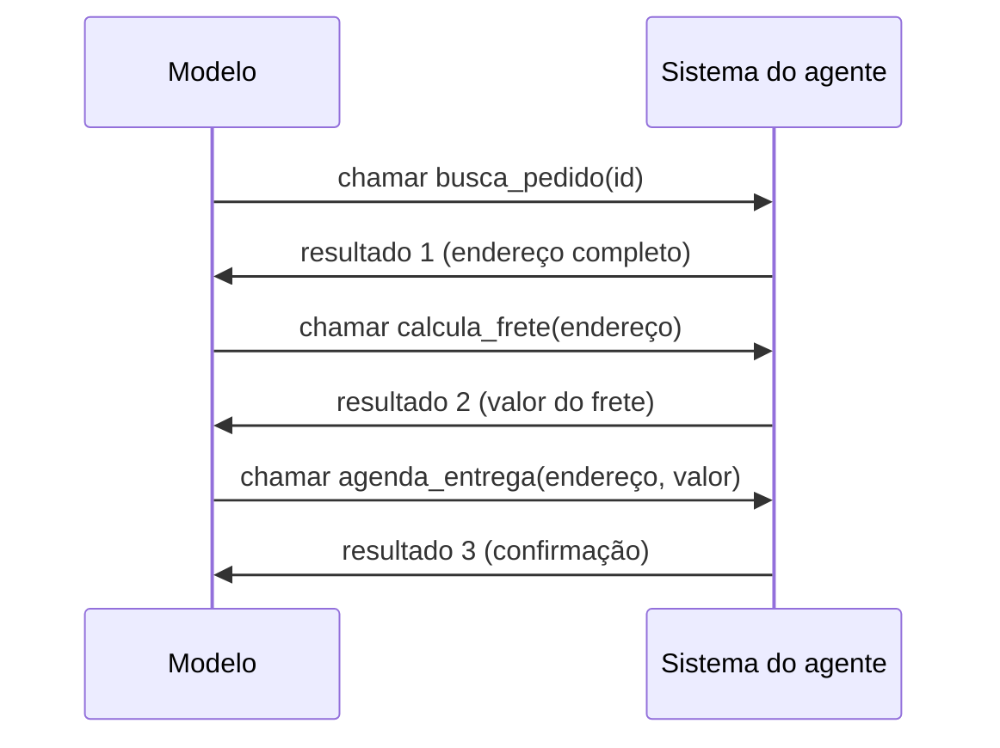
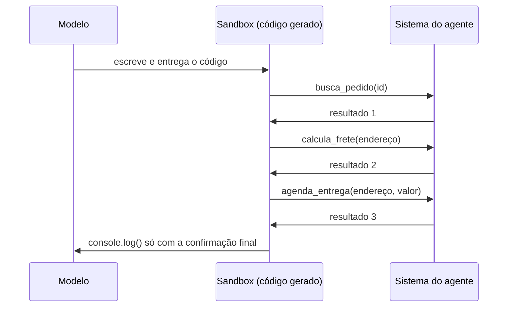
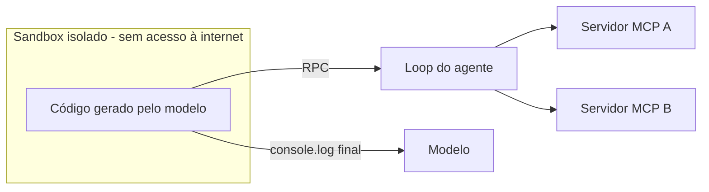

# Code Mode: executar código em vez de chamar ferramentas

## O problema do tool calling com muitos servidores MCP

[MCP, RAG e Agentes: quem faz o quê](/labs/ai/agents/07-mcp-rag-e-agentes/) já mostrou o que acontece quando um agente conecta vários servidores MCP: o catálogo de tools cresce, cada ferramenta ocupa espaço no contexto com sua descrição em JSON, e escolher a certa entre dezenas ou centenas de opções vira o novo problema de recuperação.

Tem uma segunda dor, menos falada, que aparece em fluxos com várias chamadas encadeadas. Em [Uso de Ferramentas](/labs/ai/agents/03-ferramentas/) vimos que o modelo não executa nada sozinho: ele gera um texto estruturado pedindo uma chamada, o sistema do agente executa de verdade e devolve o resultado como observação. Isso funciona bem para uma chamada isolada, mas numa sequência de "busca o pedido, pega o endereço, calcula o frete, agenda a entrega", cada resultado intermediário precisa passar de volta pela rede neural do modelo só para ser copiado, sem alteração nenhuma, como entrada da próxima chamada. É tempo de inferência e tokens gastos em um trabalho que nenhum humano faria copiando dado à mão entre duas chamadas de API.



Cada seta de volta para o modelo nesse diagrama é uma passagem pela rede neural que só serve para repetir um dado que o modelo não precisa interpretar, apenas encaminhar. Multiplique isso por uma tarefa com dez passos e o custo em tokens e latência cresce rápido.

A raiz do problema, segundo o argumento da Cloudflare, é de treinamento: um LLM viu, durante o pré-treinamento, uma quantidade enorme de código real, de milhões de projetos open source. Já o function calling (o JSON estruturado que o modelo aprende a emitir para chamar uma tool) é um formato que ele aprendeu de forma mais sintética, com muito menos exemplos do mundo real. Pedir para o modelo encadear tool calls é, nas palavras dos autores, como pedir a um especialista para escrever uma peça de teatro num idioma que ele só aprendeu num curso intensivo: ele dá um jeito, mas não é o melhor que ele conseguiria fazer.

## Code Mode: convertendo tools MCP em uma API de código

A proposta da Cloudflare, batizada de **Code Mode**, inverte a lógica: em vez de entregar as tools MCP direto para o modelo, elas são convertidas numa **API TypeScript tipada**, e o trabalho do modelo passa a ser escrever código contra essa API.

Na prática, isso muda o que o agente expõe ao modelo. Em vez de um catálogo com uma tool por função do servidor MCP, o agente passa a ter **uma única tool: executar código**. Quando você conecta um servidor MCP em modo código, o Agents SDK da Cloudflare busca o schema desse servidor e gera, automaticamente, uma função assíncrona para cada tool, dentro de um objeto (algo como `codemode.buscarPedido(id)`), com os tipos de entrada e saída derivados do JSON Schema original e os comentários de documentação copiados da descrição de cada tool.

O ganho de encadear chamadas fica claro comparando com o diagrama anterior: o código resolve a sequência inteira sozinho, e o modelo só lê o resultado final.



Um esqueleto simplificado do tipo de código que o modelo passaria a escrever, contra uma API já tipada:

```typescript
// API gerada a partir do schema MCP - o modelo só vê isto
declare const codemode: {
  buscarPedido(id: string): Promise<Pedido>;
  calculaFrete(endereco: Endereco): Promise<number>;
  agendaEntrega(endereco: Endereco, valor: number): Promise<Confirmacao>;
};

// código que o modelo escreve e entrega para execução
const pedido = await codemode.buscarPedido("123");
const frete = await codemode.calculaFrete(pedido.endereco);
const confirmacao = await codemode.agendaEntrega(pedido.endereco, frete);
console.log(confirmacao);
```

Hoje a API inteira do servidor MCP conectado é carregada no contexto do agente de uma vez, o que limita quantos servidores cabem antes de o catálogo virar peso demais, o mesmo problema de escala que motivou o Code Mode em primeiro lugar. A evolução natural, citada no próprio artigo como próximo passo, é o agente conseguir **navegar e pesquisar a API dinamicamente**, do jeito que um assistente de código já faz hoje ao explorar um repositório grande sem carregar tudo de uma vez.

O exemplo usado no artigo conecta o servidor MCP do GitMCP para o repositório `cloudflare/agents`, com tools de busca de documentação, busca semântica e busca de código no GitHub.

## Execução em sandbox isolado

Deixar um modelo escrever código e pedir para alguém executá-lo de verdade é, por definição, rodar código não confiável. A resposta da Cloudflare para isso é um **sandbox totalmente isolado da internet**: o código gerado não tem `fetch()` nem `connect()` funcionando para o mundo externo. O único jeito de ele alcançar qualquer coisa fora do próprio sandbox são as funções da API TypeScript que representam os servidores MCP conectados.

Cada chamada dessa API viaja por **RPC** de volta para o loop do agente, que despacha a chamada para o servidor MCP correto, espera a resposta e devolve o resultado para dentro do sandbox, onde a execução continua. Ao final, tudo que o código registrou com `console.log()` é coletado e devolvido ao agente de uma vez, como o resultado da execução inteira.



Essa separação é o que torna o padrão seguro mesmo executando código escrito por um LLM: o código nunca tem uma rota direta para a rede, só para as funções que o próprio sistema do agente decidiu expor.

## Isolates V8 em vez de containers

A pergunta técnica atrás desse sandbox é: como criar e descartar um ambiente de execução isolado, para cada trecho de código, sem que o custo disso vire o nova gargalo? A resposta da Cloudflare foi usar **isolates V8**, a mesma tecnologia de isolamento que já roda o Cloudflare Workers, em vez de containers.

Um container precisa inicializar um sistema operacional (ou pelo menos um processo pesado o bastante para simular um), o que custa segundos e dezenas a centenas de megabytes de memória. Um isolate V8 inicia em **poucos milissegundos** e usa **poucos megabytes**, porque ele isola só o que o JavaScript/TypeScript precisa para rodar, não uma máquina inteira por baixo. Essa diferença de ordem de grandeza é o que permite a estratégia adotada: **criar um isolate novo para cada trecho de código do agente e descartá-lo depois**, sem manter um pool de ambientes pré-aquecidos esperando uso, do jeito que seria necessário com containers para manter a latência aceitável.

A limitação que vem embutida nessa escolha é a mesma de qualquer isolate: ele roda JavaScript e WebAssembly, não qualquer linguagem. Isso é suficiente para o Code Mode, já que a API gerada a partir do MCP é TypeScript, mas deixa de fora cenários em que o código gerado precisaria ser Python, Go ou outra linguagem fora desse par.

## Worker Loader API e Dynamic Workers

Até pouco tempo atrás, implantar um Worker na Cloudflare era sempre um processo de deploy: você sobe o código pela API da Cloudflare e ele passa a rodar globalmente, de forma fixa. Isso não serve para o Code Mode, em que cada execução recebe um código **diferente**, gerado na hora pelo modelo, e precisa rodar isolada das outras.

A peça que resolveu isso foi uma API nova para carregar Workers **dinamicamente, em runtime**, sem passar pelo fluxo de deploy tradicional. No artigo original (set/2025), ela aparecia com o nome de **Worker Loader API**, descrita como: você chama um método que recebe um identificador e uma função de callback; o callback devolve o código-fonte (os módulos do Worker), a data de compatibilidade e uma configuração de ambiente. Essa configuração de ambiente pode conter dados simples e também **bindings RPC** que apontam de volta para o Worker que criou o Worker filho (um mecanismo chamado de loopback), além de uma opção para controlar ou bloquear totalmente o acesso de saída à rede.

Desde então, esse recurso evoluiu e, na documentação atual da Cloudflare, aparece sob o nome de **Dynamic Workers**, descrito como "uma alternativa leve a containers para isolar com segurança código em que você não confia" - e o próprio Code Mode de agentes de IA é citado como um dos casos de uso que motivaram o recurso. O artigo original descrevia a API como em beta fechada, com inscrição por formulário, para uso em produção; hoje ela está em **beta aberta**, disponível para contas pagas do Workers. Vale checar a documentação oficial antes de depender de um nome de método específico, porque essa é justamente a parte que mudou desde a publicação do artigo.

## Segurança: bindings em vez de filtro de rede

Um sandbox sem acesso à internet resolve metade do problema de segurança. A outra metade é: como o código gerado chama exatamente os servidores MCP que o agente precisa, sem ganhar acesso a mais nada?

A resposta da Cloudflare evita a abordagem mais comum, que seria filtrar por regras de rede ou por um proxy HTTP. O argumento contra essa abordagem é prático: é difícil definir de antemão quais domínios ou requisições são legítimos, e um modelo que está decidindo o que chamar tem dificuldade para adivinhar o que vai ser bloqueado só de olhar para uma lista de permissões de rede.

No lugar disso, o Workers tem um conceito de **binding**: o objeto `env` que um Worker recebe não guarda só strings e configuração, ele pode guardar **objetos vivos**, com métodos prontos para chamar. No Code Mode, o sandbox recebe como binding só os objetos que representam os servidores MCP conectados. A interface JavaScript que ele enxerga já define, por construção, tudo que pode ser usado - não existe uma chamada "livre" para tentar adivinhar se algo vai passar ou ser bloqueado, porque a função simplesmente não existe se o servidor não foi conectado.

O mesmo mecanismo resolve o problema das credenciais. O binding já chega para o sandbox como um **cliente autenticado**: a chamada passa primeiro pelo supervisor do agente (o código que está fora do sandbox), que é quem guarda os tokens de acesso de cada servidor MCP e os adiciona à requisição antes de ela seguir. O código escrito pela IA nunca vê uma chave de API, então não tem como vazar uma mesmo que o próprio código gerado seja malicioso ou contenha um bug.

## Code Mode em produção: de artigo a servidor oficial

O artigo original apresentava o Code Mode como proposta de arquitetura, sem benchmark detalhado - só a afirmação de que os resultados eram "impressionantes". Isso mudou com um post de acompanhamento da própria Cloudflare, publicado em 20/02/2026 e atualizado em 15/07/2026, anunciando um **servidor MCP oficial para toda a API da Cloudflare** construído com Code Mode.

O número concreto que esse servidor trouxe: ele usa cerca de **1.000 tokens** de contexto, contra os **1,17 milhão de tokens** que um servidor MCP equivalente, sem Code Mode, consumiria expondo cada endpoint da API da Cloudflare como uma tool separada. É uma redução de mais de 99% no espaço de contexto gasto só com o catálogo de ferramentas, medida com o tokenizador `tiktoken`.

Esse servidor expõe apenas **duas** ferramentas ao modelo, em vez de uma por endpoint:

- **`search()`**: o modelo escreve código que navega pela especificação OpenAPI da API da Cloudflare (com as referências internas já resolvidas) para filtrar endpoints por produto, caminho ou categoria. A especificação inteira nunca entra no contexto do modelo, só o resultado da busca.
- **`execute()`**: o modelo escreve código que de fato chama a API, trata paginação, confere a resposta e encadeia quantas operações forem necessárias numa única execução.

As duas rodam dentro de um isolate Dynamic Worker, sem acesso a sistema de arquivos nem a variáveis de ambiente, com chamadas de rede desabilitadas por padrão. No exemplo citado pela Cloudflare, uma tarefa de configurar proteção contra DDoS que levaria várias idas e voltas de tool calling tradicional foi resolvida em quatro chamadas de ferramenta. O SDK que implementa esse padrão foi publicado como código aberto dentro do Cloudflare Agents SDK, e a empresa já descreve como próximo passo levar esse mesmo modelo de custo fixo de tokens para múltiplos servidores MCP de terceiros, por meio dos chamados **MCP Server Portals**.

## MCP continua necessário: onde ele entra

Vale fechar desfazendo uma leitura errada: Code Mode não substitui o MCP, ele muda **onde** o MCP atua. O protocolo continua sendo o que padroniza três coisas, como visto em [Model Context Protocol (MCP)](/labs/ai/agents/06-mcp/): como o agente descobre o que um servidor oferece, como ele autoriza o acesso, e como a documentação de cada capacidade chega até quem vai usá-la. Nada disso muda com o Code Mode.

O que muda é a camada de execução: em vez do modelo emitir uma tool call direta para cada passo, o MCP serve como a fonte de verdade a partir da qual se gera uma API de código, e é essa API que o modelo usa escrevendo programas de verdade.

| Aspecto                         | Tool calling tradicional                                      | Code Mode                                                         |
| ------------------------------- | ------------------------------------------------------------- | ----------------------------------------------------------------- |
| Interface apresentada ao modelo | Uma tool por função MCP                                       | Uma tool que executa código, mais uma API tipada                  |
| Formato que o modelo produz     | JSON estruturado, aprendido de forma mais sintética no treino | Código, presente em volume muito maior no pré-treino              |
| Encadeamento de chamadas        | Cada resultado intermediário volta para o modelo              | O código encadeia as chamadas, o modelo só lê o resultado final   |
| Escala de tools                 | Limitada pelo tamanho do catálogo no contexto                 | Custo de contexto quase fixo, independente do número de endpoints |
| Segurança do sandbox            | Depende do framework escolhido                                | Isolate sem acesso à rede, liberado só por binding                |
| Chaves de API                   | Geralmente expostas ao código do cliente                      | Ficam no supervisor do agente, fora do alcance do código gerado   |

O MCP resolve "como descobrir e conectar"; o Code Mode resolve "como executar sem gastar o contexto todo copiando dado de ida e volta pelo modelo". Os dois continuam sendo peças complementares do mesmo sistema.

## Referências

- [Code Mode: the better way to use MCP](https://blog.cloudflare.com/code-mode/) - Cloudflare Blog (Kenton Varda e Sunil Pai), en
- [Code Mode: give agents an entire API in 1,000 tokens](https://blog.cloudflare.com/code-mode-mcp/) - Cloudflare Blog, en
- [Code execution with MCP: building more efficient agents](https://www.anthropic.com/engineering/code-execution-with-mcp) - Anthropic Engineering, en
- [Code Mode](https://developers.cloudflare.com/agents/model-context-protocol/codemode/) - Cloudflare Developers (documentação oficial), en
- [Worker Loader](https://developers.cloudflare.com/workers/runtime-apis/bindings/worker-loader/) - Cloudflare Developers (documentação oficial), en
- [Introduction](https://modelcontextprotocol.io/introduction) - Model Context Protocol (documentação oficial), en
