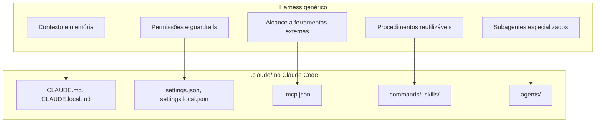

# Harness na Prática: o Diretório .claude do Claude Code

## Por que olhar um harness real

A nota [Agentes em Produção](/labs/ai/agents/15-agentes-em-producao/) definiu harness de um jeito abstrato: tudo que não é o modelo, o código e a configuração que dão a ele contexto, ferramentas, permissões e limites. É uma boa definição, mas fica mais fácil de fixar olhando um harness de verdade, arquivo por arquivo.

O Claude Code (a CLI da Anthropic para programar com IA) guarda quase todo esse harness dentro de uma pasta chamada `.claude/`, na raiz do projeto, mais alguns arquivos de escopo global em `~/.claude/`. Cada peça abstrata do conceito de harness (contexto, memória, permissões, guardrails, alcance a ferramentas, subagentes) corresponde a um arquivo ou pasta específico ali dentro.



A maioria desses arquivos nunca entra em produção, nenhum deles é código que roda no sistema que você está construindo. Mas juntos eles decidem como o agente se comporta em cada sessão: o que ele já sabe sobre o projeto antes do primeiro prompt, o que ele tem permissão de fazer, quais sistemas externos alcança e que procedimentos já aprendeu.

## CLAUDE.md e CLAUDE.local.md: contexto do projeto

O **CLAUDE.md** é um arquivo Markdown simples, sem formato especial, que o Claude Code carrega automaticamente no início de toda sessão, como se fosse uma mensagem enviada antes da sua primeira pergunta. É o lugar certo para visão geral do projeto, stack usada, decisões de arquitetura e convenções que valem sempre ("nunca comitar direto na main", "testes ficam em `__tests__/`").

Ele pode existir em mais de um nível ao mesmo tempo, e o Claude Code concatena todos em vez de um sobrescrever o outro:

- Na raiz do projeto (`./CLAUDE.md`) ou dentro de `.claude/CLAUDE.md`, versionado em Git e compartilhado com o time
- Em escopo de usuário (`~/.claude/CLAUDE.md`), suas próprias convenções, válidas em qualquer projeto que você abrir

Isso resolve o mesmo problema que a nota [Memória de Agentes](/labs/ai/agents/04-memoria/) chama de memória semântica: fatos estáveis que valem em qualquer conversa, em vez de precisar reexplicar o projeto a cada sessão nova.

O **CLAUDE.local.md** cobre um caso diferente: preferências suas, só para esse projeto, que não fazem sentido para o resto do time (um apelido de comando que só você usa, uma nota pessoal sobre onde parou). Ele é carregado junto com o CLAUDE.md, mas criado manualmente e colocado no `.gitignore`, então nunca é versionado.

## settings.json e settings.local.json: permissões e hooks

Se o CLAUDE.md é o que o agente sabe, o **settings.json** é o que ele tem permissão de fazer. Esse arquivo guarda permissões (quais comandos e ferramentas podem rodar sem perguntar), hooks, variáveis de ambiente e o modelo padrão da sessão.

```json
{
  "permissions": {
    "allow": ["Bash(npm run lint)", "Bash(npm run test *)"],
    "deny": ["Read(./.env)", "Read(./.env.*)"]
  }
}
```

Dois arquivos cumprem esse papel, com escopos diferentes:

- `settings.json` na pasta `.claude/` do projeto: compartilhado, versionado em Git, vale para todo o time que clonar o repositório
- `settings.local.json`: suas próprias sobreposições, de fora do Git (o Claude Code adiciona ele ao `.gitignore` global automaticamente na primeira vez que grava algo ali)

Quando a mesma chave aparece em mais de um lugar, existe uma ordem de precedência: configuração definida pela organização (managed) vem acima de tudo, depois o que foi passado na linha de comando, depois o `settings.local.json`, depois o `settings.json` do projeto, e por último o `settings.json` de escopo de usuário. Listas como as regras de permissão se somam entre os arquivos em vez de um substituir o outro; só valores simples (como o modelo padrão) é que a camada de cima vence.

## Hooks: ciclo de vida, não uma pasta separada

Vale uma correção aqui, porque é comum (e foi o caso da publicação que deu origem a essa nota) alguém imaginar que hooks vivem numa pasta `.claude/hooks/`. Não vivem. **Hook é uma chave `hooks` dentro do `settings.json`** (ou, de forma mais específica, dentro do frontmatter de uma skill ou de um subagente), não um diretório próprio.

Um hook é um handler que dispara automaticamente num ponto fixo do ciclo de vida do agente, por exemplo antes de uma ferramenta rodar, depois que um arquivo é editado, ou no início da sessão. O que ele dispara pode ser:

- um comando de shell
- uma chamada para um endpoint HTTP
- uma ferramenta MCP
- um prompt que vai para o próprio LLM
- um subagente

A diferença central entre hook e guardrail (visto em [Agentes em Produção](/labs/ai/agents/15-agentes-em-producao/)) é que o hook é determinístico: ele sempre dispara naquele ponto exato do ciclo, não depende do modelo "decidir" rodar a checagem. É o jeito de garantir que um lint, uma formatação ou um bloqueio de ação insegura aconteça sempre, mesmo que o modelo esqueça de pedir.

```json
{
  "hooks": {
    "PreToolUse": [
      {
        "matcher": "Bash",
        "hooks": [{ "type": "command", "command": "./scripts/validar-comando.sh" }]
      }
    ]
  }
}
```

## rules/: convenções com escopo

O CLAUDE.md funciona bem para instruções curtas e gerais, mas um projeto grande acumula convenções específicas: um jeito de nomear endpoint de API, um padrão de teste, uma regra de estilo que só importa dentro da pasta de frontend. Colocar tudo isso dentro do CLAUDE.md incharia o arquivo e faria o agente carregar regra de teste mesmo quando a tarefa é só mudar um texto.

A pasta `.claude/rules/` resolve isso dividindo as convenções em arquivos temáticos, cada um com seu próprio Markdown. O detalhe que faz a diferença é o frontmatter `paths`, que restringe quando aquela regra entra em contexto:

```markdown
---
paths: ["src/api/**/*.ts"]
---

# Convenções de API

Toda rota nova usa o padrão REST já estabelecido...
```

Com isso, a regra sobre API só carrega quando o agente está de fato lendo, escrevendo ou editando um arquivo dentro de `src/api/`. O CLAUDE.md continua curto e genérico, e cada regra entra só na hora que importa.

## .mcp.json: alcance a serviços externos

Até aqui, os arquivos cuidam do que o agente sabe e do que ele tem permissão de fazer dentro do próprio projeto. O **.mcp.json** cuida de outra coisa: alcançar sistemas de fora, como GitHub, Jira, Slack ou um banco de dados, através do [Model Context Protocol (MCP)](/labs/ai/agents/06-mcp/).

```json
{
  "mcpServers": {
    "github": {
      "command": "npx",
      "args": ["-y", "@modelcontextprotocol/server-github"]
    }
  }
}
```

Esse arquivo fica na raiz do projeto, é versionado em Git e compartilhado com o time, então qualquer pessoa que clonar o repositório ganha acesso aos mesmos servidores MCP (supondo que tenha as credenciais necessárias). É a diferença entre "o agente sabe sobre o projeto" (CLAUDE.md) e "o agente alcança sistemas fora do projeto" (`.mcp.json`), a mesma distinção entre conhecimento e ferramentas que aparece em [MCP](/labs/ai/agents/06-mcp/).

## commands/ e skills/: procedimentos reutilizáveis

Duas pastas guardam procedimentos que você quer reaproveitar entre sessões, em vez de reexplicar toda vez: `.claude/commands/` e `.claude/skills/`.

`commands/` é o mecanismo mais antigo: um arquivo Markdown único (`.claude/commands/deploy.md`) que vira o comando `/deploy`, acionado só quando você digita explicitamente. `skills/` é o sucessor recomendado: uma pasta com um `SKILL.md` (`.claude/skills/deploy/SKILL.md`) que também pode ser chamada com `/deploy`, mas tem uma vantagem a mais, descrita em detalhe na nota [Agent Skills](/labs/ai/agents/08-agent-skills/): o próprio modelo pode decidir carregá-la sozinho, sem você digitar o comando, quando o pedido bate com a descrição da Skill.

Na prática, os dois mecanismos convivem (um arquivo em `commands/` continua funcionando do mesmo jeito), mas para algo novo vale escrever direto como Skill, já que ela cobre tanto o caso de "eu aciono manualmente" quanto o de "o agente percebe que precisa disso sozinho".

## agents/: subagentes especializados

A pasta `.claude/agents/` guarda definições de **subagentes**: assistentes especializados, cada um com seu próprio prompt de sistema, acesso a ferramentas e modelo, que trabalham numa tarefa delegada e devolvem um resumo para a conversa principal. Um projeto pode ter um subagente revisor de código, outro auditor de segurança, outro especialista em escrever testes, cada um descrito num arquivo Markdown dentro dessa pasta.

```markdown
---
name: revisor-de-seguranca
description: Revisa código em busca de vulnerabilidades antes do merge.
tools: ["Read", "Grep"]
---

Você é um revisor de segurança...
```

Vale não confundir subagente com um sistema multi-agente completo, tema da nota [Sistemas Multi-Agentes](/labs/ai/agents/10-multi-agents/). Um subagente roda dentro da mesma sessão que o acionou e só reporta ao agente principal, como uma chamada de função que devolve um resultado. Um sistema multi-agente de verdade tem vários agentes independentes, cada um com seu próprio ciclo de vida, que se coordenam por protocolo ou por estado compartilhado. O subagente é uma forma mais simples e contida de dividir trabalho, sem todo o aparato de orquestração.

## O que isso ensina sobre harness em geral

Nenhuma dessas convenções de arquivo é universal, outra ferramenta de agente organiza a mesma informação com nomes e formatos diferentes. O que se repete, de produto para produto, são as peças: algum lugar para instruções persistentes, algum lugar para permissões e guardrails, algum lugar para conectar ferramentas externas, algum lugar para procedimentos reutilizáveis e, às vezes, algum lugar para subagentes.

Reconhecer essas peças por trás do nome específico de cada arquivo é o que permite migrar o raciocínio de uma ferramenta para outra sem começar do zero. A pergunta "onde fica o contexto persistente aqui?" tem resposta em praticamente qualquer harness de agente sério, só muda o nome do arquivo que guarda a resposta.

## Referências

- [Explore the .claude directory](https://code.claude.com/docs/en/claude-directory) - Anthropic (Claude Code Docs), en
- [Settings files and precedence](https://code.claude.com/docs/en/settings) - Anthropic (Claude Code Docs), en
- [Glossary](https://code.claude.com/docs/en/glossary) - Anthropic (Claude Code Docs), en
