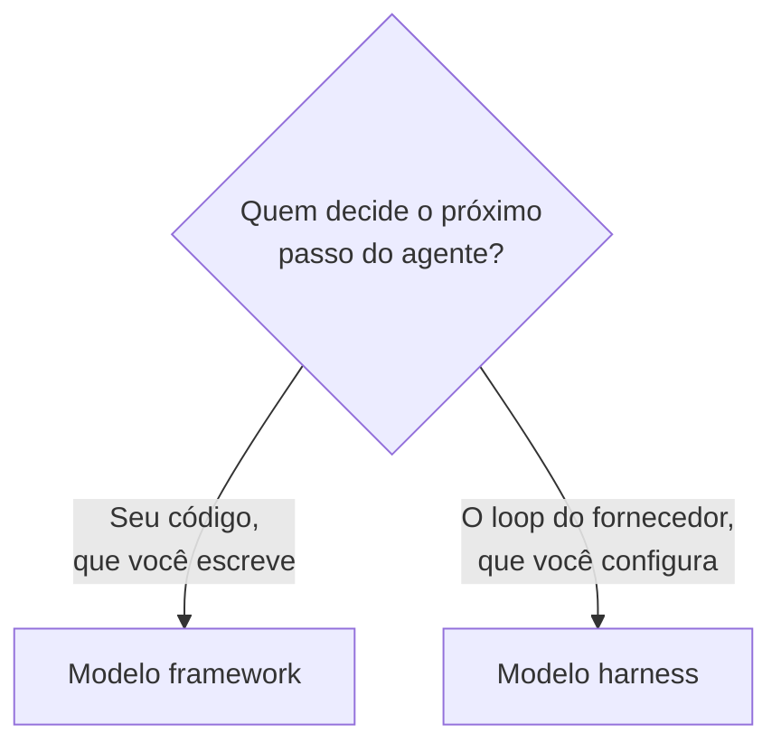

# Framework ou Harness?

## Dois jeitos de montar o mesmo agente

As notas [Frameworks de Agentes](/labs/ai/agents/09-frameworks/) e [Harness na Prática](/labs/ai/agents/17-harness-no-claude-code/) já mostraram, cada uma, um jeito de montar um agente: escolher uma biblioteca como o LangGraph, ou configurar uma CLI como o Claude Code. O que falta é a pergunta que vem antes das duas: esses dois caminhos não são variações do mesmo modelo, são **modelos concorrentes** de divisão de trabalho entre você e o fornecedor da ferramenta.

Esse enquadramento vem ganhando força na comunidade de engenharia de agentes (aparece em artigos como o "Harness engineering" de Martin Fowler e o "Anatomy of an Agent Harness" do próprio time do LangChain, e circulou bastante em posts técnicos no fim de 2025 e começo de 2026). Não é uma taxonomia oficial fechada por nenhum fornecedor, é um jeito útil de nomear uma escolha que toda equipe de agentes acaba tomando, de um jeito ou de outro: quem é dono do loop de execução?

## O modelo framework: você é dono do loop

No modelo framework, a biblioteca entrega peças soltas, e **você monta o loop com elas**: a lógica de orquestração, o controle de estado, a definição das ferramentas, a política de retry e a camada de memória. O [LangGraph](/labs/ai/agents/09-frameworks/), o [CrewAI](/labs/ai/agents/09-frameworks/), o [Google ADK](/labs/ai/agents/09-frameworks/) e o Microsoft Agent Framework seguem esse modelo: todos dão blocos de construção, mas a arquitetura final, a decisão de quando o agente para, repete ou escala para outra etapa, é código seu.

A vantagem é controle fino. Se o seu caso tem uma regra de negócio específica (esse tipo de pedido nunca repete a mesma ferramenta duas vezes, esse outro sempre passa por aprovação antes de gravar no banco), você escreve essa regra direto no loop, sem brigar contra uma abstração de terceiro para encaixar o caso. O preço é que você também é dono de toda a manutenção dessa engrenagem: se a política de retry tem um bug, é bug seu.

## O modelo harness: o loop já vem pronto

No modelo harness, o fornecedor já entrega o loop fechado: ele cuida do gerenciamento de contexto, da execução de ferramentas, do controle de permissões e da orquestração de subagentes. O Claude Code, o Codex CLI (da OpenAI) e o Gemini CLI (do Google) são exemplos desse modelo: você não escreve o `while` que decide a próxima ação, você **configura e estende** um loop que já existe.

A extensão acontece por pontos de encaixe definidos pelo próprio harness, não por código arbitrário:

- **Skills**, para ensinar um procedimento novo (ver [Agent Skills](/labs/ai/agents/08-agent-skills/))
- **Servidores MCP**, para alcançar ferramentas e serviços externos (ver [MCP](/labs/ai/agents/06-mcp/))
- **Hooks**, para interceptar um ponto fixo do ciclo de vida da execução (ver [Harness na Prática](/labs/ai/agents/17-harness-no-claude-code/))
- **Plugins**, para empacotar e distribuir esse conjunto de extensões como uma unidade só

A vantagem é ter um agente funcional no primeiro dia, sem escrever e depurar o próprio loop de raciocínio. O preço é abrir mão de parte do controle: quando o fornecedor atualiza o loop interno (uma nova versão de compactação de contexto, uma mudança em como os subagentes são despachados), seu comportamento muda com ele, e você não tem acesso para depurar o que acontece dentro da caixa fechada.

## Comparando os dois modelos

| Dimensão              | Framework                                                      | Harness                                                             |
| --------------------- | -------------------------------------------------------------- | ------------------------------------------------------------------- |
| Propriedade do loop   | Seu código decide o próximo passo                              | O loop do fornecedor decide, dentro das regras configuradas         |
| Extensibilidade       | Qualquer código que a linguagem permitir                       | Pontos de encaixe definidos (skills, MCP, hooks, plugins)           |
| Nível de abstração    | Baixo: você monta cada peça (estado, ferramentas, memória)     | Alto: a peça já vem montada, você configura o comportamento         |
| Superfície de falhas  | Bugs na sua própria orquestração                               | Bugs dentro do loop do fornecedor, fora do seu alcance de depuração |
| Modelo de atualização | Você escolhe a versão da dependência e quando subir            | O fornecedor empurra atualizações do loop, às vezes sem aviso       |
| Controle              | Total, inclusive sobre decisões bem específicas do seu domínio | Parcial, trocado por um agente que já funciona de saída             |

Nenhuma linha dessa tabela aponta um lado como "melhor". Cada uma descreve o que uma equipe ganha e o que abre mão ao escolher um caminho - o mesmo tipo de troca já visto na decisão entre [workflow e agente](/labs/ai/agents/11-workflow-ou-agente/): autonomia a mais do que a tarefa precisa custa caro, e controle a mais do que a tarefa exige também custa, só que em tempo de engenharia.

## Por que o harness ganhou força a partir de 2025

Entre 2023 e 2024, quando os modelos ainda erravam bastante em manter contexto e encadear ferramentas em sequências longas, orquestrar esse comportamento manualmente era quase obrigatório: era preciso guiar o modelo passo a passo, validar cada saída e corrigir o rumo com código próprio, porque não dava para confiar no modelo para isso. Os frameworks nasceram justamente para dar nome e estrutura a essa orquestração que todo mundo tinha que escrever de qualquer jeito.

A partir de 2025, com modelos que sustentam janelas de contexto maiores, usam ferramentas de forma mais confiável e mantêm coerência em tarefas mais longas, parte dessa orquestração manual deixou de compensar o esforço. Um harness que já embute gerenciamento de contexto, execução de ferramentas e despacho de subagentes virou uma opção viável, porque o modelo por baixo é bom o bastante para que essa camada genérica funcione sem precisar de ajuste fino caso a caso.

Vale uma ressalva: essa narrativa de "era dos frameworks" seguida da "era dos harnesses" é uma leitura de tendência, não uma regra com data de corte exata. Framework e harness continuam coexistindo, e a escolha certa depende muito mais do problema do que do calendário.

## Quando o framework ainda faz sentido

Mesmo com harnesses mais capazes disponíveis, alguns cenários continuam pedindo um framework (ou até o loop escrito à mão, sem framework nenhum, como em [Hands-on: Agente SecretarIA](/labs/ai/agents/05-hands-on-secretaria/)):

- **Fluxos customizados**, onde a sequência de passos tem regras de negócio específicas demais para caber nos pontos de extensão genéricos de um harness
- **Pipelines regulados**, que precisam de uma trilha de auditoria exata de cada decisão de orquestração, sob seu controle direto
- **Garantias determinísticas**, quando uma etapa não pode variar de execução para execução e você precisa travar esse comportamento no próprio código, não confiar que a configuração de um harness vai se comportar sempre igual

É a mesma lógica do fator "Own your control flow", visto em [12-Factor Agents](/labs/ai/agents/16-12-factor-agents/): quando o controle de fluxo é parte importante do produto, terceirizá-lo para uma abstração genérica (framework ou harness) tira exatamente o controle que o caso exige.

## Construir o agente ou construir o ambiente dele

A escolha entre framework e harness, no fundo, desloca onde fica o seu trabalho de engenharia. Com um framework, boa parte do esforço vai para escrever e testar o loop de raciocínio. Com um harness, o loop já está resolvido, e o esforço migra para desenhar bem o ambiente em que esse loop roda: que ferramentas ele alcança, com que permissões, com que contexto inicial. É a mesma ideia de harness vista em [Agentes em Produção](/labs/ai/agents/15-agentes-em-producao/) (agente = modelo + harness), olhada agora do ângulo de onde investir o tempo da equipe.

Para a maioria dos times começando um agente novo em 2026, vale começar pelo harness: configurar uma CLI já pronta, com Skills e servidores MCP, costuma chegar a um resultado útil mais rápido do que escrever um loop do zero. Trocar para um framework (ou para código próprio) quando um dos três cenários da seção anterior aparecer de fato, não antes.

## Referências

- [Harness engineering for coding agent users](https://martinfowler.com/articles/harness-engineering.html) - Martin Fowler, en
- [The Anatomy of an Agent Harness](https://www.langchain.com/blog/the-anatomy-of-an-agent-harness) - LangChain, en
- [Harness vs Framework vs SDK: How to Choose a Coding Agent's Runtime](https://levelup.gitconnected.com/harness-vs-framework-vs-sdk-how-to-choose-a-coding-agents-runtime-2ac776994c3a) - Level Up Coding, en
