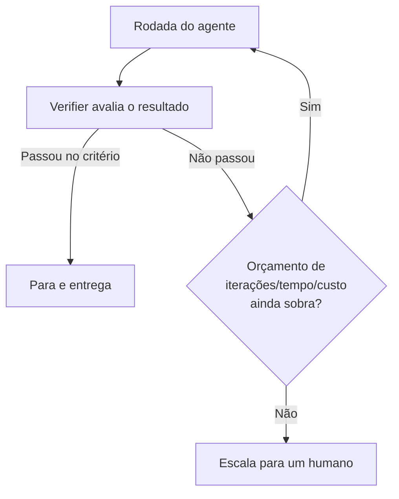

# Loop Engineering

## O que é loop engineering

Os [padrões de execução](/labs/ai/agents/15-padroes-de-execucao/) que vimos antes (plan-act-observe-reflect) descrevem **uma** rodada de um agente: recebe um pedido, raciocina, age, observa o resultado e termina. **Loop engineering** é o nome que vem sendo usado para desenhar agentes que não terminam depois de uma rodada: eles rodam de novo, e de novo, por horas ou dias, revisando o próprio trabalho, retomando de onde pararam e decidindo sozinhos quando algo está pronto.

Um agente que corrige o próprio código até os testes passarem, um que monitora um sistema e abre correções conforme encontra problemas, ou um que itera num rascunho até bater um critério de qualidade, todos têm a mesma característica: o valor não está numa resposta única, está em rodar o ciclo várias vezes até convergir para um resultado bom. Isso virou disciplina própria porque um loop que roda por muito tempo sozinho levanta problemas que uma execução de rodada única não tem: quando parar, como saber que o resultado está realmente pronto e o que fazer quando o loop trava num ciclo sem avançar.

## As peças de um loop agêntico

- **Lógica de parada:** a condição que diz se o loop terminou com sucesso, falhou de vez ou precisa escalar para uma pessoa. Sem isso, um agente que "continua tentando até dar certo" corre o risco de girar indefinidamente, consumindo tempo e dinheiro sem chegar a lugar nenhum.
- **O verifier:** a peça que avalia, ao final de cada rodada, se o resultado já está bom o suficiente para parar ou se o loop precisa continuar. Pode ser uma checagem programática (os testes passaram?), um segundo modelo agindo como juiz (como o LLM-as-judge visto em [Agentes em Produção](/labs/ai/agents/16-agentes-em-producao/)) ou uma combinação dos dois. **Verifier engineering**, às vezes citado como se fosse um tema à parte, é na prática o cuidado de desenhar bem essa peça específica dentro do loop, não uma disciplina separada dele.
- **Schema de trace:** um registro padronizado do que cada iteração fez (o que tentou, o que o verifier decidiu, por que continuou ou parou), essencial para auditar depois por que um loop demorou tanto ou chegou num resultado ruim. É a mesma ideia de trace vista em [Agentes em Produção](/labs/ai/agents/16-agentes-em-producao/), aplicada a um histórico que pode ter dezenas de iterações em vez de uma rodada só.
- **Permissão de ferramentas por iteração:** nem toda iteração deveria poder fazer qualquer coisa. Um loop que corrige código pode ter permissão de rodar testes livremente, mas precisar de aprovação explícita para fazer `git push` ou mudar um arquivo de configuração de produção.
- **Política de orçamento:** um limite explícito de número de iterações, tempo total ou custo em tokens, depois do qual o loop para e escala para uma pessoa, mesmo que o verifier ainda não tenha aprovado o resultado. É a proteção contra o loop que nunca converge.

## Como isso se relaciona com harness e padrões de execução

Loop engineering não substitui o [harness](/labs/ai/agents/16-agentes-em-producao/): usa as mesmas peças (timeouts, retries, guardrails, observabilidade), só que aplicadas a um ciclo que se repete por muito mais tempo do que uma chamada de ferramenta isolada. A diferença para o loop simples de um agente ReAct é de escala: o loop do ReAct gira dentro de uma única rodada de resposta, já um loop agêntico de longa duração pode ser pausado, retomado depois de um checkpoint salvo e continuar rodando em sessões separadas, às vezes por dias, até a lógica de parada decidir que terminou.

## Referências

- [What is loop engineering?](https://www.ibm.com/think/topics/loop-engineering) - IBM, en
- [What is Loop Engineering: Four Levels of Agentic Loops](https://www.augmentcode.com/guides/what-is-loop-engineering) - Augment Code, en
