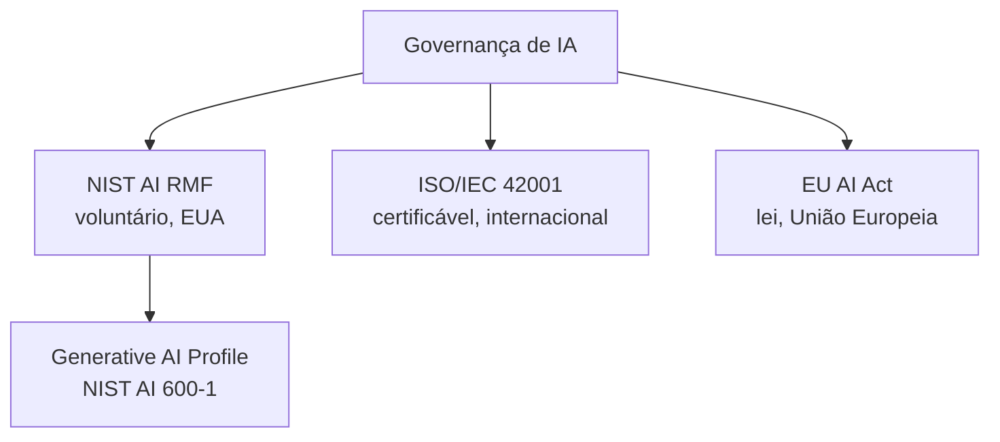

# IA Responsável e Segurança

Quanto mais poder um sistema de IA tem, mais caro fica um erro. Um chatbot que erra uma piada é um problema pequeno; um agente que decide sozinho aprovar um crédito, filtrar currículos ou agir sobre dados sensíveis pode causar dano real se ninguém pensou nos riscos antes de colocar aquilo em produção. IA responsável é justamente esse trabalho de pensar nos riscos antes, não depois.

Esta nota foca em governança e segurança em nível de sistema e de organização: princípios, riscos e frameworks que orientam como construir e operar IA com responsabilidade. Para os riscos específicos de quem constrói com LLMs no dia a dia (prompt injection, jailbreaking, falta de guardrails), veja [Boas Práticas e Segurança em Prompt Engineering](/labs/ai/engenharia-de-prompt/02-boas-praticas-e-seguranca/) - aqui vamos tratar esses riscos como parte de um quadro maior, sem repetir a explicação técnica de cada um.

## Os cinco princípios que guiam o tema

A maioria dos frameworks de IA responsável, de empresas grandes a órgãos reguladores, gira em torno de cinco ideias:

- **Fairness (justiça):** o modelo não deve produzir respostas enviesadas ou discriminatórias contra grupos de pessoas. Um classificador de currículos treinado com dados históricos tendenciosos vai reproduzir esse viés, só que agora em escala e com uma aparência de neutralidade matemática.
- **Transparency (transparência):** dá para entender, em algum nível, como o modelo chegou numa decisão? Isso importa tanto para quem usa o sistema quanto para quem precisa auditá-lo depois.
- **Privacy (privacidade):** dados pessoais e informação sensível usados para treinar ou consultar o modelo precisam de proteção, desde a coleta até o descarte.
- **Safety (segurança):** o sistema não deve gerar conteúdo prejudicial, nem ser manipulado para fazer isso.
- **Accountability (responsabilização):** quando algo dá errado, alguém precisa responder por isso. "O modelo decidiu" não é uma resposta aceitável numa auditoria.

Nenhum desses princípios é um checkbox que se marca uma vez e esquece. Eles são compromissos contínuos, revisados conforme o sistema evolui e o contexto de uso muda.

## Os riscos mais comuns

- **Viés e toxicidade:** respostas enviesadas ou ofensivas, geralmente herdadas dos dados de treino.
- **Alucinação:** o modelo gera informação falsa com a mesma confiança de uma informação correta. É um risco separado de "mentira": o modelo não sabe que está errado.
- **Vazamento de privacidade:** dados pessoais ou confidenciais aparecendo em respostas, seja porque estavam no material de treino, seja porque foram injetados num prompt sem o devido cuidado.
- **Uso indevido:** geração de spam, conteúdo fraudulento, deepfakes, ou qualquer uso que a ferramenta não foi desenhada para viabilizar mas acaba viabilizando.
- **Falta de explicabilidade:** modelos muito grandes são, na prática, caixas-pretas. Isso dificulta auditoria e complica a resposta à pergunta "por que o sistema decidiu isso?".
- **Riscos específicos de sistemas agênticos:** quando um LLM ganha acesso a ferramentas e autonomia de ação, prompt injection e jailbreaking deixam de ser só um problema de "resposta estranha no chat" e passam a ser um problema de "ação indevida no mundo real" (apagar um arquivo, enviar um e-mail, fazer uma compra). Os detalhes técnicos desses dois ataques estão em [Boas Práticas e Segurança em Prompt Engineering](/labs/ai/engenharia-de-prompt/02-boas-praticas-e-seguranca/); o ponto aqui é que a mitigação organizacional (revisão humana, guardrails, limites de permissão) precisa existir antes de dar autonomia ao agente, não depois do primeiro incidente.
- **Risco de cadeia de suprimentos:** um modelo, dataset ou pacote de terceiros comprometido pode introduzir uma vulnerabilidade que ninguém da equipe escreveu diretamente.

## Frameworks de governança

Não existe uma lei única e universal de "como fazer IA responsável", mas alguns frameworks se tornaram referência de mercado:

- **NIST AI Risk Management Framework (AI RMF):** publicado pelo instituto de padrões dos EUA (NIST), é voluntário, não uma lei. Organiza a gestão de risco em quatro funções que se repetem em ciclo: **Govern** (estabelecer cultura e política de governança), **Map** (entender o contexto e os riscos específicos do sistema), **Measure** (medir e analisar esses riscos) e **Manage** (agir para mitigá-los). O NIST também publicou um perfil específico para IA generativa, o **AI 600-1 (Generative AI Profile)**, com ações sugeridas organizadas por categorias de risco próprias desse tipo de modelo, como alucinação, vazamento de dados sensíveis presentes no treino e geração de conteúdo perigoso.
- **ISO/IEC 42001:** norma internacional de sistema de gestão de IA, estruturada de forma parecida com a ISO/IEC 27001 (a norma de segurança da informação que várias empresas já seguem). A adoção é voluntária, mas uma organização pode buscar certificação formal e auditada contra ela, algo que começou a acontecer a partir de 2024.
- **EU AI Act:** diferente dos dois anteriores, é lei de fato, aplicável a quem oferece ou usa sistemas de IA na União Europeia. Classifica sistemas por nível de risco (de mínimo a inaceitável) e define obrigações proporcionais a esse risco. As datas exatas de entrada em vigor de cada obrigação têm mudado ao longo do tempo (incluindo adiamentos de prazos para sistemas de alto risco), então vale sempre checar o texto oficial no Jornal Oficial da União Europeia ou um anúncio da Comissão Europeia antes de tomar qualquer data como definitiva.

Na prática, esses três frameworks não competem entre si: é comum uma organização usar o NIST AI RMF como guia de processo interno, buscar certificação ISO/IEC 42001 para formalizar isso perante clientes e parceiros, e tratar o EU AI Act como o piso legal obrigatório se operar na Europa.

## Como mitigar na prática

- **Filtros de conteúdo e moderação:** camadas automáticas que bloqueiam ou sinalizam saídas problemáticas antes de chegar ao usuário final.
- **Revisão humana em aplicações críticas:** decisões de alto impacto (crédito, saúde, contratação) não devem sair direto do modelo para a ação, sem alguém checando.
- **Detecção e avaliação de viés:** testar o sistema contra diferentes grupos e cenários antes de colocar em produção, não só medir acurácia geral.
- **Diretrizes claras de uso:** documentar o que o sistema pode e não pode fazer, e para quem essa documentação é acessível.
- **Red-teaming:** tentar ativamente "quebrar" o sistema antes que alguém de fora o faça, simulando ataques e usos indevidos.
- **Monitoramento contínuo:** um sistema de IA não é "lançado e esquecido". Comportamento muda conforme o uso real diverge dos dados de treino, então monitoramento e atualização são parte do ciclo de vida, não um extra.

## Referências

- [NIST AI Risk Management Framework](https://www.nist.gov/itl/ai-risk-management-framework) - NIST, en
- [NIST AI 600-1: Artificial Intelligence Risk Management Framework: Generative Artificial Intelligence Profile](https://www.nist.gov/publications/artificial-intelligence-risk-management-framework-generative-artificial-intelligence) - NIST, en
- [EU AI Act, NIST AI RMF and ISO/IEC 42001: A Plain English Comparison](https://www.eccouncil.org/cybersecurity-exchange/ethical-hacking/eu-ai-act-nist-ai-rmf-and-iso-iec-42001-a-plain-english-comparison/) - EC-Council, en
