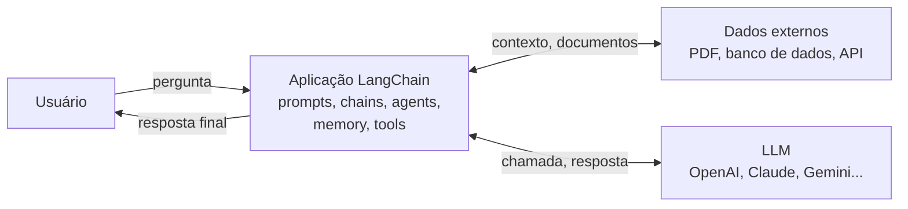

# Introdução ao LangChain

## O que é o LangChain

O LangChain é um framework open-source para construir aplicações em cima de LLMs. Na prática, ele empacota um conjunto de peças que toda aplicação de LLM minimamente séria acaba precisando: uma forma padronizada de montar prompts, de conectar com documentos e bancos de dados externos, de encadear vários passos de raciocínio e de dar ferramentas para o modelo usar.

Ele tem bibliotecas oficiais em **Python e TypeScript/JavaScript**. Isso é diferente de dizer que o LangChain é "agnóstico de linguagem de programação", algo que aparece com frequência em material de divulgação sobre o framework, mas que mistura dois conceitos: o LangChain roda só nessas duas linguagens, o que é agnóstico é o **provedor de LLM** por trás (você troca de OpenAI para Anthropic sem reescrever a aplicação). O ecossistema Python é o mais maduro e o que concentra a maior parte dos exemplos, inclusive os desta seção.

## Por que usar um framework em vez de chamar a API direto

Dá para construir uma aplicação de LLM sem o LangChain: você chama a API do provedor, monta o prompt como uma string formatada à mão e lê a resposta. Funciona para um protótipo rápido. O problema aparece quando a aplicação cresce e você precisa, ao mesmo tempo, carregar e dividir documentos, guardar o histórico da conversa, decidir qual ferramenta o modelo deve chamar e trocar de provedor sem reescrever tudo. Cada uma dessas coisas vira código repetido se você fizer na mão, aplicação por aplicação.

| Aspecto                     | Chamando a API direto                     | Com LangChain                                     |
| --------------------------- | ----------------------------------------- | ------------------------------------------------- |
| Gerenciamento de prompt     | Strings formatadas à mão no código        | Templates reutilizáveis, com variáveis            |
| Tratamento de documentos    | Parser customizado para cada formato      | Document loaders prontos para PDF, CSV, web, etc. |
| Integração com vector store | Integração manual com o SDK de cada banco | Interface comum, troca de banco com poucas linhas |
| Agentes e ferramentas       | Loop de decisão escrito do zero           | Abstrações prontas para tool calling e agentes    |
| Memória de conversa         | Tratamento manual do histórico            | Módulos de memória prontos                        |

A troca é a mesma de qualquer framework: menos código repetido, mais uma dependência para acompanhar, e menos controle fino sobre os detalhes. Para uma aplicação pequena, que só faz uma chamada simples à LLM, a API direta pode ser a escolha mais enxuta.

## Arquitetura em alto nível

A query do usuário entra na aplicação, que decide o que fazer com ela usando os componentes do framework: formata um prompt, roda uma chain, aciona um agente, busca contexto na memória ou em dados externos. Esses componentes trocam dados com a LLM escolhida e, quando precisam, com fontes externas (um PDF, um banco de dados, uma API). A resposta final volta para o usuário.

## O vocabulário básico do LangChain

Os termos abaixo aparecem o tempo todo no resto desta seção, cada um com sua própria nota mais à frente. Serve como um glossário rápido para consultar quando a sigla ou o nome da classe aparecer sem contexto:

- **Models** - a interface com a LLM (chat model) ou com modelos mais simples de completar texto
- **Prompts** - templates para montar entradas estruturadas e reutilizáveis, ver [Prompts e Templates](/labs/ai/langchain/04-prompts-e-templates/)
- **Chains** - sequências de passos que usam uma ou mais LLMs, ver [Chains e LCEL](/labs/ai/langchain/05-chains-e-lcel/)
- **Memory** - mantém o histórico da conversa, ver [Memória](/labs/ai/langchain/06-memoria/)
- **Tools** - integrações com APIs, bancos de dados e outras ações externas, ver [Ferramentas](/labs/ai/langchain/07-ferramentas/)
- **Agents** - usam tools para decidir e executar ações, ver [Agentes](/labs/ai/langchain/08-agentes/)
- **Document Loaders** e **Text Splitters** - carregam dados de várias fontes e dividem em pedaços menores, ver [Document Loaders e Text Splitters](/labs/ai/langchain/09-document-loaders-e-text-splitters/)
- **Vector Stores** e **Retrievers** - armazenam e buscam embeddings, ver [Embeddings e Vector Stores](/labs/ai/langchain/10-embeddings-e-vector-stores/)
- **Callbacks** - rastreiam e monitoram a execução (logs, uso de tokens)
- **Output Parsers** - transformam a resposta crua da LLM num formato estruturado

## Onde o LangChain se encaixa no panorama de frameworks de agentes

A comparação entre frameworks de agentes (LangChain, LangGraph, CrewAI, AutoGen, LlamaIndex e outros), incluindo quando cada um faz mais sentido, já está em [Frameworks de Agentes](/labs/ai/agents/09-frameworks/). Vale a leitura antes de seguir, principalmente porque é lá que fica registrado algo importante para o resto desta seção: desde a reformulação v1 do LangChain (2025), o próprio harness de agentes do framework (`create_agent`) passa a rodar sobre o LangGraph por baixo dos panos. Essa seção aqui não repete essa comparação, o foco é mostrar como usar o LangChain no código, para quem já decidiu (ou quer experimentar) essa ferramenta.

## Um aviso sobre os exemplos de código

Os exemplos ao longo desta seção usam nomes de modelo específicos (como `gpt-3.5-turbo` ou um identificador de uma versão do Claude) só para ilustrar a sintaxe. Esses identificadores mudam com frequência, cada provedor lança e aposenta modelos o tempo todo, então trate os nomes usados aqui como placeholders e confira os modelos disponíveis na documentação atual do provedor antes de rodar o código de verdade.

## Referências

- [LangChain Overview](https://docs.langchain.com/oss/python/langchain/overview) - LangChain, documentação oficial, en
- [O que é o LangChain?](https://cloud.google.com/use-cases/langchain?hl=pt-BR) - Google Cloud, pt-BR
