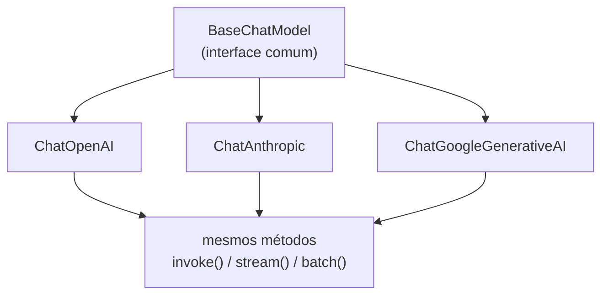

# Modelos e Provedores de LLM no LangChain

## Por que o LangChain separa a aplicação do provedor

O que é uma LLM e como ela funciona já está coberto em [O que são LLMs?](/labs/ai/llm/01-o-que-sao-llms/). A pergunta aqui é outra: como o código da sua aplicação se conecta a ela, sem ficar amarrado a um provedor específico.

Na prática, trocar de provedor é uma decisão que você revisita com frequência: compara custo, velocidade e qualidade de resposta entre OpenAI, Anthropic e Google, usa um modelo local para não enviar dados sensíveis para fora, ou quer um provedor de fallback caso o principal fique fora do ar. Se a aplicação chama a API de cada provedor do jeito específico de cada SDK, trocar significa reescrever trechos inteiros do código.

O LangChain resolve isso com uma interface comum: toda classe de chat model implementa os mesmos métodos (`invoke()`, `stream()`, `batch()`), então trocar de provedor é, na maioria dos casos, trocar a classe usada e manter o resto da aplicação intacto.



## Provedores suportados

| Provedor       | Exemplos de modelo                               | Classe no LangChain      |
| -------------- | ------------------------------------------------ | ------------------------ |
| OpenAI         | família GPT                                      | `ChatOpenAI`             |
| Anthropic      | família Claude                                   | `ChatAnthropic`          |
| Google         | família Gemini                                   | `ChatGoogleGenerativeAI` |
| Hugging Face   | modelos open source                              | `HuggingFacePipeline`    |
| Ollama (local) | Llama, Mistral, Phi e outros, rodando localmente | `Ollama`                 |
| Azure OpenAI   | GPT via Azure                                    | `AzureChatOpenAI`        |
| AWS Bedrock    | Claude, Llama e outros via Bedrock               | `BedrockChat`            |

Cada linha dessa tabela corresponde a um pacote de integração separado (`langchain-openai`, `langchain-anthropic` etc.), instalado conforme a necessidade (ver [Configurando o Ambiente](/labs/ai/langchain/02-ambiente-e-instalacao/)).

## Exemplos de integração

Os identificadores de modelo abaixo (`gpt-4`, `gemini-pro`...) são só ilustrativos da sintaxe, não uma recomendação de qual modelo usar hoje. Confira sempre os modelos disponíveis na documentação atual de cada provedor.

```python
# OpenAI
from langchain_openai import ChatOpenAI

llm = ChatOpenAI(model="gpt-4", temperature=0.7)
response = llm.invoke("Explique o LangChain em palavras simples.")
print(response.content)
```

```python
# Anthropic (Claude)
from langchain_anthropic import ChatAnthropic

llm = ChatAnthropic(model="<modelo Claude atual>", temperature=0.7)
response = llm.invoke("O que é o LangChain?")
print(response.content)
```

```python
# Google Gemini
from langchain_google_genai import ChatGoogleGenerativeAI

llm = ChatGoogleGenerativeAI(model="gemini-pro", temperature=0.7)
response = llm.invoke("Liste as principais características do LangChain.")
print(response.content)
```

```python
# LLM local com Ollama
from langchain_community.llms import Ollama

llm = Ollama(model="llama3", base_url="http://localhost:11434")
response = llm.invoke("Conte uma piada.")
print(response)
```

O modelo local via Ollama precisa do Ollama rodando na máquina (`base_url` aponta para esse servidor local), e troca o modelo que seria uma chamada de API paga por um modelo rodando no seu próprio hardware, ao custo de precisar de GPU/CPU suficiente e, normalmente, de uma qualidade de resposta um degrau abaixo dos modelos de ponta na nuvem.

## Parâmetros que valem para a maioria dos provedores

| Parâmetro     | Descrição                                                                           |
| ------------- | ----------------------------------------------------------------------------------- |
| `model`       | nome do modelo a usar                                                               |
| `temperature` | controla a aleatoriedade da resposta, de 0.0 (determinístico) a 1.0 (mais criativo) |
| `api_key`     | chave de API do provedor (se não vier de variável de ambiente)                      |
| `base_url`    | obrigatório para modelos locais como o Ollama                                       |
| `max_tokens`  | limite de tokens na resposta                                                        |
| `top_p`       | parâmetro de nucleus sampling, alternativa à temperature                            |
| `stop`        | lista de sequências que, se geradas, interrompem a resposta                         |

## Como escolher

Não existe "o melhor provedor", a escolha depende do que pesa mais no seu caso: custo por token, latência, qualidade em tarefas específicas (código, raciocínio, multilíngue), privacidade dos dados enviados e se você já tem infraestrutura de algum provedor em uso. Para prototipar, a interface comum do LangChain ajuda a testar dois ou três provedores no mesmo código antes de decidir.

## Referências

- [Chat models](https://docs.langchain.com/oss/python/langchain/models) - LangChain, documentação oficial, en
- [O que são LLMs?](/labs/ai/llm/01-o-que-sao-llms/) - nota deste repositório, para a teoria por trás dos modelos
