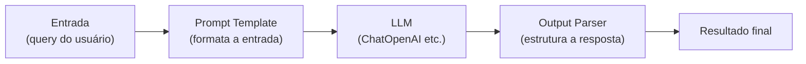

# Chains e LCEL no LangChain

## O que é uma chain

Uma chain é uma sequência de passos executados em ordem: um prompt formata a entrada, a LLM gera uma resposta, um parser estrutura essa resposta, e por aí vai. O nome é literal, você está encadeando componentes (prompts, modelos, ferramentas, retrievers, parsers) para transformar uma entrada numa saída final, sem precisar escrever a cola entre cada passo na mão.



## LCEL, a forma atual de montar chains

A LangChain Expression Language (LCEL) é a maneira declarativa de compor chains hoje: em vez de instanciar uma classe específica para cada tipo de chain, você compõe `Runnable`s com o operador `|`, o mesmo operador de pipe do shell.

Todo componente do LangChain (um prompt, uma LLM, um parser, um retriever) é um `Runnable`. Dois deles compostos com `|` viram um `RunnableSequence`, que executa um depois do outro passando a saída de um como entrada do próximo. É possível também compor em paralelo com `RunnableParallel`, quando vários passos independentes podem rodar ao mesmo tempo.

```python
from langchain_openai import ChatOpenAI
from langchain_core.prompts import PromptTemplate

llm = ChatOpenAI(model="gpt-3.5-turbo", temperature=0.7)
prompt = PromptTemplate(
    input_variables=["topic"],
    template="Explique {topic} em palavras simples.",
)

chain = prompt | llm
response = chain.invoke({"topic": "Microsserviços"})
print(response.content)
```

A vantagem de montar uma chain assim, em vez de escrever o loop de "formatar prompt, chamar modelo, tratar resposta" na mão, é que qualquer `Runnable` composto dessa forma ganha de graça suporte a chamada síncrona (`invoke`), assíncrona (`ainvoke`), em lote (`batch`) e em streaming (`stream`), sem você precisar implementar cada uma.

### Encadeando mais de dois passos

```python
resumo_prompt = PromptTemplate(
    input_variables=["topic"],
    template="Dê um resumo curto sobre {topic}.",
)
pontos_prompt = PromptTemplate(
    input_variables=["resumo"],
    template="Liste 3 pontos principais a partir deste resumo: {resumo}",
)

chain = (
    resumo_prompt
    | llm
    | (lambda resposta: {"resumo": resposta.content})
    | pontos_prompt
    | llm
)

resultado = chain.invoke({"topic": "LangChain"})
print(resultado.content)
```

A função lambda no meio é o "cano" que pega a saída do primeiro passo (um objeto de resposta da LLM) e devolve o dicionário de entrada que o próximo template espera. É normal uma chain real ter pequenos ajustes assim entre os componentes principais.

## As classes de chain "clássicas"

Antes do LCEL virar o padrão, o LangChain oferecia chains como classes prontas, cada uma empacotando um padrão específico. Elas ainda existem e aparecem bastante em código e tutoriais mais antigos:

| Chain                   | O que faz                                                                        |
| ----------------------- | -------------------------------------------------------------------------------- |
| `LLMChain`              | chain básica: um prompt e uma LLM                                                |
| `SequentialChain`       | roda várias chains em sequência, passando múltiplas entradas e saídas entre elas |
| `SimpleSequentialChain` | versão simplificada, com entrada/saída única entre os passos                     |
| `RouterChain`           | roteia a entrada para chains diferentes, dependendo de uma condição              |
| `RetrievalQA`           | combina um retriever com a LLM para responder perguntas sobre documentos (RAG)   |
| `ConversationChain`     | mantém o histórico da conversa junto com a memória                               |
| `MapReduceChain`        | processa documentos grandes em paralelo, depois combina os resultados            |
| `TransformChain`        | aplica uma transformação customizada na entrada ou saída                         |

A documentação oficial do LangChain recomenda LCEL para chains novas, essas classes continuam documentadas por compatibilidade com código existente. Se você está lendo um tutorial ou um projeto que usa `LLMChain` ou `SequentialChain`, agora sabe que é o equivalente mais antigo de compor com `|`.

## RetrievalQA, uma chain de RAG

Vale adiantar o caso de uso mais comum de chain composta: responder perguntas usando um conjunto de documentos. A mecânica completa (carregar documentos, dividir em chunks, gerar embeddings, buscar por similaridade) tem notas próprias mais à frente, aqui a ideia é só mostrar onde a chain entra nesse fluxo:

```python
chain = retriever | formatar_contexto | prompt_qa | llm
resposta = chain.invoke("Qual é a política de férias?")
```

O retriever busca os trechos relevantes, um passo intermediário formata esse contexto dentro do prompt, e a LLM gera a resposta final usando esse contexto. O detalhe de cada peça (document loaders, text splitters, embeddings, vector stores) está em [Document Loaders e Text Splitters](/labs/ai/langchain/09-document-loaders-e-text-splitters/), [Embeddings e Vector Stores](/labs/ai/langchain/10-embeddings-e-vector-stores/) e [RAG](/labs/ai/langchain/11-rag/).

## Chains vs agents vs tools

Uma dúvida comum de quem está começando é quando usar uma chain e quando usar um agente. A diferença central é quem decide o próximo passo:

| Aspecto           | Chains                                              | Agents                                             | Tools                                                 |
| ----------------- | --------------------------------------------------- | -------------------------------------------------- | ----------------------------------------------------- |
| Controle do fluxo | predefinido no código                               | dinâmico, a LLM decide em tempo de execução        | executada quando o agente chama                       |
| Caso de uso       | RAG, resumo, pipelines fixos de pergunta e resposta | tarefas complexas, com vários passos de raciocínio | busca, consulta a banco, calculadora, chamadas de API |
| Flexibilidade     | menor, o caminho é sempre o mesmo                   | maior, o caminho muda conforme a entrada           | depende de como a tool foi implementada               |
| Exemplo           | `LLMChain`, `RetrievalQA`                           | agente ReAct, agente com function calling          | `SearchTool`, `PythonREPLTool`, tool customizada      |

Se você já sabe exatamente a sequência de passos que a tarefa precisa, uma chain é mais simples, mais previsível e mais barata (menos chamadas à LLM para "decidir o que fazer"). Se o caminho muda dependendo da entrada e o sistema precisa escolher entre várias ferramentas possíveis, aí entra um agente, assunto da próxima nota.

## Referências

- [LangChain Expression Language (LCEL)](https://python.langchain.com/docs/concepts/lcel) - LangChain, documentação oficial, en
- [Chains](https://docs.langchain.com/oss/python/langchain/chains) - LangChain, documentação oficial, en
