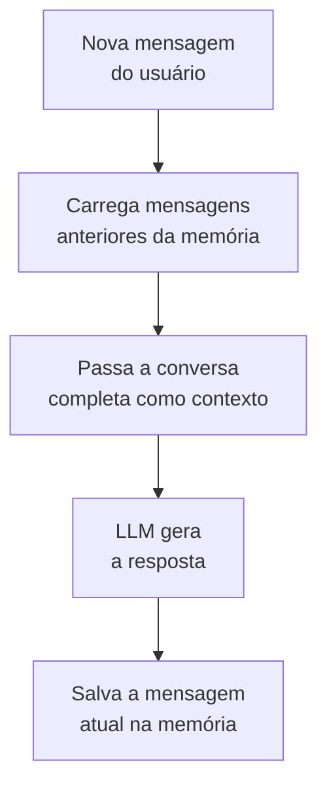

# Memória no LangChain

## O que muda em relação ao conceito geral

Por que um agente precisa de memória, e a diferença entre memória de curto e longo prazo, já está em [Memória de Agentes](/labs/ai/agents/04-memoria/). Aqui o assunto é mais direto: como representar isso no código, usando as classes de memória do LangChain.

Sem memória, cada chamada a uma chain ou LLM é tratada de forma isolada. Se você perguntar o nome de alguém numa mensagem e perguntar "qual é o meu nome?" na próxima, o modelo não tem como saber, a menos que o histórico da conversa seja reenviado junto. É exatamente isso que os módulos de memória do LangChain automatizam: carregar o histórico relevante antes da chamada e salvar a troca nova depois dela.



## Tipos de memória

| Tipo                             | O que guarda                                                  | Quando usar                                                         |
| -------------------------------- | ------------------------------------------------------------- | ------------------------------------------------------------------- |
| `ConversationBufferMemory`       | histórico completo da conversa                                | chats simples, conversas curtas                                     |
| `ConversationBufferWindowMemory` | só as últimas _k_ mensagens                                   | limitar o tamanho da memória que entra no prompt                    |
| `ConversationSummaryMemory`      | um resumo das mensagens antigas, gerado pela própria LLM      | conversas longas, onde o histórico completo não caberia no contexto |
| `EntityMemory`                   | entidades importantes mencionadas (nomes, fatos)              | assistentes personalizados                                          |
| `VectorStoreRetrieverMemory`     | histórico guardado num vector store, buscado por similaridade | memória de longo prazo, com muito histórico acumulado               |

Essas classes vivem no módulo `langchain.memory` e representam o modelo conceitual de memória do LangChain: guardar mensagens, resumi-las ou indexá-las por significado. Vale considerar que esse é terreno em movimento rápido no framework. O LangChain vem deslocando cada vez mais a gestão de estado e histórico para o LangGraph (o mesmo movimento já registrado em [Frameworks de Agentes](/labs/ai/agents/09-frameworks/) para agentes como um todo), então, ao montar um projeto novo, vale checar na documentação atual se a forma recomendada de persistir histórico de conversa ainda passa por essas classes ou se migrou para os mecanismos de estado do LangGraph.

## ConversationBufferMemory

A forma mais simples: guarda a conversa inteira e a reenvia por completo a cada chamada.

```python
from langchain_openai import ChatOpenAI
from langchain.memory import ConversationBufferMemory
from langchain.chains import ConversationChain

llm = ChatOpenAI(model="gpt-3.5-turbo", temperature=0.7)
memory = ConversationBufferMemory()

conversation = ConversationChain(llm=llm, memory=memory, verbose=True)

resposta1 = conversation.predict(input="Oi, meu nome é Rafael.")
print(resposta1)

# a segunda chamada tem acesso ao que foi dito na primeira
resposta2 = conversation.predict(input="Qual é o meu nome?")
print(resposta2)
```

O custo dessa simplicidade é óbvio: conversa longa vira prompt longo, e prompt longo custa mais tokens e, em algum ponto, estoura o limite de contexto do modelo (ver [Tokens](/labs/ai/llm/03-tokens/)).

## Limitando o histórico com ConversationBufferWindowMemory

Uma solução direta para esse problema é não guardar tudo, só as últimas mensagens:

```python
from langchain.memory import ConversationBufferWindowMemory
from langchain.chains import ConversationChain

memory = ConversationBufferWindowMemory(k=3)  # guarda só as últimas 3 mensagens

conversation = ConversationChain(llm=llm, memory=memory, verbose=True)
```

Isso limita o custo, mas tem uma consequência direta: informação dita há mais de `k` mensagens desaparece do contexto, mesmo que ainda fosse relevante.

## Resumindo o histórico com ConversationSummaryMemory

Uma alternativa que não descarta informação antiga, mas também não deixa o contexto crescer sem limite, é pedir para a própria LLM resumir a conversa conforme ela avança:

```python
from langchain.memory import ConversationSummaryMemory

memory = ConversationSummaryMemory(llm=llm)
conversation = ConversationChain(llm=llm, memory=memory, verbose=True)
```

Cada rodada, em vez de reenviar a conversa inteira, o LangChain atualiza um resumo e envia esse resumo como contexto. Isso custa uma chamada extra à LLM para gerar o resumo, mas mantém o contexto enviado a cada chamada bem menor do que o histórico bruto.

## Escolhendo o tipo certo

- conversa curta e pouco custo em jogo: `ConversationBufferMemory` resolve sem complicação
- precisa de um teto de custo previsível: `ConversationBufferWindowMemory`
- conversa longa, onde perder detalhes recentes é pior do que perder detalhes muito antigos: `ConversationSummaryMemory`
- precisa lembrar fatos específicos entre sessões diferentes, não só a conversa atual: `VectorStoreRetrieverMemory` ou `EntityMemory`, que já se aproximam do que [Memória de Agentes](/labs/ai/agents/04-memoria/) chama de memória de longo prazo

## Referências

- [Memory](https://docs.langchain.com/oss/python/langchain/memory) - LangChain, documentação oficial, en
- [Memória de Agentes](/labs/ai/agents/04-memoria/) - nota deste repositório, para o conceito por trás da implementação
