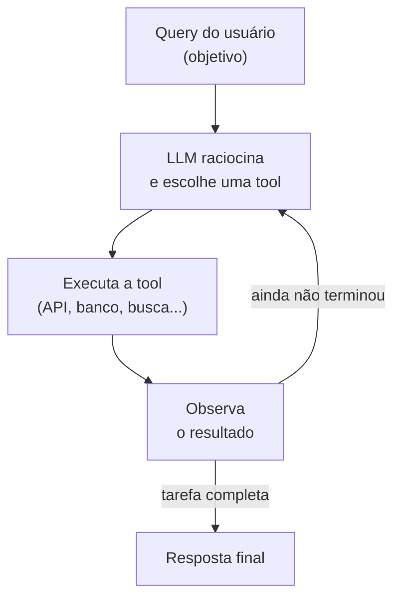

# Agentes no LangChain

## O que muda em relação ao conceito geral

O conceito de agente e o loop de raciocínio ReAct (pensar, agir, observar, repetir) já estão cobertos em [O que é um agente?](/labs/ai/agents/01-o-que-é/) e [Paradigma ReAct](/labs/ai/agents/02-react/). Aqui o assunto é como isso é implementado no LangChain, e essa implementação tem uma particularidade importante que vale explicar antes de qualquer código: a API de agentes do LangChain mudou de forma significativa.



## Duas gerações de API: a legada e a atual

Até a reformulação v1 do LangChain (2025), já registrada em [Frameworks de Agentes](/labs/ai/agents/09-frameworks/), a forma de criar um agente era `initialize_agent`, combinada com um `AgentType` que definia a estratégia de raciocínio usada. Essa API ainda aparece (e vai continuar aparecendo) em muito código e tutorial por aí, então vale reconhecer o padrão:

```python
# API legada
from langchain_openai import ChatOpenAI
from langchain.agents import initialize_agent, AgentType
from langchain_community.tools import DuckDuckGoSearchRun

llm = ChatOpenAI(model="gpt-3.5-turbo", temperature=0.7)
tools = [DuckDuckGoSearchRun()]

agent = initialize_agent(
    tools=tools,
    llm=llm,
    agent=AgentType.ZERO_SHOT_REACT_DESCRIPTION,
    verbose=True,
)

response = agent.invoke({"input": "O que é o LangChain?"})
print(response["output"])
```

A API atual, recomendada pela documentação oficial, é `create_agent`. Ele já roda sobre o LangGraph por baixo dos panos (o mesmo deslocamento mencionado na nota de frameworks), e tem uma assinatura mais enxuta, baseada em três parâmetros principais: `model`, `tools` e `system_prompt`:

```python
# API atual
from langchain.agents import create_agent
from langchain_openai import ChatOpenAI
from langchain_community.tools import DuckDuckGoSearchRun

llm = ChatOpenAI(model="gpt-3.5-turbo", temperature=0.7)
tools = [DuckDuckGoSearchRun()]

agent = create_agent(model=llm, tools=tools, system_prompt="Você é um assistente útil.")

response = agent.invoke({
    "messages": [{"role": "user", "content": "O que é o LangChain?"}]
})
```

A entrada e a saída também mudam de formato: em vez de um `input`/`output` simples, `create_agent` trabalha com uma lista de `messages`, no mesmo formato de mensagens usado em chat models. Isso não é acidente, é reflexo direto de rodar sobre o LangGraph, que modela tudo como estado e mensagens trocando entre nós. Antes de usar em produção, vale conferir a [referência oficial de `create_agent`](https://docs.langchain.com/oss/python/langchain/agents), porque parâmetros adicionais (como `response_format` para saída estruturada, ou configuração de checkpoints) mudam com alguma frequência.

## Estratégias de agente (o modelo conceitual por trás dos `AgentType`)

Mesmo quem só vai usar `create_agent` se beneficia de conhecer os nomes que a API legada usava para cada estratégia, porque eles descrevem padrões de raciocínio que continuam valendo, só a forma de configurar é que mudou:

| Estratégia           | Ideia central                                                                                                |
| -------------------- | ------------------------------------------------------------------------------------------------------------ |
| Zero-shot            | decide qual ferramenta usar só pela descrição dela, sem exemplos                                             |
| ReAct                | segue o ciclo explícito Thought → Action → Observation a cada passo                                          |
| Chat estruturado     | formata o raciocínio como uma conversa estruturada, útil com chat models                                     |
| Function calling     | delega a escolha da ferramenta para o mecanismo nativo de function calling do provedor (OpenAI, por exemplo) |
| Conversacional       | mantém o histórico da conversa entre chamadas                                                                |
| Self-ask with search | quebra uma pergunta complexa em sub-perguntas menores antes de buscar cada resposta                          |

`create_agent` não pede para você escolher uma dessas estratégias explicitamente, ele usa o mecanismo de tool calling nativo do modelo por baixo, o que, na prática, se aproxima da estratégia de function calling da tabela acima.

## Agente com múltiplas ferramentas

```python
from langchain_community.tools import DuckDuckGoSearchRun
from langchain_experimental.tools import PythonREPLTool

tools = [DuckDuckGoSearchRun(), PythonREPLTool()]
agent = create_agent(model=llm, tools=tools)

response = agent.invoke({
    "messages": [{
        "role": "user",
        "content": "Busque notícias recentes sobre LangChain e calcule 5 * 12 usando Python.",
    }]
})
```

O agente decide sozinho, a cada passo, qual das duas ferramentas chamar (ou se chama as duas), de acordo com o que a tarefa pede.

## Agente com ferramenta customizada

```python
from langchain.tools import tool

@tool
def get_employee_details(emp_id: str) -> str:
    """Busca os detalhes de um funcionário num sistema interno, a partir do ID dele."""
    # lógica de negócio real entraria aqui
    return f"Funcionário {emp_id} - Nome: Rafael, Departamento: TI"

agent = create_agent(model=llm, tools=[get_employee_details])
```

## Quando vale usar um agente

- a tarefa pede vários passos e a ordem certa depende da entrada, não é fixa
- o sistema precisa escolher entre várias ferramentas possíveis, dependendo do que o usuário pediu
- a tarefa envolve buscar informação que não está disponível de antemão (busca na web, consulta a um banco)
- o custo extra de deixar a LLM "pensar" a cada passo compensa a flexibilidade ganha

Casos de uso comuns: responder perguntas que exigem combinar várias fontes, assistentes de pesquisa, geradores de relatório, automação de tarefas de múltiplos passos. Quando o fluxo é sempre o mesmo, uma chain comum (ver [Chains e LCEL](/labs/ai/langchain/05-chains-e-lcel/)) tende a ser mais simples, mais previsível e mais barata.

## Segurança em agentes

Um agente que executa ferramentas de verdade (gravar em banco, chamar uma API externa, rodar código) é, por definição, um sistema que toma ações no mundo real a partir do que um modelo de linguagem decidiu. Isso pede cuidado: valide e restrinja o acesso de cada ferramenta ao mínimo necessário, nunca dê a um agente uma ferramenta capaz de ação destrutiva sem alguma camada de confirmação, e trate a entrada que chega até as tools como potencialmente hostil (prompt injection pode induzir o agente a chamar uma ferramenta de um jeito que o usuário não pediu). O assunto é tratado com mais profundidade em [Boas Práticas e Segurança](/labs/ai/engenharia-de-prompt/02-boas-praticas-e-seguranca/) e em [Agentes em Produção](/labs/ai/agents/15-agentes-em-producao/).

## Referências

- [Agents](https://docs.langchain.com/oss/python/langchain/agents) - LangChain, documentação oficial, en
- [O que é um agente?](/labs/ai/agents/01-o-que-é/) e [Paradigma ReAct](/labs/ai/agents/02-react/) - notas deste repositório, para o conceito por trás da implementação
