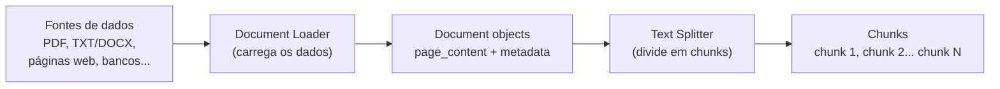

# Document Loaders e Text Splitters no LangChain

## De um arquivo qualquer a um formato padrão

Antes de qualquer LLM conseguir "ler" um PDF, uma planilha ou uma página web, alguém precisa extrair o texto de lá e colocar num formato que o resto do pipeline entenda. É esse o trabalho dos document loaders: cada um sabe ler um tipo de fonte (PDF, CSV, página web, banco de dados...) e devolve o conteúdo como um objeto `Document`, com dois campos: `page_content` (o texto em si) e `metadata` (de onde veio, número da página, e qualquer outro dado associado).



## Por que dividir documentos em chunks

Toda LLM tem um limite de tokens que consegue processar de uma vez (ver [Tokens](/labs/ai/llm/03-tokens/)). Um PDF de 50 páginas não cabe inteiro num prompt, e mesmo que coubesse, jogar o documento inteiro como contexto para responder uma pergunta específica é ineficiente, a maior parte dele é irrelevante para a pergunta. Os text splitters resolvem isso dividindo o documento em pedaços menores (chunks), pequenos o bastante para caber no contexto e, mais à frente, para serem buscados individualmente por relevância (ver [Embeddings e Vector Stores](/labs/ai/langchain/10-embeddings-e-vector-stores/)).

O tamanho do chunk e a sobreposição entre eles (quanto do fim de um chunk se repete no início do próximo) afetam diretamente a qualidade da busca depois: chunk pequeno demais perde contexto, chunk grande demais dilui a relevância, pouca sobreposição corta uma frase ao meio bem na borda de dois chunks.

## Document loaders mais usados

| Loader               | Fonte                          | Caso de uso                                               |
| -------------------- | ------------------------------ | --------------------------------------------------------- |
| `PyPDFLoader`        | arquivos PDF                   | carregar documentos PDF                                   |
| `TextLoader`         | arquivos `.txt`                | texto simples                                             |
| `Docx2txtLoader`     | arquivos `.docx`               | documentos do Word                                        |
| `CSVLoader`          | arquivos CSV                   | dados tabulares                                           |
| `WebBaseLoader`      | páginas web (URLs)             | conteúdo de sites                                         |
| `DirectoryLoader`    | vários arquivos numa pasta     | carregamento em lote                                      |
| `JSONLoader`         | arquivos JSON                  | dados estruturados                                        |
| `UnstructuredLoader` | vários formatos (PDF, HTML...) | conteúdo não estruturado, via a biblioteca `unstructured` |

## Text splitters mais usados

| Splitter                         | Como divide                                                                           | Caso de uso                                                          |
| -------------------------------- | ------------------------------------------------------------------------------------- | -------------------------------------------------------------------- |
| `CharacterTextSplitter`          | por contagem de caracteres, num único separador                                       | simples e rápido                                                     |
| `RecursiveCharacterTextSplitter` | tenta uma lista de separadores em ordem (parágrafo, linha, espaço...), recursivamente | o mais usado no dia a dia, equilíbrio entre simplicidade e qualidade |
| `TokenTextSplitter`              | por contagem de tokens (usando o tokenizador do modelo)                               | quando o limite real é de tokens, não caracteres                     |
| `MarkdownHeaderTextSplitter`     | pelos headers do Markdown                                                             | documentação técnica, arquivos `.md`                                 |
| `SemanticChunker`                | por similaridade semântica entre trechos                                              | quando preservar contexto importa mais do que um tamanho fixo        |

## Carregando e dividindo um PDF

```python
from langchain_community.document_loaders import PyPDFLoader
from langchain_text_splitters import RecursiveCharacterTextSplitter

# 1. carregar o PDF
loader = PyPDFLoader("company_policy.pdf")
docs = loader.load()
print(f"Total de páginas: {len(docs)}")

# 2. dividir em chunks
splitter = RecursiveCharacterTextSplitter(
    chunk_size=1000,
    chunk_overlap=200,
    separators=["\n\n", "\n", " ", ""],
)
chunks = splitter.split_documents(docs)
print(f"Total de chunks: {len(chunks)}")

# 3. conferir um chunk
print(chunks[0].page_content[:200])
print(chunks[0].metadata)
```

O `RecursiveCharacterTextSplitter` tenta os separadores da lista `separators` em ordem: primeiro quebra em parágrafos (`\n\n`), e só recorre a quebrar por linha ou por espaço se um parágrafo ainda for maior que `chunk_size`. É por isso que ele costuma preservar melhor a estrutura do texto original do que um `CharacterTextSplitter` simples.

Vale notar o import: a forma atual é `from langchain_text_splitters import RecursiveCharacterTextSplitter`, num pacote separado (instalado com `pip install langchain-text-splitters`, geralmente já puxado como dependência do `langchain`). Código mais antigo costuma importar de `langchain.text_splitter`, um caminho anterior à reorganização do LangChain em pacotes menores.

## Carregando páginas web

```python
from langchain_community.document_loaders import WebBaseLoader
from langchain_text_splitters import CharacterTextSplitter

loader = WebBaseLoader(["https://exemplo.com/docs"])
docs = loader.load()
print(f"Documentos carregados: {len(docs)}")

splitter = CharacterTextSplitter(chunk_size=500, chunk_overlap=50)
chunks = splitter.split_documents(docs)
```

## Parâmetros principais de um text splitter

| Parâmetro         | Descrição                                                                    | Exemplo                   |
| ----------------- | ---------------------------------------------------------------------------- | ------------------------- |
| `chunk_size`      | tamanho alvo de cada chunk (em caracteres ou tokens, dependendo do splitter) | `1000`                    |
| `chunk_overlap`   | quanto do fim de um chunk se repete no início do próximo                     | `200`                     |
| `separators`      | lista de separadores tentados em ordem                                       | `["\n\n", "\n", " ", ""]` |
| `length_function` | função usada para medir o "tamanho" (por padrão, `len`)                      | `len`                     |
| `keep_separator`  | se o separador fica dentro do chunk ou é descartado                          | `True` / `False`          |

Não existe um valor único de `chunk_size`/`chunk_overlap` correto, a combinação ideal depende do tipo de documento e de como ele vai ser consultado depois, ver as boas práticas de chunking em [RAG](/labs/ai/langchain/11-rag/) e em [Arquiteturas de RAG](/labs/ai/llm/08-arquiteturas-de-rag/).

## Referências

- [Document loaders](https://docs.langchain.com/oss/python/integrations/document_loaders) - LangChain, documentação oficial, en
- [Recursive text splitter](https://docs.langchain.com/oss/python/integrations/splitters/recursive_text_splitter) - LangChain, documentação oficial, en
