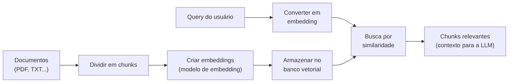

# Embeddings e Vector Stores no LangChain

## O que muda em relação ao conceito geral

O que é um embedding e como a busca semântica funciona já está em [Embeddings](/labs/ai/llm/04-embeddings/), e a arquitetura de um sistema de RAG em produção, incluindo como escolher um banco vetorial para essa escala, está em [Arquiteturas de RAG](/labs/ai/llm/08-arquiteturas-de-rag/). Esta nota cobre só o lado prático: como o LangChain conecta chunks de texto a um modelo de embedding e a um banco vetorial.

## A interface comum VectorStore

Assim como a interface comum de chat models (ver [Modelos e Provedores](/labs/ai/langchain/03-modelos-e-provedores/)) deixa trocar de provedor de LLM sem reescrever a aplicação, a classe `VectorStore` cumpre o mesmo papel para bancos vetoriais: `FAISS`, `Chroma`, `Qdrant` e outros implementam os mesmos métodos, então trocar de banco costuma significar trocar só o nome da classe.



Métodos comuns a praticamente todo `VectorStore`:

| Método                           | O que faz                                                                   |
| -------------------------------- | --------------------------------------------------------------------------- |
| `add_documents()`                | adiciona documentos ao banco                                                |
| `similarity_search()`            | busca os documentos mais similares a uma query                              |
| `similarity_search_with_score()` | mesma busca, retornando também a pontuação de similaridade                  |
| `as_retriever()`                 | transforma o vector store num retriever, pronto para usar numa chain de RAG |
| `delete()`                       | remove documentos                                                           |
| `get()`                          | busca documentos por ID                                                     |

## Comparando os bancos vetoriais mais usados

| Banco    | Onde roda                    | Ponto forte                                                    | Caso de uso                                    |
| -------- | ---------------------------- | -------------------------------------------------------------- | ---------------------------------------------- |
| FAISS    | biblioteca local, em memória | rápido e simples, sem infraestrutura extra                     | desenvolvimento local, dados pequenos a médios |
| Chroma   | local ou servidor            | fácil de usar, com persistência em disco                       | prototipagem, projetos open-source             |
| Qdrant   | servidor ou nuvem            | alta performance, suporta payload (metadados ricos)            | aplicações escaláveis em produção              |
| Pinecone | nuvem gerenciada             | zero infraestrutura para manter, escalável                     | uso corporativo, produção                      |
| Weaviate | servidor ou nuvem            | busca híbrida (vetor + palavra-chave), filtragem por metadados | busca semântica em produção                    |
| Milvus   | servidor ou nuvem            | alta escalabilidade, distribuído                               | aplicações corporativas de larga escala        |

FAISS e Chroma cobrem bem a fase de desenvolvimento e prototipagem, onde rodar tudo localmente é mais prático. Para produção com volume real de dados e múltiplos usuários simultâneos, bancos gerenciados ou servidores dedicados (Qdrant, Pinecone, Weaviate) tendem a escalar melhor, ao custo de mais infraestrutura (ou mais uma conta de SaaS) para manter.

## Modelos de embedding disponíveis

- OpenAI Embeddings (ex: a família `text-embedding-3`)
- Cohere Embeddings, com foco em modelos multilíngues
- Hugging Face, com a família sentence-transformers
- modelos locais, como BGE, all-MiniLM, Instructor
- modelos multimodais, para texto, imagem e código

Assim como os nomes de chat model usados ao longo desta seção, trate os nomes de modelo de embedding acima como ilustrativos, não como recomendação fixa, cada provedor atualiza essa linha de produtos com frequência.

## Usando FAISS

```python
from langchain_community.document_loaders import PyPDFLoader
from langchain_text_splitters import RecursiveCharacterTextSplitter
from langchain_openai import OpenAIEmbeddings
from langchain_community.vectorstores import FAISS

# 1. carregar e dividir o documento
loader = PyPDFLoader("data/company_policy.pdf")
docs = loader.load()
splitter = RecursiveCharacterTextSplitter(chunk_size=500, chunk_overlap=50)
chunks = splitter.split_documents(docs)

# 2. criar os embeddings
embeddings = OpenAIEmbeddings()

# 3. criar o vector store
vectorstore = FAISS.from_documents(chunks, embeddings)

# 4. busca por similaridade
resultados = vectorstore.similarity_search("Qual é a política de férias?", k=3)
for doc in resultados:
    print(doc.page_content)
    print(doc.metadata)
```

`FAISS.from_documents` faz três coisas de uma vez: gera o embedding de cada chunk, monta o índice de busca e guarda tudo em memória. É rápido para experimentar, mas some quando o processo termina, a menos que você salve o índice em disco explicitamente (`vectorstore.save_local(...)`).

## Usando Chroma, com persistência

```python
from langchain_community.document_loaders import DirectoryLoader
from langchain_text_splitters import RecursiveCharacterTextSplitter
from langchain_openai import OpenAIEmbeddings
from langchain_community.vectorstores import Chroma

loader = DirectoryLoader("data/")
docs = loader.load()
splitter = RecursiveCharacterTextSplitter(chunk_size=500, chunk_overlap=50)
chunks = splitter.split_documents(docs)

embeddings = OpenAIEmbeddings()
vectorstore = Chroma.from_documents(
    documents=chunks,
    embedding=embeddings,
    persist_directory="chroma_db",
)

resultados = vectorstore.similarity_search("O que é o processo de KYC?", k=3)
```

O parâmetro `persist_directory` é a diferença prática em relação ao FAISS: o Chroma grava o índice em disco naquela pasta, então rodar o script de novo não exige recriar os embeddings do zero, basta reabrir o mesmo diretório.

## Técnicas além da busca por similaridade simples

- **busca híbrida**: combina busca por vetor (significado) com busca por palavra-chave (termo exato), útil quando a query tem nomes próprios ou códigos que a busca semântica sozinha erraria
- **filtragem por metadados**: restringe a busca por fonte, data, categoria etc., antes ou depois da busca por similaridade
- **re-ranking**: usa um segundo modelo (um cross-encoder, mais lento porém mais preciso) para reordenar os top resultados da busca inicial
- **recuperação multi-vetor**: indexa múltiplos embeddings por documento (por exemplo, um do título e um do conteúdo completo), e combina os dois na busca
- **chunking semântico**: divide o texto por mudança de assunto em vez de um tamanho fixo de caracteres (ver `SemanticChunker` em [Document Loaders e Text Splitters](/labs/ai/langchain/09-document-loaders-e-text-splitters/))

## Referências

- [Vector stores](https://docs.langchain.com/oss/python/integrations/vectorstores) - LangChain, documentação oficial, en
- [Embeddings](/labs/ai/llm/04-embeddings/) - nota deste repositório, para o conceito por trás da busca semântica
