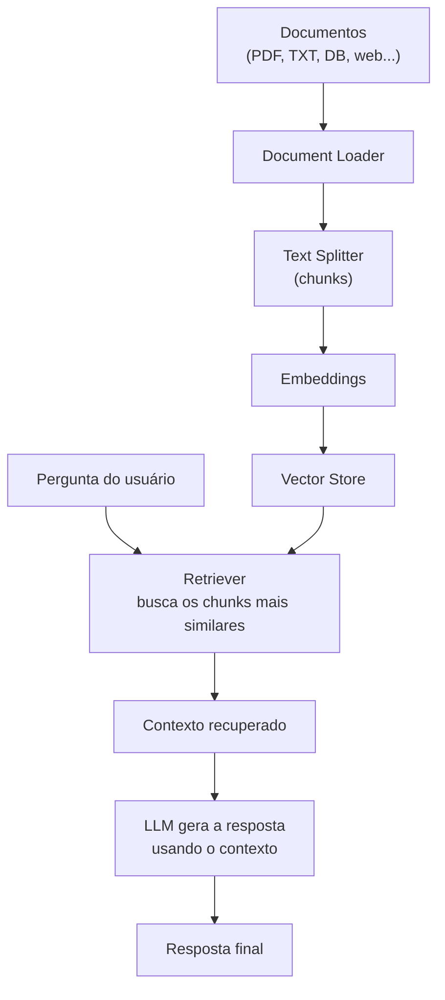

# RAG (Retrieval-Augmented Generation) no LangChain

## Juntando as peças

As notas anteriores desta seção, [Chains e LCEL](/labs/ai/langchain/05-chains-e-lcel/), [Document Loaders e Text Splitters](/labs/ai/langchain/09-document-loaders-e-text-splitters/) e [Embeddings e Vector Stores](/labs/ai/langchain/10-embeddings-e-vector-stores/), já cobriram cada peça separadamente. RAG é o que acontece quando você junta todas elas num pipeline só: carregar documentos, dividi-los, transformar em embeddings, guardar num banco vetorial e, na hora da pergunta, buscar o que for relevante e passar como contexto para a LLM responder.

A teoria por trás disso (por que RAG reduz alucinação, como ele se compara a fine-tuning, as arquiteturas usadas em produção) já está em [Context Engineering e RAG](/labs/ai/llm/07-context-engineering-e-rag/) e [Arquiteturas de RAG](/labs/ai/llm/08-arquiteturas-de-rag/). Esta nota é só a implementação, o pipeline de ponta a ponta no código.



## Os passos do pipeline

1. carregar documentos de uma ou mais fontes (PDF, texto, páginas web, banco de dados)
2. dividir os documentos em chunks menores
3. gerar embeddings de cada chunk e guardar num vector store
4. quando o usuário faz uma pergunta, buscar os chunks mais relevantes no vector store
5. montar um prompt que combina a pergunta com o contexto recuperado
6. enviar esse prompt para a LLM e devolver a resposta, idealmente citando de onde veio cada informação

## Pipeline completo com FAISS

```python
from langchain_community.document_loaders import PyPDFLoader
from langchain_text_splitters import RecursiveCharacterTextSplitter
from langchain_openai import OpenAIEmbeddings, ChatOpenAI
from langchain_community.vectorstores import FAISS
from langchain_core.prompts import ChatPromptTemplate

# 1-3. carregar, dividir e indexar
loader = PyPDFLoader("data/company_policy.pdf")
docs = loader.load()
splitter = RecursiveCharacterTextSplitter(chunk_size=1000, chunk_overlap=200)
chunks = splitter.split_documents(docs)

embeddings = OpenAIEmbeddings()
vectorstore = FAISS.from_documents(chunks, embeddings)
retriever = vectorstore.as_retriever(search_kwargs={"k": 3})

# 4-6. montar a chain de RAG com LCEL
llm = ChatOpenAI(model="gpt-3.5-turbo", temperature=0.2)
prompt_qa = ChatPromptTemplate.from_messages([
    ("system", "Responda só com base no contexto abaixo. Se a resposta não estiver no contexto, diga que não sabe.\n\nContexto:\n{contexto}"),
    ("human", "{pergunta}"),
])

def formatar_contexto(docs):
    return "\n\n".join(doc.page_content for doc in docs)

chain = (
    {"contexto": retriever | formatar_contexto, "pergunta": lambda x: x}
    | prompt_qa
    | llm
)

resposta = chain.invoke("Qual é a política de férias?")
print(resposta.content)
```

Repare que essa versão monta a chain com LCEL (a forma atual, explicada em [Chains e LCEL](/labs/ai/langchain/05-chains-e-lcel/)), em vez da classe `RetrievalQA.from_chain_type(...)` que aparece em tutoriais e código mais antigos. A lógica é a mesma, o retriever busca o contexto e a LLM responde com base nele, só a forma de compor muda. A instrução explícita no prompt de sistema ("responda só com base no contexto", "diga que não sabe se não estiver lá") é o que de fato reduz alucinação, o pipeline sozinho não garante isso, é o prompt quem faz esse trabalho.

## Com Chroma, para persistência

```python
from langchain_community.document_loaders import DirectoryLoader
from langchain_text_splitters import RecursiveCharacterTextSplitter
from langchain_openai import OpenAIEmbeddings
from langchain_community.vectorstores import Chroma

loader = DirectoryLoader("data/")
docs = loader.load()
splitter = RecursiveCharacterTextSplitter(chunk_size=1000, chunk_overlap=200)
chunks = splitter.split_documents(docs)

embeddings = OpenAIEmbeddings()
vectorstore = Chroma.from_documents(
    documents=chunks,
    embedding=embeddings,
    persist_directory="chroma_db",
)
retriever = vectorstore.as_retriever(search_kwargs={"k": 3})
```

A escolha entre FAISS e Chroma (ou outro banco) aqui é a mesma discutida em [Embeddings e Vector Stores](/labs/ai/langchain/10-embeddings-e-vector-stores/), não repetida nesta nota.

## Parâmetros que mais afetam a qualidade da resposta

| Parâmetro                      | Afeta                                         | Ponto de partida comum                                                         |
| ------------------------------ | --------------------------------------------- | ------------------------------------------------------------------------------ |
| `chunk_size` / `chunk_overlap` | quanto contexto cada chunk carrega            | 500-1500 caracteres, com 10-20% de overlap                                     |
| `search_kwargs={"k": ...}`     | quantos chunks entram no contexto da resposta | 3-5, ajustar conforme o tamanho médio do chunk                                 |
| `temperature`                  | o quanto a LLM "inventa" por cima do contexto | baixa (0.0-0.3), já que o objetivo é fidelidade ao documento, não criatividade |

Não existe uma combinação universal, o ponto de partida acima é só isso, um ponto de partida. Ajustar esses números com base em avaliação real (ver abaixo) é parte normal de colocar um pipeline de RAG para funcionar bem.

## Boas práticas

- documentos de origem com boa qualidade e bem organizados rendem mais do que qualquer ajuste fino de parâmetros
- combine a busca por similaridade com filtragem por metadados quando o domínio permitir (por fonte, data, categoria)
- inclua a citação da fonte na resposta final, isso tanto ajuda o usuário a verificar quanto expõe rápido quando o retriever trouxe o chunk errado
- avalie o pipeline com métricas, não só "parece bom" na amostragem manual, ver [Avaliação de LLMs](/labs/ai/llm/06-avaliacao-de-llms/)
- para levar esse pipeline básico a produção (observabilidade, cache, controle de acesso, re-ranking em escala), ver [Pipeline de RAG em Produção](/labs/ai/llm/10-pipeline-de-rag-em-producao/), que trata esse lado em profundidade e não é repetido aqui

## Referências

- [Retrieval](https://docs.langchain.com/oss/python/langchain/retrieval) - LangChain, documentação oficial, en
- [Arquiteturas de RAG](/labs/ai/llm/08-arquiteturas-de-rag/) - nota deste repositório, para a teoria completa
