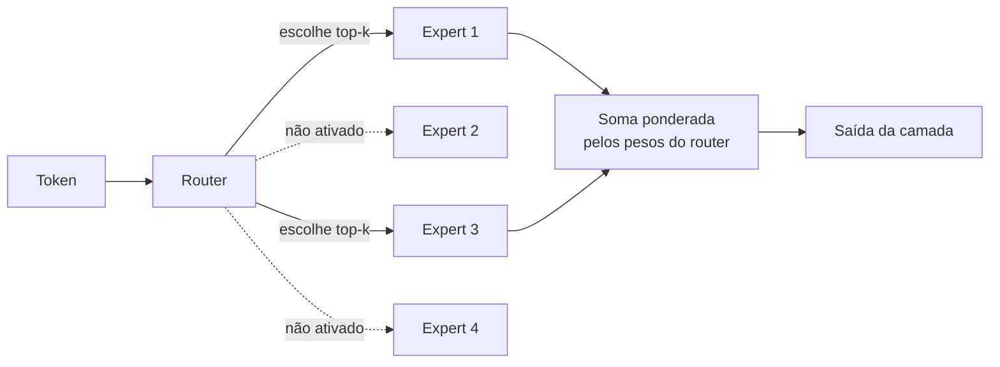

# Mixture of Experts e Scaling Laws

Duas perguntas separam quem só usa LLM de quem entende por que elas custam o que custam e melhoram do jeito que melhoram: como caber mais conhecimento num modelo sem explodir o custo de cada chamada, e como saber, antes de gastar milhões de dólares num treino, se vale a pena usar esse dinheiro em mais parâmetros ou em mais dados. Mixture of Experts responde a primeira, scaling laws respondem a segunda.

## Mixture of Experts (MoE)

Num [Transformer denso](/labs/ai/llm/05-como-uma-llm-gera-texto/), todo parâmetro do modelo participa do cálculo de todo token, sempre. Isso é simples de implementar, mas caro de escalar: dobrar o tamanho do modelo dobra (aproximadamente) o custo de cada chamada, porque não tem como "usar só uma parte" do modelo quando a arquitetura não prevê isso.

**Mixture of Experts (MoE)** ataca esse problema trocando o bloco feed-forward de cada camada do Transformer por vários blocos menores e paralelos, os **experts**, e um **router** (uma rede pequena e treinável) que decide, para cada token, quais experts vão processá-lo. Em vez de mandar o token pelos `N` experts, o router escolhe só os `k` mais adequados (top-k routing, com `k` tipicamente 1 ou 2), e só esses `k` fazem o cálculo.

O ganho é esse: o modelo pode ter centenas de bilhões de parâmetros no total (contando todos os experts de todas as camadas), mas cada token só ativa uma fração pequena deles. Isso é a **ativação esparsa** (sparse activation), em oposição à ativação densa de um Transformer comum. Na prática, o modelo tem a capacidade de um modelo gigante, mas o custo de processar cada token fica perto do custo de um modelo bem menor.

Isso não vem de graça. Sem nenhum ajuste extra, o router tende a convergir para um comportamento preguiçoso: aprende a mandar a maioria dos tokens sempre para os mesmos dois ou três experts favoritos, deixando o resto subtreinado e inútil. Para evitar isso, o treino inclui uma **perda de balanceamento de carga** (load balancing loss), um termo extra que penaliza o modelo quando a distribuição de tokens entre experts fica desigual demais, empurrando o router a espalhar o trabalho de forma mais uniforme.

Alguns modelos reais que usam essa arquitetura:

- **Switch Transformer** (Google, 2021): o primeiro trabalho a levar MoE para a escala de trilhão de parâmetros, simplificando o roteamento para top-1 (cada token vai para um único expert).
- **Mixtral 8x7B** (Mistral AI): 8 experts por camada com roteamento top-2, um dos primeiros modelos abertos de peso relevante a popularizar MoE fora dos laboratórios fechados.
- **DeepSeek-V3**: leva a ideia mais longe, com um número grande de experts "finos" (menores e mais numerosos) mais alguns experts "compartilhados" que processam todo token, uma forma de capturar conhecimento genérico sem depender só do roteamento.

O custo que aparece em troca é memória, não compute: mesmo que só alguns experts sejam ativados por token, todos precisam estar carregados na GPU (ou espalhados entre várias), porque tokens diferentes do mesmo lote podem acionar experts diferentes. Treinar e servir um MoE também exige um tipo de paralelismo próprio (expert parallelism, distribuindo experts diferentes em GPUs diferentes), mais complexo de implementar bem do que o paralelismo de um modelo denso comum.

## Scaling laws

Treinar um modelo de ponta custa dezenas de milhões de dólares em compute. Antes de gastar isso, uma pergunta natural é: para um orçamento fixo de compute, vale mais a pena treinar um modelo maior com menos dados, ou um modelo menor com mais dados? **Scaling laws** são as respostas empíricas a essa pergunta: relações, descobertas rodando dezenas de treinos em escalas menores e extrapolando o padrão, entre o tamanho do modelo (`N` parâmetros), a quantidade de dados de treino (`D` tokens), o compute total (`C`) e a perda (loss) final do modelo. Essas relações seguem aproximadamente uma lei de potência, por isso o nome.

O primeiro trabalho a formalizar isso, de Kaplan et al. (OpenAI, 2020), concluiu que, para um orçamento de compute fixo, o ganho de aumentar o tamanho do modelo supera o ganho de aumentar a quantidade de dados. Essa conclusão, lida de forma direta, empurrou a indústria para uma corrida de modelos cada vez maiores, muitas vezes treinados com uma quantidade de dados relativamente pequena perto do tamanho do modelo.

Em 2022, o paper do **Chinchilla** (Hoffmann et al., DeepMind) revisitou essa conta com um escopo de experimentos maior e chegou a uma conclusão diferente: os modelos da geração anterior (incluindo o próprio Gopher, de 280 bilhões de parâmetros, da mesma DeepMind) estavam **subtreinados** para o tamanho que tinham. A relação compute-ótima encontrada foi de aproximadamente 20 tokens de treino para cada parâmetro do modelo, bem mais dados por parâmetro do que a prática até então. Para provar o ponto, treinaram o Chinchilla, um modelo de 70 bilhões de parâmetros (um quarto do tamanho do Gopher) com 1,4 trilhão de tokens (quase 4 vezes mais dados), usando o mesmo orçamento total de compute dos dois, e o Chinchilla superou o Gopher em praticamente todas as avaliações.

| | Kaplan et al. (2020) | Chinchilla (2022) |
| --- | --- | --- |
| Conclusão principal | Priorizar tamanho do modelo | Priorizar mais dados por parâmetro |
| Razão parâmetros:tokens sugerida | Baixa (modelos "subtreinados") | ~1:20 (compute-ótimo) |
| Resultado prático | Modelos gigantes com poucos dados relativos | Modelos menores, treinados por muito mais tempo |

O efeito prático foi imediato: a geração seguinte de modelos abertos, como a família Llama, passou a ser treinada com uma proporção de dados por parâmetro muito mais próxima da receita do Chinchilla do que da prática anterior a 2022.

Essas leis não são uma garantia eterna. Seguir a receita compute-ótima do Chinchilla pressupõe que exista texto de qualidade suficiente para alimentar o treino nessa proporção, e boa parte do debate atual da área gira em torno de uma possível **"parede de dados"**: o texto de boa qualidade disponível na internet não cresce na mesma velocidade que a demanda por dados de treino, o que empurra a indústria para dados sintéticos (como visto em [Engenharia de Datasets](/labs/ai/llm/13-engenharia-de-datasets/)) e para técnicas que tiram mais proveito do mesmo dado, em vez de simplesmente escalar os três fatores (parâmetros, dados, compute) na mesma proporção indefinidamente.

## Referências

- [Switch Transformers: Scaling to Trillion Parameter Models with Simple and Efficient Sparsity](https://arxiv.org/abs/2101.03961) - Fedus et al., arXiv, en
- [Scaling Laws for Neural Language Models](https://arxiv.org/abs/2001.08361) - Kaplan et al., arXiv, en
- [Training Compute-Optimal Large Language Models (Chinchilla)](https://arxiv.org/abs/2203.15556) - Hoffmann et al., arXiv, en
