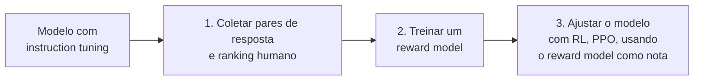

# Fine-Tuning

## O que é fine-tuning

**Fine-tuning** (ajuste fino) é pegar um modelo já treinado e continuar o treinamento dele com um conjunto de dados menor e específico, em vez de treinar um modelo do zero. O modelo sai do processo sabendo tudo que já sabia antes, mais um comportamento novo que os dados de ajuste ensinaram.

A diferença para o [RAG](/labs/ai/llm/08-context-engineering-e-rag/) importa: RAG dá **conhecimento** novo ao modelo, buscando informação externa e colocando no prompt, sem mudar um parâmetro sequer do modelo. Fine-tuning muda o **comportamento** do modelo, de forma permanente, treinando os pesos dele de novo.

## Fine-tuning ou RAG: qual usar

A pergunta certa não é "qual dos dois é melhor", é "qual problema eu tenho":

| Problema                                                                             | Solução            |
| ------------------------------------------------------------------------------------ | ------------------ |
| O modelo não sabe uma informação (desatualizada, privada, específica da empresa)     | RAG                |
| O modelo sabe a informação, mas não segue o formato/tom/domínio de forma consistente | Fine-tuning        |
| As duas coisas ao mesmo tempo                                                        | Os dois combinados |

Uma progressão que costuma funcionar bem: comece com um prompt bem escrito (ver [Engenharia de Prompts](/labs/ai/engenharia-de-prompt/01-engenharia-de-prompts/)), adicione RAG quando o problema for falta de conhecimento, e só recorra a fine-tuning quando um prompt bom e um RAG bem feito ainda não seguram um comportamento consistente. Fine-tuning tem custo de dados, treinamento e manutenção que os outros dois não têm.

Em produção, os dois costumam conviver: o fine-tuning fixa a "interface" (como o modelo responde, em que formato, com que tom), e o RAG cuida do conteúdo que muda com o tempo.

## Full fine-tuning vs PEFT e LoRA

Existem duas formas de fazer o ajuste:

- **Full fine-tuning:** atualiza **todos** os parâmetros do modelo. Exige bastante poder computacional e corre o risco de _esquecimento catastrófico_, quando o modelo perde parte do que sabia antes ao aprender a tarefa nova.
- **PEFT (Parameter-Efficient Fine-Tuning):** uma família de técnicas que atualiza só uma fração pequena dos parâmetros, mantendo o resto do modelo congelado.

Dentro do PEFT, a técnica mais usada hoje é o **LoRA** (Low-Rank Adaptation, criada por pesquisadores da Microsoft em 2021). Em vez de mexer nos pesos originais do modelo, o LoRA insere matrizes pequenas e treináveis ao lado deles. O treinamento ajusta só essas matrizes novas, que juntas têm uma fração do tamanho do modelo inteiro, e o resultado se aproxima da qualidade de um full fine-tuning por um custo bem menor.

Na prática, LoRA (ou variações como QLoRA) é o padrão para a maioria dos times. Full fine-tuning só compensa quando o time já tem um volume grande de dados de treino (a partir de dezenas de milhares de exemplos) e um motivo específico pelo qual PEFT não é suficiente.

## Instruction tuning

**Instruction tuning** é um tipo específico de fine-tuning: o modelo treina com pares de (instrução, resposta esperada), aprendendo a seguir comandos em vez de só completar texto. É esse processo, aplicado sobre um modelo base, que dá origem a um assistente de chat como o ChatGPT.

## Alignment: RLHF e DPO

Instruction tuning ensina o modelo a seguir o formato de instrução e resposta, mas não ensina qual resposta é a **melhor** entre várias que seguem esse formato corretamente. Duas respostas podem estar ambas gramaticalmente corretas e no formato certo, e ainda assim uma ser mais útil, mais segura ou mais alinhada ao que a pessoa realmente queria. Fechar essa lacuna é o papel do **alignment** (alinhamento): ajustar o modelo para preferir as respostas que humanos de fato preferem.

O método que popularizou essa etapa foi o **RLHF** (Reinforcement Learning from Human Feedback), usado pela OpenAI no InstructGPT e depois no ChatGPT. Ele roda em três etapas, sobre um modelo que já passou por instruction tuning:

1. **Coleta de preferências:** o modelo gera várias respostas para a mesma pergunta, e pessoas rankeiam qual é melhor.
2. **Reward model:** esse ranking treina um segundo modelo, cujo único trabalho é prever, dada uma resposta, que nota um humano daria a ela.
3. **Reinforcement learning:** o modelo original é ajustado para maximizar a nota do reward model, geralmente usando o algoritmo **PPO** (Proximal Policy Optimization). Na prática, o modelo "aprende" a gerar respostas que o reward model pontua bem, que por sua vez foi treinado para imitar a preferência humana.

RLHF funciona, mas é caro e instável: treinar e manter um reward model separado, mais um loop de reinforcement learning por cima, consome bastante infraestrutura e pede ajuste fino de hiperparâmetros para não degradar a qualidade do modelo.

Por isso ganhou força o **DPO** (Direct Preference Optimization), que chega num resultado parecido sem precisar de reward model nem de RL. O DPO usa os mesmos pares de resposta (uma preferida, uma rejeitada) e ajusta os pesos do modelo diretamente, com uma função de perda que aumenta a probabilidade da resposta preferida e reduz a da rejeitada. É mais simples de implementar e mais estável de treinar, e por isso virou a escolha de modelos abertos recentes como o Llama 3.

## Modelos de raciocínio e test-time compute

Tudo que vimos até aqui (instruction tuning, RLHF, DPO) melhora o modelo gastando mais compute **no treino**. A partir do o1 da OpenAI e do DeepSeek-R1, ganhou força uma ideia complementar: gastar mais compute **na hora de responder**, deixando o modelo gerar um raciocínio mais longo antes de chegar na resposta final. Isso é **test-time compute** (ou inference-time scaling): em vez de um modelo fixo que responde sempre com o mesmo esforço, o modelo "pensa mais" em perguntas difíceis e responde direto em perguntas fáceis, de forma parecida com uma pessoa que rabisca contas numa folha de rascunho antes de dar a resposta de um problema de matemática.

Na prática, um **modelo de raciocínio** gera um longo encadeamento de passos intermediários (parecido com o chain-of-thought visto em [Engenharia de Prompts](/labs/ai/engenharia-de-prompt/01-engenharia-de-prompts/), só que o próprio modelo foi treinado para fazer isso por conta própria, não porque o prompt pediu) antes de emitir a resposta final. Esse raciocínio mais longo consome mais tokens e mais tempo por resposta, mas em tarefas de lógica, matemática e código o ganho de acerto compensa o custo extra.

Esse comportamento vem de uma etapa de treino com reinforcement learning diferente do RLHF clássico, usando duas peças que vale conhecer:

- **GRPO (Group Relative Policy Optimization):** nasceu no paper do DeepSeekMath (2024) e ficou conhecido por sustentar o treino do DeepSeek-R1. A diferença para o PPO usado no RLHF tradicional (visto em [Alignment: RLHF e DPO](#alignment-rlhf-e-dpo)) é que o GRPO não precisa de um **reward model** separado, do mesmo porte do modelo principal, para avaliar cada resposta. Em vez disso, ele gera um grupo de várias respostas para a mesma pergunta, pontua cada uma com um critério mais simples e usa a média do grupo como referência: respostas acima da média do grupo são reforçadas, abaixo da média são penalizadas. Isso corta pela metade (ou mais) a infraestrutura de treino, porque elimina o segundo modelo gigante que o RLHF exige.
- **RLVR (Reinforcement Learning with Verifiable Rewards):** em vez de um reward model aprendido (que imita uma preferência humana e pode errar ou ser enganado), a recompensa vem de um critério objetivo e verificável por código: a resposta de matemática bate com o gabarito, o código gerado passa nos testes, a prova lógica está correta. Isso funciona muito bem em domínios onde "certo" e "errado" são fatos checáveis automaticamente, e é justamente por isso que os ganhos mais visíveis desses modelos aparecem em matemática e programação, não em tarefas abertas como escrever um e-mail.

Para quem constrói aplicação, a troca é direta: um modelo de raciocínio custa mais (mais tokens gerados, mais tempo de resposta) e por isso vale a pena só em tarefas onde o raciocínio errado sai caro, como depurar um bug sutil ou resolver um problema matemático de várias etapas. Para perguntas simples ou tarefas de formato (resumir, extrair um campo, responder uma FAQ), o custo extra de um modelo de raciocínio raramente se paga, e um modelo "normal" mais barato e mais rápido resolve igual ou melhor.

## Referências

- [O que é Fine-Tuning (ajuste fino)](https://www.dio.me/articles/o-que-e-finetuning-ajuste-fino-546bb90ad96b) - Sergio Santos, DIO, pt-BR
- [Fine-tuning guide](https://platform.openai.com/docs/guides/fine-tuning) - OpenAI, en
- [A Survey of Large Language Models](https://arxiv.org/abs/2303.18223) - Zhao et al., en, seção sobre RLHF e alignment
- [Learning to Reason with LLMs (o1)](https://openai.com/index/learning-to-reason-with-llms/) - OpenAI, en
- [DeepSeekMath: Pushing the Limits of Mathematical Reasoning in Open Language Models](https://arxiv.org/abs/2402.03300) - Shao et al., arXiv, en (origem do GRPO)
- [Reinforcement Learning with Verifiable Rewards Implicitly Incentivizes Correct Reasoning in Base LLMs](https://arxiv.org/html/2506.14245v2) - arXiv, en
