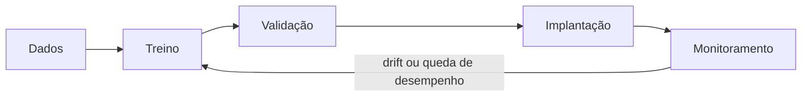
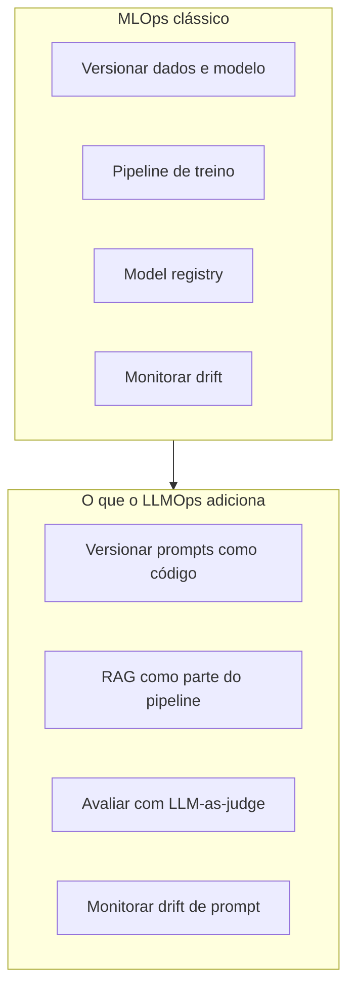

# MLOps e LLMOps

## Por que treinar o modelo é só o começo

Todas as notas anteriores desta seção tratam de construir alguma peça: ajustar um modelo com [fine-tuning](/labs/ai/llm/11-fine-tuning/), montar um [dataset](/labs/ai/llm/12-engenharia-de-datasets/), otimizar a [inferência](/labs/ai/llm/13-otimizacao-de-inferencia/). Nenhuma delas resolve o problema seguinte: o que acontece depois que isso vai para produção e continua lá, rodando, por meses?

Um modelo em produção não para de precisar de atenção no dia do lançamento. Os dados do mundo real mudam, o comportamento dos usuários muda, e o próprio código do pipeline de treino evolui. Sem um processo para lidar com isso, o time acaba descobrindo que o modelo piorou só quando alguém reclama, e reconstruindo o pipeline de treino do zero toda vez que algo precisa mudar. **MLOps** é o nome dado ao conjunto de práticas que evita esse cenário, aplicando ao ciclo de vida de modelos de Machine Learning a mesma disciplina que o DevOps trouxe para software comum: automação, versionamento e monitoramento contínuo.

## Os três níveis de maturidade de MLOps

O Google Cloud descreve três níveis de maturidade que ajudam a situar onde um time está e o que falta automatizar. Eles não são obrigatórios de seguir em ordem, mas servem como um mapa do que "fazer MLOps" realmente significa na prática.

### Nível 0: processo manual

Tudo acontece à mão, normalmente em notebooks: um cientista de dados explora os dados, treina o modelo, valida o resultado e entrega o artefato final para a engenharia implantar. Esse formato tem um problema estrutural chamado **training-serving skew**: o código que processou os dados durante o treino é diferente do código que processa os dados em produção, e pequenas diferenças entre os dois (uma coluna calculada de outro jeito, um valor ausente tratado de forma diferente) fazem o modelo se comportar em produção de um jeito que ele nunca mostrou durante a validação. Lançamentos são raros, e não existe monitoramento ativo depois que o modelo está no ar.

### Nível 1: automação do pipeline (treino contínuo)

O objetivo aqui é o **treinamento contínuo (continuous training, CT)**: o pipeline inteiro de treino passa a rodar automaticamente em produção, disparado por dados novos, não só uma vez pelo cientista de dados. Isso exige modularizar e containerizar cada etapa (preparar dados, treinar, validar), para que elas se conectem como peças de um pipeline, não como passos soltos de um notebook.

Esse nível introduz peças que o nível 0 não tinha:

- **Validação de dados**, que detecta dois tipos de problema diferentes: desvio de esquema (uma coluna mudou de tipo ou desapareceu, o que interrompe o pipeline) e desvio estatístico nos valores (a distribuição dos dados mudou, o que dispara um retreinamento em vez de travar tudo)
- **Validação de modelo**, offline (compara o modelo novo com o que já está em produção) e online (libera o modelo novo para uma fração do tráfego primeiro, em canary release ou teste A/B, antes de assumir 100% do tráfego)
- **Armazenamento de metadados**, que guarda qual versão de dado, código e configuração gerou cada modelo, essencial para conseguir reproduzir um resultado ou voltar atrás (rollback) quando algo dá errado
- **Gatilhos de retreinamento**: sob demanda, numa agenda fixa, quando chegam dados novos em volume suficiente, quando o desempenho cai ou quando aparece concept drift (ver seção de monitoramento abaixo)

O que falta nesse nível: mudar o próprio código do pipeline (trocar uma feature, testar uma arquitetura nova) ainda passa por teste e implantação manuais. O pipeline treina sozinho, mas evoluir o pipeline em si não é automático.

### Nível 2: automação completa de CI/CD

Esse nível automatiza também a implantação de mudanças no pipeline, não só a execução dele. Entram as mesmas ideias de CI/CD que times de software já usam, adaptadas para ML:

- **CI (integração contínua)**: testes unitários do código de features e dos métodos do modelo, verificação de que o treino converge e não produz NaN, testes de artefato e de integração entre os componentes do pipeline
- **CD (entrega contínua)**: verificação de compatibilidade com a infraestrutura de destino, testes da API de predição, testes de carga, validação de dados e checagem das metas de desempenho, antes de promover a mudança de um ambiente de teste para pré-produção e, por fim, para produção

Nesse nível o time ganha velocidade real para experimentar: uma ideia nova de feature engineering, arquitetura ou hiperparâmetro entra, passa pelos testes automáticos e chega à produção sem depender de alguém implantar manualmente cada etapa.

## Onde o modelo versionado fica: model registry

Um **model registry** é o catálogo central de todas as versões de um modelo que já foram treinadas, com os metadados de cada uma: em qual dado foi treinado, quais métricas de validação teve, se está em staging ou em produção. Ferramentas como MLflow Model Registry, o registry do Vertex AI (Google) e o do SageMaker (AWS) cumprem esse papel.

O MLflow é open source e cobre mais do que o registry: o MLflow Tracking registra cada execução de treino (parâmetros, métricas, artefatos gerados) para comparar experimentos depois, e o registry é só a peça que guarda qual dessas versões está de fato em produção. Mais recentemente, o MLflow também passou a oferecer uma plataforma voltada para GenAI, cobrindo tracing e avaliação de aplicações de LLM, não só o treino clássico de um modelo.

O registry é o que torna o rollback uma operação simples em vez de uma reconstrução: se o modelo que acabou de ir ao ar está se comportando mal, voltar para a versão anterior é só apontar o serviço de inferência para o registro de volta, sem precisar retreinar nada.

## Monitoramento e drift

Depois que o modelo está em produção, o trabalho muda de "treinar bem" para "perceber quando parou de funcionar bem". O problema central tem nome: **drift**, a mudança no mundo que invalida silenciosamente o que o modelo aprendeu.

- **Drift de dados (data drift)**: a distribuição das features de entrada muda. Um exemplo clássico: um modelo de crédito treinado antes de uma crise econômica passa a receber perfis de renda muito diferentes do que viu no treino.
- **Drift de modelo (concept drift)**: a própria relação entre entrada e saída muda, mesmo que a distribuição de entrada pareça igual. O que definia "transação fraudulenta" há um ano pode não ser mais o padrão que os fraudadores usam hoje.

Métodos estatísticos como o **PSI (Population Stability Index)** e o **teste de Kolmogorov-Smirnov (KS-test)** comparam a distribuição dos dados que chegam em produção com a distribuição vista no treino, e disparam um alerta (ou o gatilho de retreinamento do nível 1) quando a diferença passa de um limiar.

## LLMOps: a mesma disciplina, um artefato diferente

**LLMOps** não é uma disciplina concorrente do MLOps, é uma extensão dele para o caso específico de aplicações construídas sobre LLMs. A base se mantém (versionamento, pipelines, monitoramento), mas o que precisa ser versionado e avaliado muda, porque o artefato principal de uma aplicação de LLM raramente é um modelo treinado do zero.

### Prompt como configuração, não como artefato de modelo

Num pipeline de MLOps clássico, o artefato versionado é o modelo (os pesos). Numa aplicação de LLM, na maioria das vezes o modelo em si vem pronto de um provedor (GPT, Claude, Gemini), e o que o time de fato constrói e precisa versionar é o **prompt**, junto com a configuração de [RAG](/labs/ai/llm/08-arquiteturas-de-rag/) usada (quais documentos, qual estratégia de busca, quantos chunks). Tratar prompt e configuração de RAG como código, versionado e revisado em pull request, com os mesmos testes em CI que qualquer outra mudança de comportamento do produto, é a prática que substitui o "versionar o modelo" do MLOps clássico.

### Avaliação: por que LLM-as-judge entra no lugar das métricas fixas

O CI/CD de ML tradicional valida um modelo contra uma métrica fixa, acurácia ou F1, por exemplo, porque a tarefa tem uma resposta certa objetiva. Um LLM gerando texto livre não tem essa garantia: duas respostas completamente diferentes na forma podem estar igualmente certas no conteúdo, o que quebra a suposição por trás de um teste de CI tradicional ("a saída bate exatamente com o esperado?"). É por isso que a avaliação de aplicações de LLM se apoia tanto em **LLM-as-judge** e em revisão humana, já detalhados em [Avaliação de LLMs](/labs/ai/llm/06-avaliacao-de-llms/), em vez de só assertions programáticas.

### Drift de prompt: a degradação que o dashboard de MLOps não vê

O monitoramento de drift do MLOps clássico foi desenhado para detectar mudança na distribuição de dados numéricos ou categóricos, algo que um teste estatístico como o PSI mede bem. Uma aplicação de LLM pode degradar sem que nenhuma distribuição numérica mude: o provedor atualiza o modelo por trás da mesma API, um documento importante saiu da base de RAG, ou um prompt que funcionava bem parou de funcionar depois de uma mudança pequena em outra parte do sistema. Esse tipo de degradação, às vezes chamado de **drift de prompt**, é silencioso para um dashboard pensado em termos de distribuição estatística, e só aparece de verdade num processo de avaliação contínua, com um conjunto de perguntas de referência (o dataset dourado visto em [Avaliação de LLMs](/labs/ai/llm/06-avaliacao-de-llms/)) rodando de novo a cada mudança.

### O que o LLMOps não precisa reinventar

Duas peças de infraestrutura que já apareceram neste lab fazem parte do LLMOps sem precisar de nome novo: o [model routing e o LLM Gateway](/labs/ai/llm/14-model-routing/) cuidam de qual modelo responde e de fallback entre provedores, e o [feedback do usuário e o data flywheel](/labs/ai/llm/15-feedback-do-usuario/) fecham o ciclo de melhoria contínua a partir do uso real. LLMOps é a camada que amarra essas peças com o mesmo rigor operacional que o MLOps aplica a um modelo treinado do zero.

## Referências

- [O que são MLOps?](https://cloud.google.com/discover/what-is-mlops?hl=pt-BR) - Google Cloud, pt-BR
- [O que é MLOps?](https://www.redhat.com/pt-br/topics/ai/what-is-mlops) - Red Hat, pt-BR
- [MLOps: Continuous delivery and automation pipelines in machine learning](https://docs.cloud.google.com/architecture/mlops-continuous-delivery-and-automation-pipelines-in-machine-learning) - Google Cloud (Architecture Center), en
- [Large language model operations (LLMOps)](https://www.techtarget.com/searchEnterpriseAI/definition/large-language-model-operations-LLMOps) - TechTarget, en
