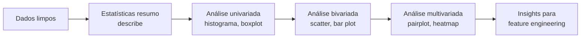
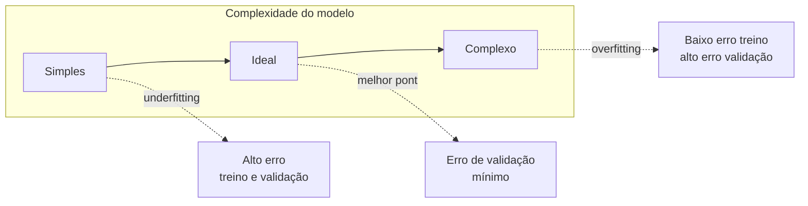

# Preparação e Avaliação de Dados

Antes de treinar qualquer algoritmo, existe um trabalho que consome a maior parte do tempo de um projeto de Machine Learning: conseguir os dados certos, limpar o que está sujo e garantir que a forma de medir o resultado final faz sentido. Essa nota cobre as duas pontas desse processo, a preparação dos dados que entram no modelo e as métricas que dizem se ele ficou bom.

## Coleta e entendimento dos dados

Os dados de um projeto de ML podem vir de lugares bem diferentes:

- **Fontes internas**: bancos de dados da própria aplicação, logs, planilhas internas
- **Fontes externas**: datasets públicos, APIs de terceiros, sites
- **Coleta manual**: formulários, pesquisas, sensores
- **Datasets abertos**: Kaggle, UCI Machine Learning Repository, portais de dados governamentais

Os dados também variam em formato:

- **Estruturados**: tabelas, planilhas, bancos relacionais, com colunas bem definidas
- **Não estruturados**: texto livre, imagens, áudio
- **Semi-estruturados**: JSON, XML, algo entre os dois extremos
- **Rotulados vs. não rotulados**: se já existe a resposta correta associada a cada exemplo ou não

Na prática, você vai encontrar esses dados em formatos de arquivo como CSV e Excel (simples, bons para datasets pequenos), JSON (comum em APIs), SQL (quando os dados vivem num banco relacional) e Parquet. Esse último merece destaque: é um formato colunar, mais compacto e rápido de ler que CSV para volumes grandes, e por isso é o padrão em data lakes e pipelines de big data.

Antes de sair tratando os dados, vale um primeiro reconhecimento: qual o tamanho do dataset (`shape`), quais os tipos de cada coluna, quantos valores estão faltando, o que cada feature realmente significa no domínio do problema, e uma olhada nas estatísticas básicas. Esse reconhecimento inicial já aponta boa parte do trabalho de limpeza que vem a seguir.

## Pré-processamento de dados

Dado real quase nunca chega pronto para um algoritmo. Vem com buracos, duplicatas, valores fora da curva e colunas em formatos que o modelo não entende. O pré-processamento resolve isso antes do treino.

### Valores ausentes

Um dataset com células vazias trava boa parte dos algoritmos. As saídas mais comuns:

- Remover a linha ou a coluna inteira (só funciona se a perda de dados for pequena)
- Preencher com a média, mediana ou moda da coluna
- Preencher com um valor constante que sinalize "ausente"
- Forward fill / backward fill, útil em séries temporais (preenche com o valor anterior ou seguinte)

Em pandas, isso é basicamente um `fillna`:

```python
df["idade"] = df["idade"].fillna(df["idade"].median())
```

O scikit-learn tem uma versão mais robusta do mesmo princípio no `SimpleImputer`, que encaixa melhor dentro de um pipeline de treino (mais sobre isso na seção de vazamento de dados, abaixo).

### Duplicatas e outliers

Linhas duplicadas distorcem estatísticas e podem inflar artificialmente a importância de certos padrões - `drop_duplicates()` resolve a maioria dos casos. Outliers (valores muito fora do padrão) são mais delicados: primeiro você identifica com um boxplot ou alguma regra de distância estatística, depois decide se remove, limita o valor a um teto/piso (capping) ou usa uma técnica de escalonamento mais resistente a valores extremos (scaling robusto).

### Codificação de variáveis categóricas

Modelos trabalham com números, não com texto. Então uma coluna como `cor: azul, verde, vermelho` precisa virar número de algum jeito:

- **Label Encoding**: troca cada categoria por um número (azul=0, verde=1, vermelho=2). Simples, mas cria uma ordem artificial entre categorias que não tinham ordem nenhuma
- **One-Hot Encoding**: cria uma coluna binária para cada categoria (`cor_azul`, `cor_verde`, `cor_vermelho`). Evita a ordem falsa, mas pode inflar bastante o número de colunas se a variável tiver muitas categorias

### Normalização e padronização

Features em escalas muito diferentes (idade de 0 a 100, salário de 0 a 50.000) prejudicam vários algoritmos, especialmente os que dependem de distância. `MinMaxScaler` reescala tudo para um intervalo fixo (geralmente 0 a 1); `StandardScaler` centraliza os dados na média 0 com desvio padrão 1. Qual usar depende do algoritmo e da presença de outliers, mas a regra geral é: se o algoritmo mede distância ou calcula gradiente, normalize antes.

### O erro que todo mundo comete uma vez: vazamento de dados

Existe uma armadilha comum nessa etapa toda: calcular a média para imputação, ou ajustar o `StandardScaler`, usando o dataset **inteiro** (treino + teste) antes de separar os dois conjuntos. Isso é **vazamento de dados (data leakage)** - o modelo acaba "vendo" informação do conjunto de teste de forma indireta, e a avaliação final fica otimista demais, sem refletir o desempenho real em produção.

A forma correta é ajustar (`fit`) qualquer transformação **só no conjunto de treino**, e depois aplicar (`transform`) essa mesma transformação no teste. O jeito mais seguro de garantir isso na prática é usar um `Pipeline` do scikit-learn, que encadeia pré-processamento e modelo numa única estrutura e aplica o `fit`/`transform` na ordem certa automaticamente.

## Análise Exploratória de Dados (EDA)

Com os dados já limpos, a Análise Exploratória de Dados é o momento de olhar para eles antes de treinar qualquer coisa. O objetivo é entender a estrutura, encontrar valores ausentes ou outliers que passaram batido, ver como as variáveis se distribuem e como se relacionam entre si - tudo isso ajuda a decidir quais features vale a pena criar ou descartar depois.

Um ponto de partida quase automático é o `describe()` do pandas, que devolve contagem, média, mediana, desvio padrão, mínimo, máximo e percentis de cada coluna numérica de uma vez. A partir daí, a análise se divide em três níveis:

- **Univariada**: olha uma variável por vez. Histograma e KDE mostram a distribuição; boxplot mostra mediana, quartis e outliers.
- **Bivariada**: olha a relação entre duas variáveis. Scatter plot para duas numéricas, bar plot quando uma é categórica.
- **Multivariada**: olha várias variáveis ao mesmo tempo. Pair plot cruza várias colunas numéricas de uma vez; heatmap de correlação mostra rapidamente quais pares de variáveis caminham juntos.



Para visualização, as bibliotecas mais usadas em Python são matplotlib e seaborn (a dupla clássica), plotly quando você quer gráficos interativos, e missingno especificamente para visualizar onde estão os valores ausentes num dataset - um mapa visual costuma revelar padrões (ex: duas colunas sempre vazias juntas) que uma tabela de contagem não mostra tão bem.

## Divisão de dados e validação cruzada

Treinar e avaliar um modelo nos mesmos dados é um erro clássico: o modelo pode simplesmente memorizar os exemplos em vez de aprender um padrão generalizável. Por isso os dados são divididos:

- **Training set**: onde o modelo aprende
- **Validation set**: onde você ajusta hiperparâmetros e compara versões do modelo
- **Test set**: usado só uma vez, no final, para estimar o desempenho real

Proporções como 70/15/15 ou 80/20 (treino/teste, sem validação separada) são convenções comuns, não regras fixas. Com datasets muito grandes, até uma fatia pequena (1-2%) para validação e teste já tem exemplos suficientes para uma estimativa confiável. Em classificação, vale usar **stratified sampling**, que garante que a proporção de cada classe seja mantida igual nos três conjuntos - sem isso, é fácil uma classe rara ficar sub-representada no teste por acaso.

Quando o dataset é pequeno, um único split fixo desperdiça dados e a métrica final fica sujeita a sorte. A **validação cruzada (K-Fold)** resolve isso: divide o dataset em K partes, treina em K-1 delas e testa na parte restante, repete o processo K vezes trocando qual parte fica de fora, e no final tira a média das K métricas. K=5 ou K=10 são os valores mais comuns. No scikit-learn, isso é `KFold`, `StratifiedKFold` (a versão com estratificação) e a função de conveniência `cross_val_score`.

## Overfitting, underfitting e regularização

Depois de treinado, o modelo pode errar de dois jeitos opostos:

- **Overfitting**: o modelo aprendeu demais os dados de treino, inclusive o ruído. Vai bem no treino, mas erra feio em dados novos. É um problema de **alta variância**.
- **Underfitting**: o modelo é simples demais para capturar o padrão real dos dados. Erra tanto no treino quanto em dados novos. É um problema de **alto viés (bias)**.

O equilíbrio entre os dois é chamado de trade-off viés-variância: conforme a complexidade do modelo aumenta, o erro no treino cai continuamente, mas o erro na validação forma uma curva em U - cai, atinge um ponto mínimo, e depois volta a subir porque o modelo começou a decorar o treino.



Algumas formas de atacar o overfitting: conseguir mais dados de treino, selecionar menos features (removendo as irrelevantes ou redundantes), usar validação cruzada para detectar o problema mais cedo, reduzir a complexidade do modelo e aplicar **regularização**.

Regularização é basicamente uma penalidade adicionada à função de custo do modelo para desencorajar coeficientes muito grandes:

- **L1 (Lasso)**: a penalidade tem formato "de diamante" geometricamente, o que faz com que o processo de otimização costume zerar coeficientes inteiros. Na prática, isso funciona como uma seleção automática de features - as que o modelo zera são consideradas irrelevantes.
- **L2 (Ridge)**: a penalidade tem formato circular, então ela encolhe todos os coeficientes de forma suave, sem necessariamente zerar nenhum. Funciona melhor quando você acredita que todas as features têm alguma relevância, só não quer que nenhuma domine demais.
- **Elastic Net**: combina as duas penalidades, útil quando você não tem certeza de qual das duas abordagens é mais adequada ao problema.

## Métricas de avaliação

A métrica certa depende do tipo de problema.

### Regressão

| Métrica | O que mede                                   | Observação                                                                                |
| ------- | -------------------------------------------- | ----------------------------------------------------------------------------------------- |
| MAE     | Erro absoluto médio                          | Fácil de interpretar, mesma unidade do alvo                                               |
| MSE     | Erro quadrático médio                        | Penaliza erros grandes com mais força (eleva ao quadrado)                                 |
| RMSE    | Raiz do MSE                                  | Volta para a mesma unidade do alvo, mantendo a penalização de erros grandes               |
| R²      | Proporção da variância explicada pelo modelo | Varia de 0 a 1 (pode ficar negativo se o modelo for pior que simplesmente prever a média) |

Um detalhe que passa batido com frequência: o R² tende a subir só de você adicionar mais variáveis ao modelo, mesmo que elas não tenham relação real com o alvo. Por isso, ao comparar modelos com números diferentes de features, o R² ajustado é uma medida mais justa.

### Classificação

A base de tudo aqui é a **matriz de confusão**, que cruza o que o modelo previu com o que realmente aconteceu:

|                   | Previsto positivo        | Previsto negativo        |
| ----------------- | ------------------------ | ------------------------ |
| **Real positivo** | Verdadeiro Positivo (VP) | Falso Negativo (FN)      |
| **Real negativo** | Falso Positivo (FP)      | Verdadeiro Negativo (VN) |

A partir dela:

- **Accuracy** = (VP+VN) / total - a métrica mais intuitiva, mas enganosa em datasets desbalanceados. Se 95% dos casos são da classe A, um modelo que sempre prevê "A" já acerta 95% sem aprender nada.
- **Precision** = VP / (VP+FP) - de tudo que o modelo marcou como positivo, quanto realmente era positivo
- **Recall** = VP / (VP+FN) - de tudo que era realmente positivo, quanto o modelo conseguiu encontrar
- **F1-Score** = média harmônica entre Precision e Recall - útil quando você precisa de um número só que equilibre os dois

Precision e Recall normalmente competem entre si: forçar o modelo a ser mais rigoroso para marcar algo como positivo aumenta a precision, mas tende a reduzir o recall (porque ele passa a deixar passar mais casos verdadeiros). Qual priorizar depende do custo de cada erro no problema real: num exame médico de triagem, um falso negativo (deixar passar uma doença) costuma ser muito mais grave que um falso positivo, então vale priorizar recall. Já num filtro de spam agressivo demais, bloquear um e-mail importante (falso positivo) pode ser pior que deixar passar um spam ocasional.

## Referências

- [scikit-learn - Imputation of missing values](https://scikit-learn.org/stable/modules/impute.html) - scikit-learn (docs oficiais), en
- [scikit-learn - Preprocessing data](https://scikit-learn.org/stable/modules/preprocessing.html) - scikit-learn (docs oficiais), en
- [scikit-learn - Cross-validation: evaluating estimator performance](https://scikit-learn.org/stable/modules/cross_validation.html) - scikit-learn (docs oficiais), en
- [scikit-learn - Model evaluation: quantifying the quality of predictions](https://scikit-learn.org/stable/modules/model_evaluation.html) - scikit-learn (docs oficiais), en
- [Overfitting vs. underfitting: Finding the balance](https://www.ibm.com/think/topics/overfitting-vs-underfitting) - IBM, en
