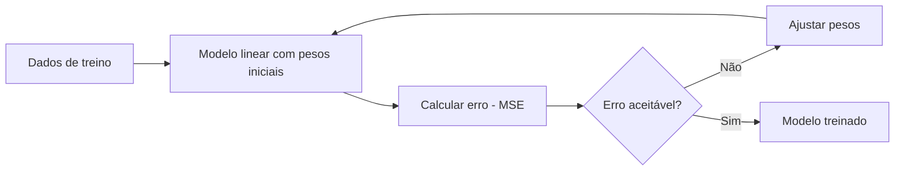

# Regressão Linear e Logística

Regressão linear e regressão logística são os dois primeiros algoritmos que praticamente todo material de Machine Learning ensina, e por um bom motivo: mesmo sendo simples, eles já trazem as ideias que vão aparecer em algoritmos muito mais complexos depois, como função de custo, otimização e regularização. Apesar do nome parecido, eles resolvem problemas diferentes: regressão linear prevê um número contínuo, regressão logística classifica.

## Regressão Linear

Regressão linear é um algoritmo supervisionado que tenta prever um valor contínuo (um número, não uma categoria) assumindo que existe uma relação linear entre a saída e as variáveis de entrada (as features).

Na forma mais simples, com uma única feature, a relação é a equação de uma reta:

```text
y = mx + b
```

Com várias features, a ideia se generaliza para:

```text
y = β₀ + β₁x₁ + β₂x₂ + ... + βₙxₙ
```

Aqui, `β₀` é o intercepto (o valor de `y` quando todas as features são zero) e cada `βᵢ` é o peso que mede o quanto a feature `xᵢ` influencia a previsão. Geometricamente, essa equação desenha uma reta quando há uma feature, um plano com duas features, e um hiperplano a partir de três.

### Como o modelo aprende os pesos

Treinar uma regressão linear é, na prática, encontrar os valores de `β` que façam a reta (ou plano, ou hiperplano) passar o mais perto possível dos dados reais. A forma padrão de medir "o mais perto possível" é o **MSE** (Mean Squared Error, erro quadrático médio):

```text
MSE = (1/n) · Σ (yᵢ - ŷᵢ)²
```

`yᵢ` é o valor real, `ŷᵢ` é o valor previsto pelo modelo, e elevar a diferença ao quadrado faz dois trabalhos ao mesmo tempo: elimina o sinal negativo (então erros para cima e para baixo não se cancelam) e penaliza mais os erros grandes.

Existem duas formas de encontrar os `β` que minimizam o MSE:

- **Equação normal**: uma solução analítica que calcula os pesos de uma vez, resolvendo `w* = (XᵀX)⁻¹Xᵀy`. Funciona bem para datasets pequenos, mas fica cara computacionalmente (e pode até ser inviável) quando há muitas features, porque envolve inverter uma matriz.
- **Gradiente descendente**: um método iterativo que ajusta os pesos pouco a pouco, na direção que reduz o erro. É a opção padrão para datasets grandes, justamente por não precisar inverter matriz nenhuma.



### Pressupostos

A regressão linear funciona bem quando alguns pressupostos são atendidos: a relação entre `X` e `y` é de fato linear, os resíduos (os erros) são independentes entre si, a variância do erro é constante ao longo dos dados (homocedasticidade), e não há multicolinearidade forte (features muito correlacionadas entre si, que confundem o modelo sobre qual delas é realmente responsável pelo efeito). Na prática, poucos datasets do mundo real atendem tudo isso perfeitamente, mas violações grandes desses pressupostos costumam ser o motivo de um modelo linear performar mal.

### Exemplo numérico

Imagine um modelo simples para prever o preço de um imóvel a partir da área, que aprendeu `preço = 2.000 · área + 50.000`. Para um imóvel de 80m², a previsão seria `2.000 × 80 + 50.000 = 210.000`. Se o imóvel realmente vendeu por 220.000, o erro dessa previsão foi de 10.000, e é esse tipo de erro, ao quadrado e somado para todos os imóveis do dataset, que o MSE mede.

### Implementação

```python
from sklearn.linear_model import LinearRegression
from sklearn.model_selection import train_test_split

X_train, X_test, y_train, y_test = train_test_split(X, y, test_size=0.2)

modelo = LinearRegression()
modelo.fit(X_train, y_train)
previsoes = modelo.predict(X_test)
```

## Regularização: Ridge, Lasso e Elastic Net

Com muitas features (ou features correlacionadas), uma regressão linear comum tende a dar pesos exagerados a algumas variáveis só para encaixar o ruído do treino, o que é um sintoma de overfitting (veja [Overfitting, underfitting e regularização](/labs/ai/machine-learning/02-preparacao-e-avaliacao-de-dados/) para a explicação geral desse problema). A solução é somar uma penalidade ao custo que o modelo está minimizando, para forçar os pesos a ficarem menores:

- **Ridge (regularização L2)**: soma `λ · Σβᵢ²` ao MSE. Encolhe todos os pesos de forma suave, mas raramente zera algum por completo.
- **Lasso (regularização L1)**: soma `λ · Σ|βᵢ|` ao MSE. Pode zerar coeficientes inteiros, o que funciona como uma seleção automática de features, as que o modelo zera são as que ele considerou pouco relevantes.
- **Elastic Net**: combina as duas penalidades, útil quando você quer um pouco de seleção de features (como o Lasso) sem perder a estabilidade do Ridge.

O hiperparâmetro `alpha` controla a força dessa penalidade: `alpha = 0` volta a ser uma regressão linear comum, e valores maiores encolhem os pesos com mais força.

```python
from sklearn.linear_model import Ridge, Lasso, ElasticNet

ridge = Ridge(alpha=1.0).fit(X_train, y_train)
lasso = Lasso(alpha=0.1).fit(X_train, y_train)
elastic = ElasticNet(alpha=0.1, l1_ratio=0.5).fit(X_train, y_train)
```

Na prática, Lasso é uma boa escolha quando você suspeita que só algumas features importam de verdade, Ridge funciona melhor quando todas as features têm algum peso relevante mas estão correlacionadas entre si.

## Regressão Logística

Apesar do nome, regressão logística não prevê um número, ela classifica. É um algoritmo supervisionado usado para classificação binária (duas classes, como "spam" ou "não spam"), que estima a probabilidade de uma entrada pertencer a uma das classes.

O cálculo começa igual ao da regressão linear, uma combinação linear das features:

```text
z = β₀ + β₁x₁ + β₂x₂ + ... + βₙxₙ
```

Mas em vez de usar esse `z` diretamente como resultado, ele passa pela **função sigmoide**, que comprime qualquer número real para o intervalo entre 0 e 1:

```text
σ(z) = 1 / (1 + e⁻ᶻ)
```

O resultado é interpretado como uma probabilidade. A regra de decisão padrão é: se `σ(z) ≥ 0,5`, o modelo prevê a classe 1, senão prevê a classe 0.

### Por que não usar MSE aqui

Seria tentador usar o mesmo MSE da regressão linear para treinar uma regressão logística, mas isso cria um problema: a combinação de MSE com a curva sigmoide gera uma superfície de custo não convexa, com vários mínimos locais, o que deixa o gradiente descendente propenso a ficar preso num ponto que não é o melhor possível.

A solução padrão é usar **Log Loss** (também chamada de entropia cruzada binária / Binary Cross-Entropy):

```text
L = -(1/n) · Σ [yᵢ · log(ŷᵢ) + (1 - yᵢ) · log(1 - ŷᵢ)]
```

Essa função penaliza muito mais pesado as previsões confiantes e erradas (por exemplo, prever 99% de chance de ser spam quando não é) do que as previsões incertas e erradas, e tem a vantagem de gerar uma superfície de custo convexa, bem mais fácil de otimizar.

### Multiclasse

Regressão logística nasceu para classificação binária, mas se estende para múltiplas classes de duas formas: **One-vs-Rest** (treina um classificador binário por classe, "é essa classe ou não é") ou **softmax** (regressão logística multinomial, que generaliza a sigmoide para várias classes de uma vez, produzindo uma distribuição de probabilidade sobre todas elas).

### Implementação

```python
from sklearn.linear_model import LogisticRegression

modelo = LogisticRegression(penalty="l2", C=1.0)
modelo.fit(X_train, y_train)
probabilidades = modelo.predict_proba(X_test)
```

No scikit-learn, a regularização L2 já vem ativada por padrão. O hiperparâmetro `C` é o inverso da força de regularização (valores menores de `C` significam regularização mais forte, o oposto do `alpha` do Ridge/Lasso), e `solver` escolhe o algoritmo de otimização usado internamente.

## Como avaliar os modelos

As métricas para medir a qualidade desses modelos (MAE, MSE, RMSE e R² para regressão; Accuracy, Precision, Recall, F1 e matriz de confusão para a classificação da logística) estão detalhadas em [Preparação e Avaliação de Dados](/labs/ai/machine-learning/02-preparacao-e-avaliacao-de-dados/), já que elas valem para qualquer algoritmo de regressão ou classificação, não só para esses dois.

Vale destacar só um ponto prático para a regressão logística: a escolha entre priorizar Precision ou Recall depende do custo de cada tipo de erro no seu problema. Num filtro de spam, um falso positivo (email importante marcado como spam) costuma ser mais grave que um falso negativo (um spam que passa), então faz sentido priorizar Precision. Já num exame médico para detectar uma doença grave, um falso negativo (doença que passa batido) é geralmente mais perigoso que um falso positivo, então Recall tende a importar mais.

## Referências

- [Regressão linear - documentação oficial do scikit-learn](https://scikit-learn.org/stable/modules/linear_model.html) - scikit-learn, en
- [Modelos de Machine Learning explicados](https://www.datacamp.com/pt/blog/machine-learning-models-explained) - DataCamp, pt-BR
- [Log Loss - documentação oficial do scikit-learn](https://scikit-learn.org/stable/modules/generated/sklearn.metrics.log_loss.html) - scikit-learn, en
