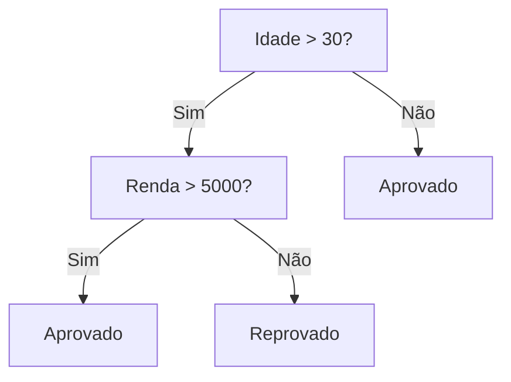
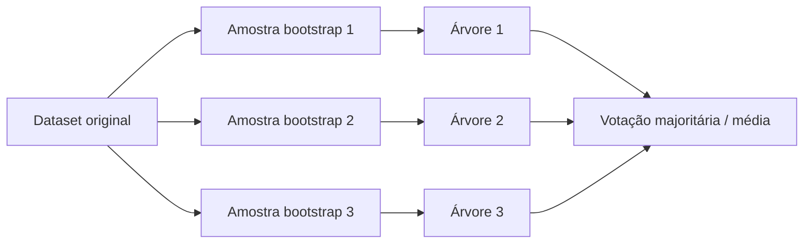
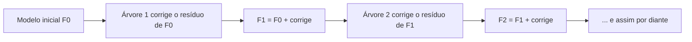

# Árvores de Decisão e Ensemble

## Árvore de Decisão (Decision Tree)

Uma árvore de decisão aprende a classificar (ou prever um número) fazendo uma sequência de perguntas sobre as features, uma de cada vez, até chegar numa resposta. É literalmente uma árvore: começa num **nó raiz**, passa por **nós internos** (cada um é um teste do tipo "idade > 30?") e termina numa **folha**, que carrega a predição final.



O algoritmo funciona tanto para classificação (prever uma categoria) quanto para regressão (prever um número), mas os critérios usados para decidir onde cortar a árvore mudam entre os dois casos.

### Como a árvore escolhe onde cortar

Em cada nó, o algoritmo testa várias features e vários pontos de corte, e escolhe o que deixa os grupos resultantes mais "puros" (com uma classe dominando). Existem duas formas clássicas de medir essa pureza:

**Entropia e Ganho de Informação** (usados no algoritmo original, o ID3):

```text
Entropia: H(S) = -Σ pᵢ log₂(pᵢ)
Ganho de Informação: IG(S, A) = H(S) - Σ (|Sᵥ|/|S|) H(Sᵥ)
```

A entropia mede o quão "misturado" está um conjunto de dados: 0 quando todas as amostras são da mesma classe, e máxima quando estão divididas igualmente entre as classes. O ganho de informação é só a redução de entropia que um determinado split proporciona, e a árvore escolhe o split que maximiza esse ganho.

**Índice Gini** (usado por padrão no scikit-learn, que implementa o algoritmo CART):

```text
Gini(S) = 1 - Σ pᵢ²
```

Na prática, Gini e entropia costumam concordar na maioria dos splits, a diferença entre os dois é mais de custo computacional (Gini não precisa calcular logaritmo, então é um pouco mais rápido) do que de qualidade do modelo final. Por isso o scikit-learn usa `criterion="gini"` como padrão em `DecisionTreeClassifier`, mas também aceita `"entropy"` e `"log_loss"` (uma variante moderna equivalente à entropia de Shannon).

### O problema de overfitting

Uma árvore sem limites cresce até separar perfeitamente os dados de treino, inclusive o ruído, e isso é exatamente o que você não quer: ela memoriza em vez de generalizar. É o problema central de árvores isoladas. As formas mais comuns de controlar isso:

- `max_depth`: limita a profundidade máxima da árvore
- `min_samples_split`: exige um número mínimo de amostras para permitir um novo split
- `min_samples_leaf`: exige um número mínimo de amostras em cada folha
- Poda (pruning): deixar a árvore crescer e depois cortar os ramos que não melhoram a performance em dados de validação

### Vantagens e desvantagens

Árvores de decisão são fáceis de visualizar e explicar (você literalmente desenha o fluxo de decisão) e não exigem normalizar as features antes de usar, já que cada split olha uma feature por vez, sem comparar escalas diferentes. O lado ruim é que são instáveis: uma pequena mudança nos dados de treino pode gerar uma árvore bem diferente. É exatamente esse ponto fraco que o Random Forest ataca.

```python
from sklearn.tree import DecisionTreeClassifier

modelo = DecisionTreeClassifier(criterion="gini", max_depth=5)
modelo.fit(X_treino, y_treino)
```

## Random Forest

Se uma árvore sozinha é instável, a solução é treinar várias árvores diferentes e combinar as respostas. É isso que o Random Forest faz, usando duas fontes de aleatoriedade para garantir que as árvores do conjunto não fiquem todas parecidas:

1. **Bagging (bootstrap aggregating)**: cada árvore é treinada numa amostra aleatória dos dados, sorteada com reposição (bootstrap sampling) - então cada árvore vê um subconjunto levemente diferente das linhas do dataset
2. **Seleção aleatória de features (random subspace)**: em cada split, a árvore só considera um subconjunto aleatório das colunas, não todas



A predição final é por votação majoritária (classificação) ou média (regressão) entre todas as árvores. O resultado é um modelo bem mais estável que uma árvore isolada, porque o erro de uma árvore específica tende a ser compensado pelas outras.

### Avaliação "de brinde": Out-of-Bag (OOB)

Como cada árvore só vê uma amostra bootstrap dos dados (em média, cerca de 63% das linhas originais), sobra uma fração de dados que ela nunca viu: as amostras "out-of-bag". O scikit-learn pode usar essas amostras para estimar o erro de generalização do modelo sem precisar separar um conjunto de validação só para isso (`oob_score=True`). É uma forma gratuita de validação cruzada.

### Importância de features

Depois de treinado, o Random Forest consegue estimar qual feature contribuiu mais para as decisões do conjunto todo, acessível via `feature_importances_`. É útil tanto para interpretar o modelo quanto para descartar features irrelevantes.

### Principais hiperparâmetros

- `n_estimators`: número de árvores no ensemble (padrão 100 no scikit-learn desde a versão 0.22)
- `max_depth`: profundidade máxima de cada árvore
- `max_features`: quantas features considerar em cada split (padrão `'sqrt'` para classificação, ou seja, raiz quadrada do total de features)
- `bootstrap`: se usa amostragem com reposição (padrão `True`)

```python
from sklearn.ensemble import RandomForestClassifier

modelo = RandomForestClassifier(n_estimators=100, max_features="sqrt", oob_score=True)
modelo.fit(X_treino, y_treino)
```

## Gradient Boosting e XGBoost

Random Forest treina as árvores em paralelo e combina os votos. O Gradient Boosting faz o oposto: treina as árvores **em sequência**, e cada árvore nova é treinada para corrigir o erro (o resíduo) que as árvores anteriores deixaram passar.



Formalmente, o modelo final é a soma do modelo inicial com os ajustes sucessivos, cada um multiplicado por uma taxa de aprendizado:

```text
Fₘ(x) = Fₘ₋₁(x) + η · hₘ(x)
```

Onde `hₘ` é a árvore treinada na iteração `m` (geralmente uma árvore rasa, um "weak learner") e `η` (eta) é a taxa de aprendizado: controla o quanto cada nova árvore pode mudar a previsão. Valores menores de `η` deixam o treino mais lento, mas costumam generalizar melhor.

### Boosting vs. Bagging: a diferença de fundo

|                    | Bagging (Random Forest)            | Boosting (Gradient Boosting)                       |
| ------------------ | ---------------------------------- | -------------------------------------------------- |
| Treino             | Árvores em paralelo, independentes | Árvores em sequência, cada uma depende da anterior |
| Objetivo principal | Reduzir variância                  | Reduzir viés                                       |
| Combinação         | Votação/média simples              | Soma ponderada e progressiva                       |

### XGBoost: o Gradient Boosting afiado

O XGBoost (Extreme Gradient Boosting) é uma implementação de Gradient Boosting que ficou popular por ser mais rápida e mais resistente a overfitting que a versão clássica. As duas diferenças centrais:

- Usa uma **aproximação de segunda ordem** da função de perda (via hessiana, o equivalente a usar informação de "curvatura", não só a "inclinação" do gradiente), o que torna cada passo de correção mais preciso
- Adiciona um termo de **regularização explícita** sobre o número de folhas e o peso de cada folha da árvore, penalizando árvores complexas demais

Isso faz o XGBoost (e primos como LightGBM) serem hoje uma escolha padrão para dados tabulares em competições e produção, muitas vezes superando redes neurais nesse tipo de dado.

### Principais hiperparâmetros

- `n_estimators`: número de árvores (iterações de boosting)
- `learning_rate`: a taxa de aprendizado `η`
- `max_depth`: profundidade de cada árvore (geralmente pequena, diferente do Random Forest)
- `subsample`: fração dos dados usada em cada iteração (adiciona um pouco de aleatoriedade, parecido com o bagging)

```python
from sklearn.ensemble import GradientBoostingClassifier

modelo = GradientBoostingClassifier(n_estimators=100, learning_rate=0.1, max_depth=3)
modelo.fit(X_treino, y_treino)
```

Para avaliar qualquer um desses modelos (árvore, Random Forest ou Gradient Boosting), use as métricas de classificação e regressão já descritas em [Preparação e Avaliação de Dados](/labs/ai/machine-learning/02-preparacao-e-avaliacao-de-dados/).

## Referências

- [Decision Trees - scikit-learn](https://scikit-learn.org/stable/modules/tree.html) - scikit-learn (documentação oficial), en
- [Ensemble methods - scikit-learn](https://scikit-learn.org/stable/modules/ensemble.html) - scikit-learn (documentação oficial), en
- [Florestas de decisão](https://developers.google.com/machine-learning/decision-forests/intro-to-decision-forests-real?hl=pt-br) - Google for Developers, pt-BR
- [Árvores de decisão com aumento de gradiente](https://developers.google.com/machine-learning/decision-forests/intro-to-gbdt?hl=pt-br) - Google for Developers, pt-BR
- [XGBoost: A Scalable Tree Boosting System](https://arxiv.org/abs/1603.02754) - Chen & Guestrin (2016), en
