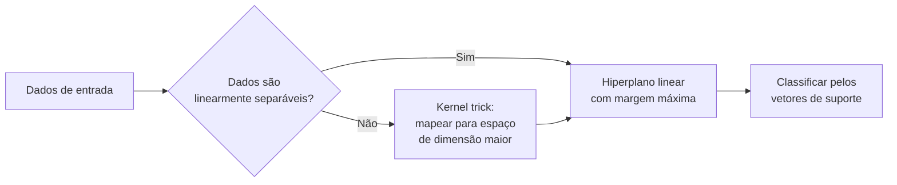
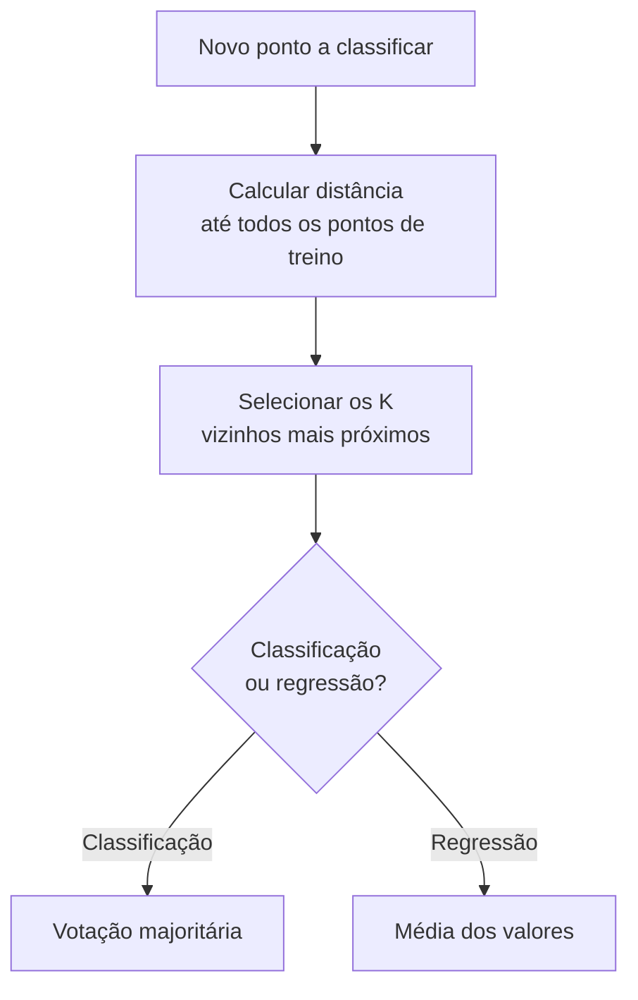

# SVM, KNN e Naive Bayes

Depois de ver regressão, árvores e ensemble, vale conhecer outros três algoritmos clássicos de classificação. Cada um ataca o problema de um jeito bem diferente: o SVM desenha uma fronteira geométrica, o KNN decide por proximidade e o Naive Bayes aposta em probabilidade. Saber quando cada um se encaixa poupa tempo de tentativa e erro.

## Support Vector Machine (SVM)

A ideia do SVM é simples de visualizar: dado um conjunto de pontos de duas classes, existem infinitas retas (ou planos, em mais dimensões) que conseguem separá-las. O SVM escolhe a que deixa a maior distância possível entre si e os pontos mais próximos de cada classe, essa distância é a **margem**.



A fronteira de decisão é descrita por uma função linear:

```text
f(x) = w·x + b
```

Os pontos exatamente sobre as duas retas que marcam a margem são chamados de **vetores de suporte**, são eles que definem a posição do hiperplano. Mover qualquer outro ponto, desde que não cruze a margem, não muda nada na fronteira. A largura da margem é `2/||w||`, então treinar um SVM é, no fundo, encontrar o `w` que maximiza essa margem.

### Quando os dados não são linearmente separáveis: o kernel trick

Na prática, poucos problemas reais têm uma separação limpa por uma reta. O **kernel trick** é o que torna o SVM capaz de lidar com isso: em vez de desenhar uma fronteira reta no espaço original dos dados, ele calcula a similaridade que os pontos teriam se fossem projetados para um espaço de dimensão muito maior, onde aí sim existe uma separação linear, sem nunca precisar calcular essa projeção de verdade. Isso economiza uma quantidade enorme de processamento.

Os kernels mais usados são:

- **Linear**: `K(x,x') = x·x'`, usado quando os dados já são (quase) linearmente separáveis
- **RBF/Gaussiano**: o padrão do `scikit-learn`, funciona bem na maioria dos casos
- **Sigmoide**: menos comum, lembra a função de ativação de redes neurais
- **Polinomial**: `K(x,x') = (γ(x·x') + r)^d`

Vale um cuidado com a fórmula do kernel polinomial: é comum encontrar material por aí que escreve essa fórmula sem o coeficiente `γ` (gamma), como se fosse só `(x·x' + c)^d`. Essa versão simplificada está incompleta, o `gamma` escala o produto interno antes de elevar ao grau `d` e faz diferença real no resultado. A implementação do `scikit-learn` usa a forma completa, com `gamma`.

### O parâmetro C e a margem suave (soft margin)

Exigir que todos os pontos fiquem perfeitamente do lado certo da margem (a chamada **hard margin**) é frágil: um único outlier pode forçar uma margem minúscula ou tornar o problema impossível de resolver. A solução é a **margem suave (soft margin)**: o modelo permite que alguns pontos fiquem do lado errado ou dentro da margem, mas paga um preço por isso através de variáveis de folga (`ξᵢ`, lê-se "csi"). O quanto esse preço pesa é controlado pelo hiperparâmetro `C`:

- **C grande**: o modelo erra pouco, margem mais estreita; tende a decorar os dados de treino (mais variância, risco de overfitting)
- **C pequeno**: o modelo tolera mais erros, margem mais larga; tende a generalizar melhor, mas pode errar demais (mais viés)

No kernel RBF, existe ainda o hiperparâmetro `gamma`, que controla o alcance de influência de cada ponto de treino: um `gamma` baixo faz cada ponto influenciar uma região grande (fronteira mais suave); um `gamma` alto restringe essa influência a uma vizinhança pequena (fronteira mais "recortada", com risco de overfitting).

### Na prática

No `scikit-learn`, o SVM está em `sklearn.svm.SVC`, com hiperparâmetros principais `C`, `kernel`, `gamma`, `degree` (grau do polinômio) e `coef0` (o `r` da fórmula do kernel polinomial). Para datasets muito grandes, o custo do SVM cresce rápido com o número de amostras, então vale considerar `LinearSVC` (otimizado para o caso linear) ou `SGDClassifier` com aproximação de kernel.

## K-Nearest Neighbors (KNN)

O KNN segue uma lógica quase ingênua: para classificar um ponto novo, olhe para os `K` pontos de treino mais próximos dele e vote pela classe mais comum entre eles. Em regressão, em vez de votar, tira-se a média dos valores dos vizinhos.



Isso faz do KNN um algoritmo **baseado em instância** e um exemplo de **lazy learning**: ele não "aprende" nada durante o treino, só guarda os dados. Todo o trabalho pesado acontece na hora de prever, quando precisa calcular a distância até cada ponto armazenado. Isso inverte o custo comum de outros algoritmos: treinar é instantâneo, prever é caro.

### Medindo distância

A métrica mais comum é a distância Euclidiana, a mesma de geometria básica:

```text
d(x,y) = √Σ(xᵢ - yᵢ)²
```

Outras opções incluem a distância de Manhattan (`Σ|xᵢ - yᵢ|`, soma das diferenças absolutas), a Minkowski (generalização que engloba Euclidiana e Manhattan como casos particulares) e a Hamming (para dados categóricos, conta quantas posições são diferentes).

### Por que normalizar os dados é obrigatório

O KNN trata todas as features igualmente no cálculo de distância, o que é um problema quando elas estão em escalas diferentes. Imagine prever o preço de um carro usando "quilometragem" (até centenas de milhares) e "número de portas" (de 2 a 5). Sem normalizar, a quilometragem domina completamente a distância, e o número de portas vira irrelevante, mesmo que ambas as features importem. Por isso, normalizar ou padronizar os dados (`MinMaxScaler` ou `StandardScaler` do `scikit-learn`) antes de treinar um KNN não é opcional, é parte do algoritmo funcionar corretamente.

### A maldição da dimensionalidade

Conforme o número de features (dimensões) aumenta, a ideia de "proximidade" começa a perder sentido: em espaços de alta dimensão, a distância entre o ponto mais próximo e o mais distante tende a ficar cada vez mais parecida, e todo mundo parece "igualmente distante" de todo mundo. Esse efeito, conhecido como **maldição da dimensionalidade**, é uma das razões pelas quais o KNN funciona bem em datasets com poucas features, mas degrada em datasets muito largos. Técnicas de redução de dimensionalidade, como o PCA (coberto em [Clustering e Redução de Dimensionalidade](/labs/ai/machine-learning/06-clustering-e-reducao-de-dimensionalidade/)), ajudam a mitigar isso.

### Escolhendo o valor de K

- **K pequeno** (ex: 1 ou 3): a classificação fica sensível a ruído, um único ponto estranho por perto pode mudar o resultado (alta variância)
- **K grande**: a fronteira de decisão fica mais suave, mas pode "borrar" padrões reais e misturar classes diferentes (alto viés)
- Em classificação binária, usar K ímpar evita empates no voto
- Na prática, o valor ideal de K é encontrado testando alguns candidatos com validação cruzada, não adivinhando de cara

No `scikit-learn`, isso vira `sklearn.neighbors.KNeighborsClassifier`, com o hiperparâmetro `weights='distance'` como variação útil: em vez de cada vizinho valer um voto igual, os mais próximos pesam mais que os mais distantes.

## Naive Bayes

O Naive Bayes parte de uma pergunta puramente probabilística: dado que observei estas features, qual é a classe mais provável? A resposta vem do Teorema de Bayes:

```text
P(C|X) = P(X|C) · P(C) / P(X)
```

Em português: a probabilidade da classe `C` dado que observei os dados `X` depende de quão provável seria observar `X` se a classe fosse `C` (`P(X|C)`), multiplicado pela probabilidade da classe `C` ocorrer no geral (`P(C)`), dividido por quão provável é observar `X` de qualquer forma (`P(X)`).

O problema é que calcular `P(X|C)` direto é difícil quando `X` é um conjunto de várias features, porque seria preciso conhecer a probabilidade conjunta de todas elas acontecerem juntas. É aqui que entra o "naive" (ingênuo) do nome: o algoritmo assume que todas as features são **condicionalmente independentes entre si**, dado a classe. Essa suposição raramente é 100% verdadeira na realidade, mas simplifica a conta de um jeito que funciona bem o suficiente na prática:

```text
P(x₁, x₂, ..., xₙ | C) = P(x₁|C) · P(x₂|C) · ... · P(xₙ|C) = Π P(xᵢ|C)
```

Vale notar essa diferença: o Teorema de Bayes puro, sozinho, não diz nada sobre independência entre features, isso é a parte "naive" que o algoritmo adiciona. Com essa simplificação, a predição final escolhe a classe que maximiza o produto das probabilidades (regra conhecida como MAP, Maximum A Posteriori):

```text
classe prevista = argmax_C [ P(C) · Π P(xᵢ|C) ]
```

### Variantes por tipo de dado

O `scikit-learn` oferece implementações diferentes dependendo do tipo das features:

- **GaussianNB**: para features contínuas, assume que cada uma segue uma distribuição normal dentro de cada classe
- **MultinomialNB**: para dados de contagem, o exemplo clássico é frequência de palavras em classificação de texto
- **BernoulliNB**: para features binárias (presença ou ausência de algo)
- **CategoricalNB**: para features categóricas puras

### O problema da frequência zero

Se uma combinação de feature e classe nunca aparece nos dados de treino, a probabilidade estimada para ela é zero, e como a fórmula multiplica todas as probabilidades, um único zero zera o produto inteiro, mesmo que todas as outras features apontem fortemente para aquela classe. A solução padrão é a **suavização de Laplace** (também chamada de suavização aditiva): soma-se uma pequena constante (o hiperparâmetro `alpha`, geralmente 1) a todas as contagens, garantindo que nenhuma probabilidade chegue a zero de verdade.

### Por que usar Naive Bayes

É rápido de treinar e prever, funciona bem mesmo com poucos dados e lida de forma surpreendentemente boa com datasets de alta dimensionalidade, como classificação de texto, onde cada palavra do vocabulário é uma feature. A contrapartida é a suposição de independência: quando as features são fortemente correlacionadas entre si, o modelo tende a ser menos preciso que alternativas como Random Forest ou SVM.

## Referências

- [Support Vector Machines - scikit-learn (user guide)](https://scikit-learn.org/stable/modules/svm.html) - scikit-learn, en
- [Nearest Neighbors - scikit-learn (user guide)](https://scikit-learn.org/stable/modules/neighbors.html) - scikit-learn, en
- [Naive Bayes - scikit-learn (user guide)](https://scikit-learn.org/stable/modules/naive_bayes.html) - scikit-learn, en
- [Machine Learning Models Explained](https://www.datacamp.com/pt/blog/machine-learning-models-explained) - DataCamp, pt-BR
