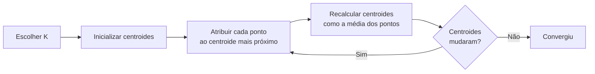

# Clustering e Redução de Dimensionalidade

Até agora, os algoritmos vistos nesta seção aprendiam a partir de exemplos com resposta certa (regressão, classificação). Clustering e redução de dimensionalidade são o outro lado do aprendizado não supervisionado: não existe rótulo nenhum, só os dados. O objetivo aqui é achar estrutura escondida, seja agrupando pontos parecidos (clustering) ou simplificando quantas colunas descrevem cada ponto (redução de dimensionalidade).

## K-Means

O K-Means é o algoritmo mais usado para agrupar dados em clusters, e também o mais simples de entender. A ideia: escolher `K` pontos centrais (centroides) e empurrar cada ponto do dataset para o centroide mais próximo dele.

O objetivo matemático do algoritmo é minimizar a **inércia**, também chamada de WCSS (_within-cluster sum of squares_): a soma dos quadrados das distâncias de cada ponto até o centroide do seu cluster. Quanto menor a inércia, mais "compactos" os clusters ficaram.

O problema é que essa otimização não é convexa: dependendo de onde os centroides começam, o algoritmo pode travar em um mínimo local, um agrupamento pior do que o ideal. Duas práticas resolvem isso na prática:

- **`k-means++`**: em vez de sortear os centroides iniciais de forma totalmente aleatória, essa estratégia escolhe os primeiros centroides espalhados entre si, o que reduz bastante a chance de começar com uma inicialização ruim. É o padrão do scikit-learn.
- **`n_init`**: roda o K-Means várias vezes com inicializações diferentes e mantém o resultado com menor inércia. Custa mais processamento, mas evita depender de sorte.

Falta resolver uma pergunta: como escolher `K`? Duas abordagens comuns:

- **Método do Cotovelo (Elbow Method)**: roda o K-Means para vários valores de K e plota a inércia de cada um. A inércia sempre cai conforme K aumenta (no limite, com K = número de pontos, ela chega a zero), mas o gráfico costuma ter um "cotovelo", um ponto onde a queda desacelera bastante. Esse ponto é um bom candidato de K.
- **Silhouette Score**: mede, para cada ponto, o quão bem ele se encaixa no próprio cluster comparado aos clusters vizinhos. Varia de -1 a 1, e valores mais altos indicam clusters mais bem definidos. Dá para calcular esse score para vários valores de K e escolher o que maximiza ele.

O K-Means tem duas limitações que valem ter em mente antes de usar: ele exige que você defina `K` de antemão (diferente do DBSCAN, visto a seguir), e usa distância Euclidiana para medir proximidade, o que funciona bem em poucas dimensões mas degrada conforme o número de features cresce (o mesmo problema de "maldição da dimensionalidade" que afeta o KNN).

## Clustering Hierárquico

Em vez de already partir direto para K clusters, o clustering hierárquico constrói uma árvore de agrupamentos, do zero até todos os pontos juntos (ou o caminho inverso). O resultado visual chama-se **dendrograma**, um diagrama em árvore que mostra em que "altura" (distância) cada par de clusters foi unido.

Existem duas direções possíveis:

- **Aglomerativa (bottom-up)**: começa com cada ponto como seu próprio cluster e vai juntando os dois clusters mais próximos, repetidamente, até sobrar um único cluster com tudo dentro. É a abordagem mais usada na prática.
- **Divisiva (top-down)**: o caminho contrário, começa com todos os pontos num cluster só e vai dividindo recursivamente. É bem menos comum, porque decidir "onde cortar" em cada divisão é mais caro computacionalmente.

Para decidir qual par de clusters está "mais próximo", é preciso de uma métrica de distância entre pontos:

- **Euclidiana**: distância em linha reta, a mais comum.
- **Manhattan**: soma das diferenças absolutas em cada eixo (como andar em quarteirões de uma cidade, sem diagonal).
- **Cosseno**: mede o ângulo entre dois vetores, ignorando o tamanho deles. Costuma aparecer em clustering de texto, onde a "direção" do vetor importa mais que a magnitude.

A grande vantagem do clustering hierárquico sobre o K-Means é que você não precisa decidir `K` antes de rodar o algoritmo. Com o dendrograma pronto, basta "cortar" a árvore na altura desejada para obter o número de clusters que fizer sentido.

## DBSCAN

O DBSCAN (_Density-Based Spatial Clustering of Applications with Noise_) ataca o problema de um jeito bem diferente: em vez de pensar em centroides ou distância total, ele define cluster como uma região **densa** de pontos.

Dois parâmetros controlam isso:

- **`eps`**: o raio de uma vizinhança em torno de cada ponto.
- **`minPts`**: o número mínimo de pontos que precisam estar dentro desse raio para considerar a região "densa".

Um ponto com pelo menos `minPts` vizinhos dentro do raio `eps` se torna um ponto central de um cluster. Pontos que estão dentro do raio de um ponto central, mas não têm vizinhos suficientes por conta própria, entram no cluster como pontos de borda. E pontos que não se encaixam em nenhuma dessas situações são marcados como **ruído** (outliers), não pertencem a cluster nenhum.

Isso dá ao DBSCAN duas vantagens importantes sobre o K-Means:

- Não exige que você defina o número de clusters de antemão, ele emerge da densidade dos dados.
- Encontra clusters de formato arbitrário (não só blobs redondos), porque não depende da distância até um centroide central.

O preço a pagar é que `eps` e `minPts` precisam ser ajustados ao dataset, e o algoritmo tende a performar mal quando os clusters têm densidades muito diferentes entre si.

## Gaussian Mixture Model (GMM)

O GMM pode ser visto como uma versão mais flexível do K-Means. Em vez de assumir que cada cluster é um blob circular ao redor de um centroide, o GMM assume que os dados vêm de uma mistura de várias distribuições gaussianas (a famosa "curva de sino"), cada uma com seu próprio centro, formato e orientação.

Isso traz duas diferenças práticas importantes:

- **Clusters elípticos**: como cada gaussiana tem sua própria "forma" (definida por uma matriz de covariância), o GMM consegue capturar clusters alongados ou inclinados, algo que o K-Means não faz (ele sempre assume clusters esféricos).
- **Atribuição probabilística (soft clustering)**: no K-Means, cada ponto pertence a exatamente um cluster. No GMM, cada ponto recebe uma probabilidade de pertencer a cada cluster. Um ponto na fronteira entre dois grupos pode ter 60% de chance de estar no cluster A e 40% no cluster B, em vez de ser forçado a escolher um dos dois.

O treinamento do GMM usa o algoritmo **Expectation-Maximization (EM)**, que alterna entre duas etapas: estimar a probabilidade de cada ponto pertencer a cada gaussiana (Expectation) e depois ajustar os parâmetros de cada gaussiana para maximizar essas probabilidades (Maximization). Esse ciclo se repete até os parâmetros pararem de mudar significativamente.

## Métricas de avaliação de clustering

Clustering é aprendizado não supervisionado, então não existe "resposta certa" para comparar, como fazemos com accuracy ou F1 em classificação. Em vez disso, essas métricas avaliam a qualidade da estrutura encontrada:

- **Silhouette Score**: já mencionado no K-Means, mede o quão bem cada ponto se encaixa no próprio cluster em comparação aos clusters vizinhos. Varia de -1 a 1.
- **Davies-Bouldin Index**: compara a dispersão dentro de cada cluster com a distância entre os clusters. Quanto menor o valor, melhor (clusters compactos e bem separados).
- **Calinski-Harabasz Index**: também conhecido como "critério da razão de variância", compara a dispersão entre clusters com a dispersão dentro dos clusters. Quanto maior o valor, melhor.

Na prática, nenhuma dessas métricas é perfeita isoladamente. É comum usar mais de uma e, sempre que possível, visualizar os clusters (em 2D ou 3D, com ajuda de PCA ou t-SNE) para checar se o resultado faz sentido.

## Redução de Dimensionalidade: PCA

Datasets reais costumam ter dezenas ou centenas de colunas (features), muitas delas correlacionadas entre si. O PCA (_Principal Component Analysis_) resolve isso transformando essas features originais em um novo conjunto de variáveis, os **componentes principais**, que não são correlacionadas entre si e capturam a maior variância possível dos dados originais.

O algoritmo segue estes passos:

1. **Padronizar os dados**: como PCA é sensível à escala das variáveis, primeiro padroniza-se cada feature para média zero e desvio padrão um: `Z = (X - μ) / σ`.
2. **Calcular a matriz de covariância**: essa matriz resume como cada par de features varia em conjunto.
3. **Decompor em autovalores e autovetores** (ou, de forma mais robusta numericamente, via SVD, _Singular Value Decomposition_, da matriz de dados): cada autovetor indica uma direção no espaço de features, e o autovalor correspondente indica quanta variância dos dados está capturada naquela direção.
4. **Selecionar os K componentes principais**: os autovetores com maiores autovalores, ou seja, as direções que capturam mais variância.
5. **Projetar os dados** nesses K componentes, reduzindo o número de colunas sem perder (muita) informação.

Uma pergunta prática inevitável é "quantos componentes eu mantenho?". O scikit-learn expõe o atributo `explained_variance_ratio_`, que mostra qual fração da variância total cada componente captura. Um jeito comum de decidir é somar essas frações até atingir um valor "bom o suficiente" (por exemplo, 95% da variância original) e manter só os componentes necessários para chegar lá.

A limitação central do PCA é que ele assume relações **lineares** entre as features. Se a estrutura dos dados é curva ou tem padrões não lineares, o PCA perde informação importante, e aí entram alternativas como o t-SNE.

## t-SNE e visualização de alta dimensão

O t-SNE (_t-Distributed Stochastic Neighbor Embedding_) não é um substituto direto do PCA, ele serve a um propósito diferente: **visualizar** dados de alta dimensão em 2D ou 3D, preservando a proximidade local entre os pontos. Dois pontos que estão próximos no espaço original de muitas dimensões tendem a aparecer próximos também no gráfico final.

Isso difere do PCA de um jeito importante: o PCA busca preservar a variância global dos dados (boa para redução de dimensionalidade "geral", usada depois em outro modelo), enquanto o t-SNE prioriza preservar vizinhanças locais, o que o torna ótimo para enxergar clusters visualmente, mas não tão útil como etapa de pré-processamento antes de outro algoritmo.

Uma prática recomendada quando o dataset tem muitas features: aplicar PCA primeiro para reduzir a dimensionalidade a algumas dezenas de componentes, e só então rodar o t-SNE sobre esse resultado. Isso acelera bastante o cálculo do t-SNE, que é computacionalmente custoso em datasets grandes.

O UMAP (_Uniform Manifold Approximation and Projection_) é uma alternativa mais recente ao t-SNE, com visualizações parecidas mas tempo de execução geralmente menor, o que tem feito ele ganhar espaço em pipelines que antes usavam t-SNE por padrão.

## Referências

- [Clustering - scikit-learn user guide](https://scikit-learn.org/stable/modules/clustering.html) - scikit-learn, en
- [Decomposing signals in components (PCA) - scikit-learn user guide](https://scikit-learn.org/stable/modules/decomposition.html#pca) - scikit-learn, en
- [Aprendizado não supervisionado: o que é e como funciona](https://www.alura.com.br/artigos/aprendizado-nao-supervisionado) - Alura, pt-BR
- [t-SNE: Como funciona o algoritmo de redução de dimensionalidade](https://www.datacamp.com/pt/tutorial/introduction-t-sne) - DataCamp, pt-BR
