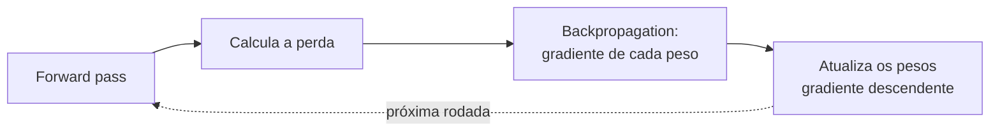
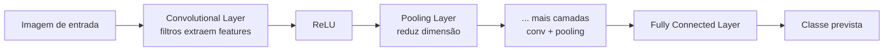
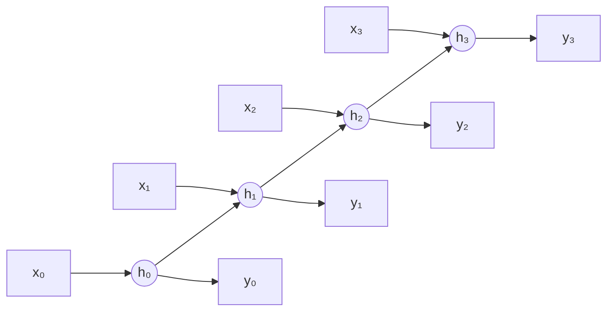

# Redes Neurais: Backpropagation, CNN e RNN

A nota [Como as Redes Neurais Funcionam](/labs/ai/fundamentos/03-redes-neurais/) mostra a ideia geral: camadas de neurônios que recebem dados, processam padrões e produzem uma saída. Aqui a gente desce um nível: como o neurônio calcula sua saída, como a rede aprende de fato (backpropagation) e duas famílias de arquitetura que nasceram para resolver problemas específicos - imagem (CNN) e sequência (RNN). A arquitetura Transformer, que resolveu sequência de um jeito diferente e virou a base dos LLMs, já tem uma nota própria e bem mais profunda em [Como uma LLM gera texto](/labs/ai/llm/05-como-uma-llm-gera-texto/) - aqui só vale a ponte histórica no final.

## O neurônio e o forward pass

Cada neurônio artificial faz a mesma conta, por mais complexa que a rede pareça por fora: soma ponderada das entradas, mais um termo de ajuste, seguida de uma função de ativação.

```text
z = Σ wᵢxᵢ + b
a = φ(z)
```

`w` são os pesos (o quanto cada entrada importa), `b` é o bias (desloca o resultado, útil quando todas as entradas são zero) e `φ` é a função de ativação, que decide se e o quanto aquele neurônio "dispara". Passar os dados por todas as camadas até chegar na saída é o **forward pass**.

Sem a função de ativação, empilhar camadas não ajudaria em nada: uma sequência de transformações lineares continua sendo uma transformação linear, então a rede só conseguiria aprender relações lineares, não importa quantas camadas você adicione. A não linearidade é o que permite a uma rede aprender fronteiras de decisão curvas, hierarquias de padrões, qualquer coisa que uma reta não resolve.

As funções de ativação mais usadas hoje:

- **ReLU** (Rectified Linear Unit): `f(x) = max(0, x)`. Zera tudo que é negativo e deixa passar o resto sem alteração. É a escolha padrão em camadas ocultas porque é barata de calcular e evita boa parte do problema de **vanishing gradient** (gradiente que encolhe tanto ao passar por várias camadas que os pesos das primeiras camadas praticamente não se atualizam).
- **Sigmoid** e **Tanh**: comprimem a saída entre 0 e 1 (sigmoid) ou entre -1 e 1 (tanh). O problema é que, para entradas muito grandes ou muito pequenas, a curva fica quase plana (saturação), e aí o gradiente que passa por ali vira praticamente zero. Hoje aparecem menos em camadas ocultas, mas sigmoid ainda é comum na saída de classificação binária.
- **Softmax**: usada na camada de saída de classificação multiclasse. Transforma um vetor de números quaisquer numa distribuição de probabilidade (tudo entre 0 e 1, somando 1), então a saída já vem no formato "qual a chance de cada classe".

Um problema prático da ReLU é a **"ReLU morta"**: se um neurônio acumula pesos que o levam sempre para o lado negativo, sua saída fica travada em zero e o gradiente que passa por ele também é zero, então ele nunca mais se atualiza. Duas saídas comuns: reduzir a taxa de aprendizado (evita que um passo de treino "empurre" o neurônio demais para o lado negativo) ou trocar por **Leaky ReLU**, uma variante que deixa passar uma fração pequena dos valores negativos em vez de zerá-los completamente.

## Backpropagation: como a rede aprende de fato

O forward pass produz uma previsão. Para saber o quão errada ela está, a rede compara com o valor real usando uma **função de perda** (loss function):

- **MSE** (erro quadrático médio) para regressão
- **Cross-Entropy** para classificação

O número que sai dessa função é só o começo. O que realmente ajusta a rede é o **backpropagation**: o algoritmo que calcula o quanto cada peso contribuiu para o erro final, e em que direção ele deveria mudar para reduzir esse erro.



A matemática por trás é a **regra da cadeia** do cálculo: o erro na saída depende dos pesos da última camada, que dependem da saída da camada anterior, que depende dos pesos dela, e assim por diante até a primeira camada. Backpropagation percorre esse caminho de trás para frente, calculando o gradiente (a derivada do erro) em relação a cada peso da rede numa única passada eficiente, em vez de recalcular tudo do zero para cada peso individualmente.

Com o gradiente de cada peso em mãos, o **gradiente descendente** dá o passo de atualização: cada peso se move um pouco na direção contrária ao seu gradiente, proporcional a uma taxa de aprendizado. O problema do gradiente descendente "puro" é que ele pode ser lento ou ficar balançando em superfícies de erro irregulares, daí as variantes:

- **Momentum**: acumula uma média das direções anteriores, como uma bola que ganha inércia rolando morro abaixo. Ajuda a atravessar vales estreitos sem ficar oscilando de um lado para o outro.
- **Adam**: combina a ideia do momentum com uma taxa de aprendizado adaptativa por parâmetro (ajusta o tamanho do passo individualmente para cada peso, com base no histórico dos seus próprios gradientes). É o otimizador padrão na maioria dos projetos de deep learning hoje, por convergir rápido sem exigir muito ajuste manual.

## Convolutional Neural Networks (CNN)

Para imagem, usar uma rede totalmente conectada (todo neurônio ligado a todo pixel) seria inviável: uma foto de 224x224 pixels já tem mais de 150 mil valores de entrada, e a rede perderia completamente a noção de que pixels vizinhos formam padrões espaciais (bordas, texturas, formas). A **CNN** resolve isso com camadas especializadas que aprendem padrões locais e os reaproveitam pela imagem inteira.



- **Convolutional Layer**: passa pequenos filtros (ex: 3x3 pixels) sobre a imagem, cada um aprendendo a detectar um padrão específico (uma borda vertical, uma textura, uma curva). O mesmo filtro é aplicado em toda a imagem, então a rede aprende um padrão uma vez e o reconhece em qualquer posição.
- **ReLU**: aplicada depois de cada convolução, do mesmo jeito que em uma rede comum.
- **Pooling Layer**: reduz o tamanho espacial do mapa de features, geralmente pegando o valor máximo de cada pequena região (**max pooling**). Isso diminui o custo computacional das camadas seguintes e torna a rede um pouco mais tolerante a pequenos deslocamentos do objeto na imagem.
- **Fully Connected Layer**: depois de várias rodadas de convolução + pooling, o mapa de features já reduzido é achatado num vetor e passa por camadas comuns, terminando numa saída de classificação (geralmente com softmax).

Nas primeiras camadas, os filtros tendem a aprender padrões simples (bordas, cantos); nas camadas mais profundas, combinações desses padrões formam conceitos mais complexos (um olho, uma roda, um rosto inteiro). Três termos que aparecem direto na prática:

- **Stride**: de quantos pixels em quantos o filtro se move a cada passo. Stride maior reduz o tamanho da saída mais rápido.
- **Padding**: preencher as bordas da imagem (geralmente com zeros) para controlar o tamanho da saída e evitar perder informação das bordas.
- **Receptive field**: a região da imagem original que influencia um determinado neurônio de uma camada mais profunda. Quanto mais profunda a camada, maior o receptive field, até que um neurônio da camada final pode estar "vendo" a imagem inteira indiretamente.

CNNs são a base de classificação de imagem, reconhecimento facial, análise de imagem médica (raio-x, tomografia) e detecção de objetos em geral.

## Recurrent Neural Networks (RNN) e variantes

Imagem tem estrutura espacial fixa; texto, áudio e séries temporais têm estrutura **sequencial**: a ordem importa, e o significado de um item depende do que veio antes. A **RNN** foi desenhada para isso: em vez de processar tudo de uma vez, ela processa a sequência passo a passo, mantendo um **estado oculto** que carrega um resumo do que já foi visto.



Os mesmos pesos são reaplicados em cada passo de tempo, então a rede não precisa de um conjunto de parâmetros diferente para cada posição da sequência. O problema é que, em sequências longas, o gradiente que volta lá da última posição até as primeiras precisa atravessar muitos passos de multiplicação, e aí o mesmo **vanishing gradient** das redes profundas aparece de novo, só que no eixo do tempo em vez do eixo das camadas: a rede "esquece" o que aconteceu muitos passos atrás.

Duas variantes resolveram isso adicionando **portões** (gates) que controlam o fluxo de informação:

- **LSTM** (Long Short-Term Memory): mantém um "estado de célula" separado do estado oculto, controlado por três portões - o de **esquecimento** (decide o que descartar do estado anterior), o de **entrada** (decide o que incorporar da entrada atual) e o de **saída** (decide o que expor como saída naquele passo). Essa estrutura permite que informação relevante atravesse muitos passos de tempo sem se diluir.
- **GRU** (Gated Recurrent Unit): uma versão mais simples, que funde os portões de esquecimento e entrada num único "portão de atualização". Tem menos parâmetros que o LSTM, treina mais rápido e, para muitas tarefas, entrega desempenho equivalente.

RNN, LSTM e GRU dominaram tradução automática, geração de texto e reconhecimento de fala por anos, mas têm uma limitação estrutural: o processamento é sequencial por natureza (o cálculo do passo `t` depende do passo `t-1`), o que impede paralelizar o treino ao longo do tempo. Foi exatamente esse ponto que o **Transformer** resolveu ao trocar a recorrência por um mecanismo de atenção que compara todos os tokens entre si de uma vez, o que tanto paraleliza melhor o treino quanto captura dependências de longo alcance sem o gargalo do estado oculto sequencial. Esse mecanismo, incluindo self-attention e multi-head attention, está detalhado em [Como uma LLM gera texto](/labs/ai/llm/05-como-uma-llm-gera-texto/).

## Referências

- [Neural Networks and Deep Learning](http://neuralnetworksanddeeplearning.com/) - Michael Nielsen, en
- [Understanding LSTM Networks](https://colah.github.io/posts/2015-08-Understanding-LSTMs/) - Christopher Olah, en
- [CS231n: Convolutional Neural Networks for Visual Recognition](https://cs231n.stanford.edu/) - Stanford University, en
- [Backpropagation algorithm](https://developers.google.com/machine-learning/crash-course/neural-networks/backpropagation) - Google Machine Learning Crash Course, en
