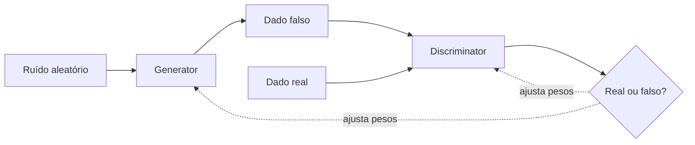
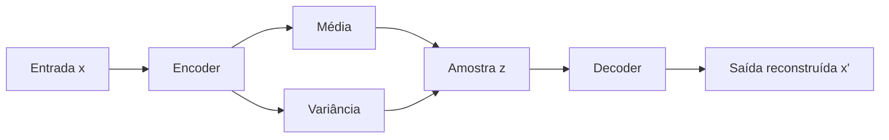
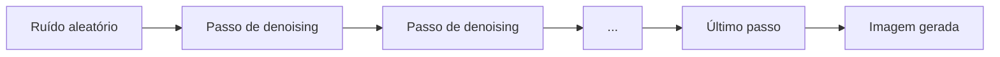

# GAN, VAE e Modelos de Difusão

## Por que esta nota existe

Essas três arquiteturas geram conteúdo novo, principalmente imagem, sem passar pelo caminho "LLM baseado em Transformer" já coberto em [Como uma LLM gera texto](/labs/ai/llm/05-como-uma-llm-gera-texto/). São a base de ferramentas como Stable Diffusion, DALL-E e StyleGAN, e entender as três ajuda a situar por que a geração de imagem evoluiu do jeito que evoluiu nos últimos anos.

## Generative Adversarial Networks (GAN)

Uma GAN (Generative Adversarial Network) é formada por duas redes neurais que competem entre si:

- **Generator (gerador)**: parte de ruído aleatório e tenta produzir dados falsos que pareçam reais (por exemplo, uma imagem de rosto)
- **Discriminator (discriminador)**: recebe uma mistura de dados reais e dados gerados e tenta dizer qual é qual



O treino é um jogo de soma zero: o gerador melhora para enganar o discriminador, e o discriminador melhora para não ser enganado. Essa competição é formalizada por uma função minimax:

```text
min(G) max(D) V(D,G) = E[log D(x)] + E[log(1 - D(G(z)))]
```

O discriminador quer maximizar essa expressão (acertar os reais como reais e os falsos como falsos), e o gerador quer minimizá-la (fazer o discriminador errar nos dados gerados). As duas redes são treinadas em rodadas alternadas: congela-se uma enquanto a outra atualiza seus pesos. No ponto de equilíbrio teórico, o discriminador não consegue mais distinguir real de falso e passa a prever 1/2 para qualquer entrada, mas chegar perto desse equilíbrio na prática é a parte difícil.

### O problema do treino instável

GANs têm fama de serem complicadas de treinar. O objetivo adversarial facilmente desequilibra: se o discriminador fica bom demais rápido demais, o gerador para de receber um sinal de gradiente útil para melhorar. O problema mais citado é o **mode collapse**: o gerador descobre um punhado de saídas que enganam bem o discriminador e passa a repeti-las, perdendo a variedade que os dados reais têm.

### Onde as GANs ainda fazem sentido

GANs dominaram a geração de imagem até por volta de 2021-2022. Depois disso, os modelos de difusão (que você vê mais abaixo) assumiram a liderança na maioria dos produtos comerciais, porque treinam de forma mais estável e geram resultados com mais qualidade e diversidade. Mas a vantagem histórica das GANs continua valendo em um ponto: elas geram uma imagem numa única passada pela rede, o que as torna muito mais rápidas na inferência. Por isso ainda aparecem em cenários onde velocidade é crítica, como super-resolução em tempo real ou edição interativa.

O **StyleGAN**, da NVIDIA, segue como referência de qualidade para geração de rostos realistas e é um bom exemplo de como uma arquitetura GAN bem ajustada ainda compete de perto com difusão em tarefas específicas.

## Variational Autoencoders (VAE)

Um autoencoder comum aprende a comprimir uma entrada em um vetor (o "espaço latente") e depois reconstruir essa entrada a partir do vetor. O problema é que esse espaço latente costuma ficar "esburacado": pontos entre dois exemplos conhecidos não necessariamente geram algo que faça sentido.

O **Variational Autoencoder (VAE)** resolve isso mudando o que o encoder produz. Em vez de mapear a entrada para um único ponto, ele mapeia para os parâmetros de uma distribuição de probabilidade, geralmente gaussiana (uma média e uma variância). O decoder então reconstrói o dado a partir de uma amostra sorteada dessa distribuição.



Essa mudança tem duas consequências boas:

- O espaço latente fica **contínuo**: como cada ponto vem de uma distribuição, pontos vizinhos tendem a gerar saídas parecidas, o que permite interpolar entre dois exemplos de forma suave
- É possível **gerar dados novos** amostrando direto do espaço latente, sem precisar de uma entrada real para comprimir

### O truque da reparametrização

Tem um detalhe técnico que resolve um problema real de treino: como amostrar de uma distribuição é um processo aleatório, não dá para calcular o gradiente dessa etapa diretamente (backpropagation precisa de uma cadeia de operações diferenciáveis). O **reparameterization trick** contorna isso separando a parte aleatória da parte aprendida: em vez de amostrar `z` direto da distribuição do encoder, o modelo amostra um ruído de uma normal padrão e escala esse ruído pelos parâmetros (média e variância) que o encoder calculou. Assim, o gradiente consegue fluir pela média e pela variância normalmente, e só o ruído em si fica fora do cálculo do gradiente.

### O que o modelo otimiza

O objetivo de treino do VAE é o **ELBO** (Evidence Lower Bound), que combina dois termos:

- **Termo de reconstrução**: o quanto a saída do decoder se parece com a entrada original
- **Termo de regularização**: uma divergência KL que empurra a distribuição latente aprendida para ficar perto de uma normal padrão, evitando que o modelo "decore" pontos isolados em vez de aprender uma estrutura organizada

### Onde VAEs são usados hoje

VAEs puros caíram de popularidade para gerar imagens fotorrealistas isoladamente, porque GANs e difusão entregam resultados mais nítidos. Mas a ideia continua muito viva como peça dentro de arquiteturas maiores: o Stable Diffusion, por exemplo, usa um VAE para comprimir imagens a um espaço latente menor antes de aplicar a difusão (mais sobre isso já na próxima seção). VAEs também aparecem bastante em biologia computacional e descoberta de fármacos, onde interpolar suavemente entre moléculas no espaço latente é útil.

## Modelos de Difusão

A ideia central de um modelo de difusão é diferente das duas anteriores: em vez de competir (GAN) ou comprimir e reconstruir (VAE), ele aprende a **reverter um processo de ruído**. No treino, o modelo vê uma imagem real com ruído gaussiano adicionado em quantidades crescentes, até ela virar puro ruído, e aprende a prever, em cada etapa, qual ruído foi adicionado. Na geração, o processo roda ao contrário: começa de ruído aleatório puro e, passo a passo, remove ruído até sobrar uma imagem coerente.



### Difusão em pixels vs. difusão latente

Rodar esse processo direto sobre os pixels de uma imagem de alta resolução é caro: cada passo de denoising processa a imagem inteira, e são necessários muitos passos. O **Stable Diffusion** resolve isso aplicando a difusão num **espaço latente comprimido**, gerado por um VAE (o mesmo tipo de arquitetura da seção anterior) treinado só para comprimir e descomprimir imagens. O processo de ruído e denoising roda nesse espaço menor, bem mais barato computacionalmente, e só na etapa final o decoder do VAE converte o resultado de volta para pixels.

### O pipeline completo de um sistema text-to-image

Um sistema como o Stable Diffusion não é só "o modelo de difusão". O pipeline típico junta várias peças:

- Um modelo de embedding de texto (como o **CLIP**), que transforma o prompt em um vetor que guia a geração
- O modelo de difusão propriamente dito, que remove ruído passo a passo nesse espaço latente, condicionado pelo embedding do texto
- Um **decodificador de imagem** (o decoder do VAE), que converte o resultado final do espaço latente de volta para pixels
- Um **scheduler**, que define como o ruído é distribuído ao longo dos passos de treino e quantos passos a geração vai usar

### Difusão vs. GAN, na prática

O trade-off entre as duas abordagens é direto: modelos de difusão treinam de forma mais estável (sem o jogo adversarial que pode desequilibrar) e costumam entregar mais qualidade e diversidade, mas pagam o preço na inferência, que exige várias dezenas de passos de denoising em vez de uma única passada. É por isso que boa parte da pesquisa recente em difusão foca em reduzir esse número de passos sem perder qualidade.

## Referências

- [Generative Adversarial Networks](https://arxiv.org/abs/1406.2661) - Goodfellow et al., en
- [Auto-Encoding Variational Bayes](https://arxiv.org/abs/1312.6114) - Kingma & Welling, en
- [Denoising Diffusion Probabilistic Models](https://arxiv.org/abs/2006.11239) - Ho, Jain & Abbeel, en
- [VAE Explainer: Supplement Learning Variational Autoencoders with Interactive Visualization](https://arxiv.org/pdf/2409.09011) - Bertucci & Endert (Georgia Tech), ferramenta interativa, en
- [Stable Diffusion](https://stability.ai/stable-image) - Stability AI (documentação oficial), en
