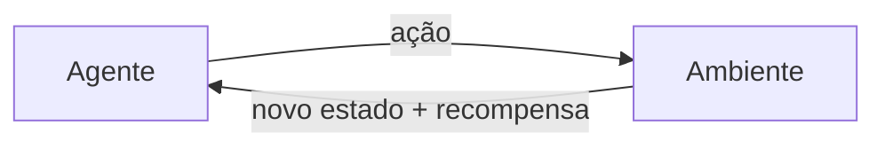

# Aprendizado por Reforço

Até aqui, os algoritmos desta seção aprenderam a partir de dados prontos: um dataset rotulado (supervisionado) ou sem rótulo (não supervisionado). O Aprendizado por Reforço (Reinforcement Learning, ou RL) segue outra lógica: não existe dataset de treino, existe um **agente** que aprende tentando coisas, errando, acertando e ajustando o comportamento com base no resultado. É o paradigma usado para treinar programas que jogam Go, robôs que aprendem a andar, e a etapa de alinhamento de LLMs (RLHF, mencionada em [Como uma LLM gera texto](/labs/ai/llm/05-como-uma-llm-gera-texto/)).

## Conceitos fundamentais

O cenário de RL tem sempre os mesmos papéis:

- **Agente**: quem toma a decisão (o programa que está aprendendo)
- **Ambiente**: tudo que está fora do agente e com o qual ele interage (um jogo, um robô físico, um sistema de recomendação)
- **Estado**: a situação atual do ambiente, do ponto de vista do agente (a posição das peças num tabuleiro, os sensores de um robô)
- **Ação**: o que o agente pode fazer naquele estado
- **Recompensa**: um número que o ambiente devolve depois da ação, dizendo o quão boa ou ruim ela foi
- **Política**: a estratégia do agente, uma função que mapeia estado → ação



O objetivo não é maximizar a recompensa de uma única ação, é maximizar a **soma de recompensas no longo prazo**. Isso cria um dilema central do RL: às vezes vale abrir mão de uma recompensa pequena agora para chegar a uma recompensa maior depois (um robô que sobe uma rampa gasta energia no caminho, mas chega no destino).

Esse dilema aparece também na forma de **exploração vs. explotação**: o agente precisa decidir entre experimentar ações novas (exploração, para descobrir se existe algo melhor) ou repetir o que já sabe que funciona (explotação, para garantir a recompensa conhecida). Uma estratégia simples e comum para equilibrar os dois é a **ε-greedy**: com probabilidade ε o agente escolhe uma ação aleatória (explora), e com probabilidade 1-ε escolhe a melhor ação que já conhece (explota). Normalmente ε começa alto (explora bastante no início, quando ainda não sabe nada) e vai diminuindo com o tempo.

Muitos problemas de RL são formalizados como um **Processo de Decisão de Markov (MDP)**: um conjunto de estados, ações, probabilidades de transição entre estados e recompensas, com a propriedade de que o próximo estado depende só do estado e da ação atuais, não do histórico completo.

## Q-Learning

O Q-Learning é um dos algoritmos mais conhecidos de RL. A ideia central é aprender uma **Q-table**: uma tabela que, para cada par (estado, ação), guarda uma estimativa de quanta recompensa acumulada o agente pode esperar se tomar aquela ação naquele estado e seguir a política ótima depois disso.

A tabela começa zerada (ou com valores aleatórios) e vai sendo ajustada a cada interação com o ambiente, pela regra de atualização:

```text
Q(s,a) = Q(s,a) + α [ r + γ · max_a' Q(s',a') - Q(s,a) ]
```

Onde:

- `s` é o estado atual, `a` a ação tomada, `r` a recompensa recebida, `s'` o próximo estado
- `α` (taxa de aprendizado) controla quanto cada atualização pesa sobre o valor antigo
- `γ` (fator de desconto, entre 0 e 1) controla o quanto o agente valoriza recompensas futuras frente a recompensas imediatas
- `max_a' Q(s',a')` é a melhor estimativa disponível para o próximo estado, assumindo que o agente vai agir de forma ótima a partir dali

Esse `max` é o detalhe que torna o Q-Learning um método **off-policy**: a atualização usa a melhor ação possível no próximo estado, não necessariamente a ação que o agente de fato vai tomar (que pode ser uma ação de exploração, escolhida pela ε-greedy). Ou seja, o agente aprende sobre uma política "ideal" enquanto se comporta de um jeito mais exploratório no mundo real. Q-Learning também é um método de **diferença temporal (temporal-difference)**: atualiza a estimativa a cada passo, sem precisar esperar o episódio terminar (diferente de métodos que só aprendem no final, com a recompensa total acumulada).

### SARSA: a versão on-policy

O **SARSA** (o nome vem da sequência State-Action-Reward-State-Action) usa quase a mesma fórmula, com uma diferença importante: em vez de `max_a' Q(s',a')`, ele usa `Q(s',a')` da ação que o agente **de fato vai tomar** a seguir (escolhida, por exemplo, pela mesma ε-greedy que está guiando a exploração). Por isso é um método **on-policy**: aprende sobre a política que realmente está sendo seguida, incluindo as escolhas exploratórias.

Na prática isso muda o comportamento aprendido. Num cenário clássico de teste (um agente andando numa grade com um precipício do lado), o Q-Learning aprende o caminho mais curto, colado na borda do precipício, porque assume que vai agir de forma ótima; só que, como ele ainda explora durante o treino, às vezes cai. O SARSA aprende um caminho mais afastado da borda, porque leva em conta que, de vez em quando, uma ação exploratória vai ser escolhida, e prefere um caminho mais seguro mesmo que um pouco mais longo.

## Deep Q-Network (DQN)

A Q-table funciona bem quando o número de estados e ações é pequeno. O problema aparece em cenários com espaços de estado enormes, como os pixels de um jogo de Atari: não existe memória suficiente para guardar uma tabela com uma entrada para cada combinação possível de pixels.

O **Deep Q-Network (DQN)**, apresentado pela DeepMind em 2013 e refinado em 2015, resolve isso trocando a tabela por uma **rede neural** que aprende a aproximar a função Q: em vez de consultar uma tabela, o agente passa o estado (por exemplo, os pixels da tela) pela rede e recebe de volta uma estimativa de valor para cada ação possível. Essa combinação de Q-Learning com deep learning foi o que permitiu treinar agentes capazes de jogar vários jogos de Atari direto a partir da imagem da tela, sem conhecimento prévio das regras, e é considerada um marco que popularizou o uso de redes neurais em RL.

## Policy Gradient e Actor-Critic

Q-Learning e DQN são **métodos baseados em valor**: eles aprendem o quão boa é cada ação e derivam a política disso (escolhendo, por exemplo, a ação de maior valor). Existe uma família diferente de algoritmos, os **métodos baseados em política (policy gradient)**, que aprendem a política diretamente, como uma função que recebe o estado e devolve uma ação (ou uma distribuição de probabilidade sobre ações), ajustando os parâmetros dessa função para aumentar a chance de ações que levaram a boas recompensas.

Métodos de policy gradient "puros" tendem a ter uma variância alta nas estimativas (o resultado de um episódio inteiro pode depender de muito acaso). O **Actor-Critic** reduz esse problema combinando os dois mundos: um componente **ator** (actor) é a política que escolhe as ações, e um componente **crítico** (critic) é uma função de valor que avalia o quão boas essas ações foram, servindo de referência para ajustar o ator com menos ruído.

O **PPO (Proximal Policy Optimization)** é hoje um dos algoritmos actor-critic mais usados na prática, incluindo no RLHF usado para alinhar LLMs. Ele faz atualizações de política de forma mais estável, limitando (via uma técnica de "clipping") o quanto a política pode mudar de uma atualização para a outra, o que evita que um ajuste grande demais desestabilize o treino.

## Referências

- [Reinforcement Learning: An Introduction](http://incompleteideas.net/book/the-book-2nd.html) - Sutton & Barto (2ª ed., MIT Press), en
- [Spinning Up in Deep RL: Introduction](https://spinningup.openai.com/en/latest/spinningup/rl_intro.html) - OpenAI, en
- [Q Learning vs SARSA: Key Differences in Reinforcement Learning](https://www.baeldung.com/cs/q-learning-vs-sarsa) - Baeldung, en
